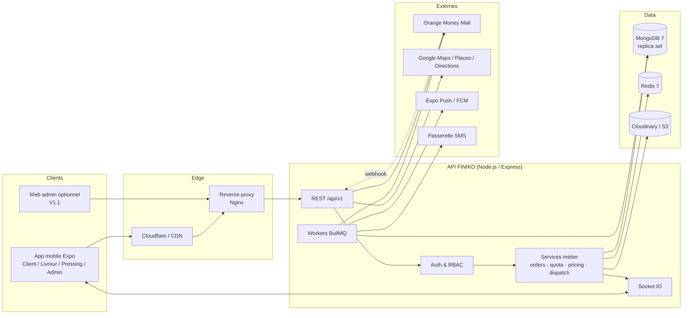
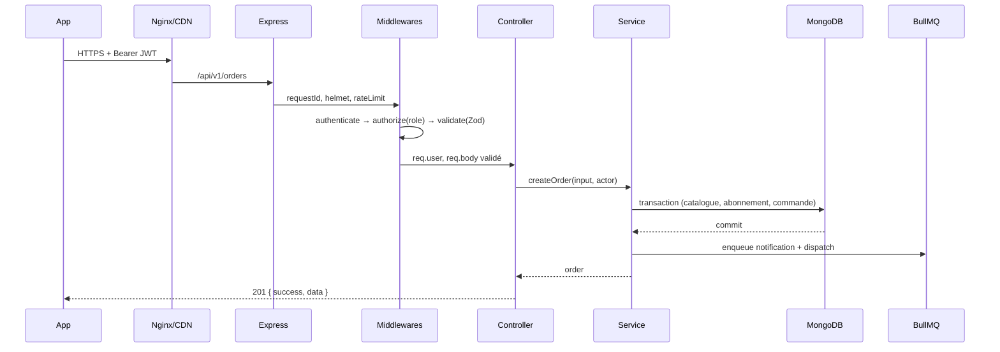
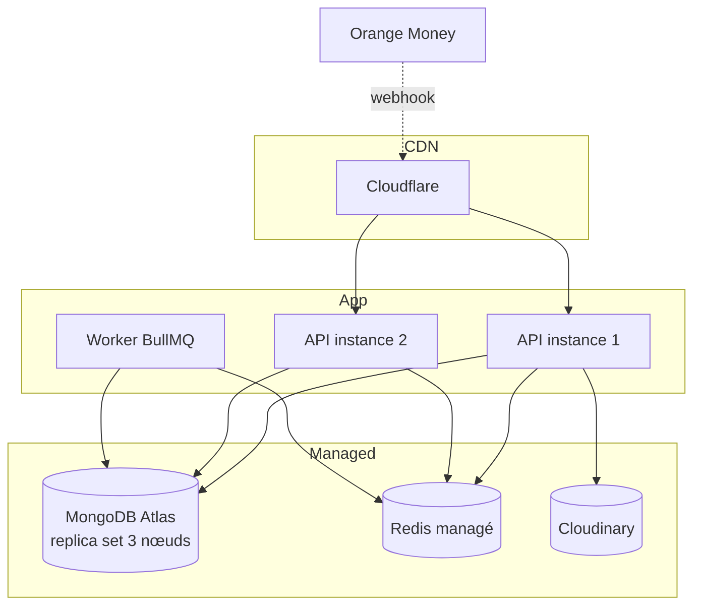

# 01 — Architecture système

## 1. Objectifs et contraintes

| Objectif                           | Implication architecturale                                                                   |
| ---------------------------------- | -------------------------------------------------------------------------------------------- |
| Application mobile multi-rôles     | Un seul binaire Expo, routes protégées par rôle, RBAC serveur.                               |
| Fonctionnement sur réseau instable | Cache TanStack Query, file d'actions livreur, retries idempotents, UI optimiste contrôlée.   |
| Paiement Orange Money fiable       | Webhook signé, machine à états de paiement, réconciliation périodique, idempotence.          |
| Quota d'abonnement exact           | Transactions MongoDB + garde atomique sur `quota_used + quota_reserved`, ledger append-only. |
| Supervision temps réel             | Socket.IO + notifications push, événements de statut persistés.                              |
| Traçabilité et litiges             | Journal d'audit, historique de statut, preuves photo.                                        |
| Croissance                         | Monolithe modulaire, workers séparables, index et pagination dès le départ.                  |

**Contraintes connues** : Android majoritaire, téléphones d'entrée de gamme, data coûteuse, paiement mobile via USSD/web, adresses peu structurées à Bamako, opérateurs terrain parfois hors ligne.

---

## 2. Vue d'ensemble



### Composants

| Composant        | Rôle                                                                                           |
| ---------------- | ---------------------------------------------------------------------------------------------- |
| **App mobile**   | Toutes les interfaces des 4 rôles. Un seul projet, guards par rôle.                            |
| **API REST**     | Source de vérité métier. Aucun prix, quota ou statut n'est décidé côté client.                 |
| **Socket.IO**    | Pousse les changements de statut, nouvelles missions, notifications in-app.                    |
| **Workers**      | Paiements en attente, expirations de réservation, rappels, push, réconciliation, clôture auto. |
| **MongoDB**      | Données métier, ledger de quota, historique. Replica set obligatoire pour les transactions.    |
| **Redis**        | Cache, rate limiting, verrous courts, queues BullMQ, présence livreurs.                        |
| **Cloudinary**   | Photos de conformité, preuves de livraison, visuels de bannières.                              |
| **Orange Money** | Encaissement des packs et des surplus.                                                         |
| **Google Maps**  | Sélection d'adresses, itinéraires, calcul de distance.                                         |

---

## 3. Monorepo

```text
finiko-v2/
├── apps/
│   ├── api/
│   └── mobile/
├── packages/
│   ├── contracts/        # Zod : payloads, réponses, enums, codes d'erreur
│   ├── config/           # ESLint, TSConfig, Prettier partagés
│   └── utils/            # formatage FCFA, dates, téléphone, geo
├── docs/
├── docker-compose.yml
├── pnpm-workspace.yaml
└── turbo.json            # optionnel : build/lint/test incrémentaux
```

**Règle d'or** : `packages/contracts` ne dépend ni de React Native ni d'Express. Il contient uniquement TypeScript + Zod. L'API valide les entrées avec ces schémas ; le mobile infère ses types depuis les mêmes schémas.

```ts
// packages/contracts/src/orders.ts
export const treatmentSchema = z.enum(['lavage', 'repassage', 'lavage_repassage']);

export const createOrderSchema = z.object({
  items: z
    .array(
      z.object({
        catalogItemId: z.string().min(1),
        treatment: treatmentSchema,
        quantity: z.number().int().min(1).max(99),
      }),
    )
    .min(1)
    .max(50),
  pickupAddressId: z.string().optional(),
  pickup: addressSchema,
  delivery: addressSchema,
  pickupSlot: slotSchema,
  paymentMethod: z.enum(['pack', 'orange_money', 'cash']),
  useSubscription: z.boolean().default(true),
  preferences: z
    .object({
      perfume: z.enum(['lavande', 'frais', 'neutre']).default('neutre'),
      notes: z.string().max(500).optional(),
    })
    .optional(),
  idempotencyKey: z.string().uuid(),
});
export type CreateOrderInput = z.infer<typeof createOrderSchema>;
```

---

## 4. Architecture backend

### 4.1 Style : monolithe modulaire

Pour un MVP avec 4 rôles et une équipe réduite, les microservices seraient un coût inutile. On adopte un **monolithe modulaire** avec des frontières explicites, prêt à être découpé plus tard (paiements, notifications, dispatch).

```text
apps/api/src/
├── config/
│   ├── env.ts              # validation Zod des variables d'environnement
│   ├── db.ts               # connexion Mongoose + transactions
│   ├── redis.ts
│   ├── logger.ts           # pino
│   └── swagger.ts
├── modules/
│   ├── auth/
│   │   ├── auth.routes.ts
│   │   ├── auth.controller.ts
│   │   ├── auth.service.ts
│   │   ├── token.service.ts
│   │   └── auth.schemas.ts
│   ├── users/
│   ├── catalog/
│   ├── packs/
│   ├── subscriptions/
│   │   ├── subscription.model.ts
│   │   ├── quota.service.ts      # cœur du moteur de quota
│   │   └── subscription.service.ts
│   ├── orders/
│   │   ├── order.model.ts
│   │   ├── pricing.service.ts
│   │   ├── order.service.ts
│   │   ├── order-state.machine.ts
│   │   └── order.routes.ts
│   ├── payments/
│   │   ├── payment.model.ts
│   │   ├── payment.service.ts
│   │   ├── providers/
│   │   │   ├── payment-provider.ts
│   │   │   ├── orange-money.provider.ts
│   │   │   ├── cash.provider.ts
│   │   │   └── mock.provider.ts
│   │   └── webhooks/
│   ├── logistics/          # affectations, positions, missions
│   ├── pressings/          # réception, traitement article par article
│   ├── notifications/
│   ├── disputes/
│   ├── admin/              # KPI, supervision, configuration
│   └── uploads/
├── middleware/
│   ├── authenticate.ts
│   ├── authorize.ts        # rôle
│   ├── ownership.ts        # client/livreur/pressing propriétaire
│   ├── validate.ts         # Zod
│   ├── idempotency.ts
│   ├── rateLimit.ts
│   └── errorHandler.ts
├── jobs/
│   ├── queues.ts
│   ├── expire-payment-intents.job.ts
│   ├── reconcile-payments.job.ts
│   ├── expire-subscriptions.job.ts
│   ├── auto-complete-orders.job.ts
│   └── dispatch-notifications.job.ts
├── sockets/
│   ├── index.ts
│   ├── auth.socket.ts
│   └── rooms.ts
├── models/                 # index des modèles Mongoose
├── utils/
│   ├── ApiError.ts
│   ├── money.ts            # entiers FCFA uniquement
│   ├── orderNumber.ts
│   ├── geo.ts
│   └── result.ts
├── app.ts
└── server.ts
```

### 4.2 Cycle d'une requête



**Règles** :

- Les contrôleurs ne contiennent aucune règle métier : ils traduisent HTTP ↔ service.
- Les services ne connaissent pas `req`/`res`.
- Les modèles Mongoose ne contiennent que structure, index, hooks simples.
- Les prix sont **toujours** recalculés côté serveur depuis le catalogue.
- Toute mutation de commande passe par la machine à états, jamais par une écriture directe du statut.

### 4.3 Modules et responsabilités

| Module          | Responsabilités                                           | Collections                                                        |
| --------------- | --------------------------------------------------------- | ------------------------------------------------------------------ |
| `auth`          | Inscription client, login, refresh, OTP, reset, sessions  | `users`, `sessions`, `otp_codes`                                   |
| `users`         | Profils client/livreur/pressing, CRUD admin, suspension   | `users`, `client_profiles`, `driver_profiles`, `pressing_profiles` |
| `catalog`       | CRUD articles, 3 prix, activation, catégories             | `catalog_items`                                                    |
| `packs`         | CRUD packs, quotas, prestations incluses, versioning      | `packs`                                                            |
| `subscriptions` | Souscription, activation, renouvellement, quota, ledger   | `subscriptions`, `subscription_usages`                             |
| `orders`        | Devis, création, affectation, machine à états, annulation | `orders`, `order_status_events`                                    |
| `payments`      | Intentions, Orange Money, webhooks, remboursements        | `payments`, `refunds`                                              |
| `logistics`     | Missions livreur, position, conformité, preuves           | `orders`, `users`                                                  |
| `pressings`     | Réception, traitement par article, clôture                | `orders`, `pressing_profiles`                                      |
| `notifications` | In-app, push, SMS, préférences                            | `notifications`                                                    |
| `disputes`      | Litiges, messages, résolution                             | `disputes`, `dispute_messages`                                     |
| `admin`         | KPI, supervision, bannières, zones, paramètres, audit     | `audit_logs`, `promo_banners`, `delivery_zones`, `settings`        |

### 4.4 Événements de domaine

Les événements internes déclenchent les effets asynchrones sans coupler les modules :

| Événement                | Producteur    | Consommateurs                          |
| ------------------------ | ------------- | -------------------------------------- |
| `order.created`          | orders        | notifications, dispatch, analytics     |
| `order.status_changed`   | orders        | notifications, socket, analytics       |
| `order.ready`            | pressings     | notifications, dispatch livreur        |
| `subscription.activated` | subscriptions | notifications, analytics               |
| `subscription.expired`   | job           | notifications                          |
| `payment.succeeded`      | payments      | orders ou subscriptions, notifications |
| `payment.failed`         | payments      | orders, notifications, release quota   |
| `dispute.opened`         | disputes      | admin notification, audit              |

Implémentation : `EventBus` local (Node `EventEmitter`) pour le synchrone léger + BullMQ pour les tâches longues/retryables. On persiste d'abord l'état métier, on publie ensuite (outbox simple : la ligne d'événement `order_status_events` sert de journal, le job est rejouable).

---

## 5. Architecture mobile

```text
apps/mobile/
├── app/                     # Expo Router
│   ├── _layout.tsx          # providers + guard global
│   ├── (public)/            # onboarding, landing
│   ├── (auth)/              # login, register, otp, reset
│   ├── (client)/            # espace client
│   ├── (driver)/            # espace livreur
│   ├── (pressing)/          # espace pressing
│   ├── (admin)/             # espace admin
│   └── (shared)/            # tracking, paiement, litige, profil
└── src/
    ├── api/
    │   ├── client.ts        # fetch + refresh token + erreurs normalisées
    │   ├── query-client.ts
    │   └── endpoints/       # par module
    ├── components/
    │   ├── ui/              # Button, Input, Card, Badge, Sheet...
    │   └── business/        # PackCard, OrderCard, MapPicker, QuotaGauge...
    ├── features/
    │   ├── auth/
    │   ├── catalog/
    │   ├── cart/
    │   ├── subscriptions/
    │   ├── orders/
    │   ├── missions/
    │   ├── pressing/
    │   └── admin/
    ├── stores/
    │   ├── auth.store.ts
    │   ├── draft-order.store.ts
    │   └── ui.store.ts
    ├── theme/
    ├── lib/
    └── types/
```

### Couches

| Couche          | Outil                                 | Règle                                                                                       |
| --------------- | ------------------------------------- | ------------------------------------------------------------------------------------------- |
| Navigation      | Expo Router                           | Routes par groupe de rôle ; guard central basé sur la session.                              |
| Données serveur | TanStack Query                        | Une clé par ressource ; invalidation après mutation ; `staleTime` adapté.                   |
| Données locales | Zustand + SecureStore/MMKV            | Auth, brouillon de commande, préférences UI.                                                |
| Formulaires     | RHF + Zod                             | Mêmes schémas que l'API via `packages/contracts`.                                           |
| Temps réel      | Socket.IO client                      | Connexion après login, rejoindre `user:{id}` et `role:*`, invalider les queries concernées. |
| Offline         | MMKV + file d'actions                 | Les actions livreur critiques sont mises en file et rejouées avec idempotence.              |
| Cartes          | `react-native-maps` + `expo-location` | Google provider, clé restreinte, proxy Places côté API.                                     |

### Guards de navigation

```tsx
// app/_layout.tsx (principe)
const { user, status } = useAuth();
const segments = useSegments();

useEffect(() => {
  if (status === 'loading') return;
  const group = segments[0];
  if (!user && group !== '(auth)' && group !== '(public)') {
    router.replace('/(auth)/login');
    return;
  }
  if (user && group !== roleGroup[user.role]) {
    router.replace(homeForRole[user.role]);
  }
}, [user, status, segments]);
```

> Le guard mobile est un confort UX. **La sécurité réelle est côté API** (JWT + rôle + ownership).

---

## 6. Temps réel

### Rooms Socket.IO

| Room                    | Membres              | Événements                                          |
| ----------------------- | -------------------- | --------------------------------------------------- |
| `user:{userId}`         | un utilisateur       | `notification:new`, `order:status` (si client)      |
| `role:driver`           | livreurs disponibles | `mission:new`, `mission:updated`                    |
| `driver:{driverId}`     | un livreur           | `mission:assigned`, `mission:cancelled`             |
| `pressing:{pressingId}` | un pressing          | `order:incoming`, `order:ready_to_pickup`           |
| `role:admin`            | admins               | `order:created`, `payment:failed`, `dispute:opened` |

### Événements serveur → client

```json
{
  "event": "order:status",
  "data": {
    "orderId": "66f...",
    "orderNumber": "#FK-1042",
    "status": "prete",
    "previousStatus": "en_traitement",
    "at": "2026-11-02T18:30:00.000Z"
  }
}
```

**Robustesse** : le client ne dépend pas du socket pour l'état final. À chaque événement, il invalide la query `order:{id}` et refetch. En cas de perte de connexion, le polling de secours (30 s sur l'écran de suivi) prend le relais.

---

## 7. Déploiement

### Environnements

| Env          | Mobile                      | API                        | Données                          |
| ------------ | --------------------------- | -------------------------- | -------------------------------- |
| `local`      | Expo Go / dev build         | `localhost:5000`           | Docker Mongo replica set + Redis |
| `staging`    | EAS internal distribution   | Render/Railway             | Atlas M10 + Upstash Redis        |
| `production` | EAS production (Play Store) | Render/Railway autoscaling | Atlas M20+ + Redis managé        |

### Topologie cible



### CI/CD

```yaml
# .github/workflows/ci.yml (principe)
jobs:
  quality:
    steps:
      - pnpm install --frozen-lockfile
      - pnpm lint
      - pnpm typecheck
      - pnpm test -- --coverage
  api:
    needs: quality
    steps:
      - build Docker image
      - deploy staging (render.yaml)
      - smoke test /health + /openapi.json
  mobile:
    needs: quality
    steps:
      - eas build --profile staging --platform android
      - eas update --branch staging
```

**Migrations** : MongoDB n'a pas de migrations SQL. On versionne les scripts `migrations/2026xxxx-*.ts` idempotents, exécutés au déploiement (index, backfill, renommage). Les changements de schéma doivent rester rétrocompatibles pendant au moins une version mobile.

---

## 8. Décisions d'architecture (ADR synthétiques)

| #      | Décision                                              | Alternatives écartées        | Conséquence                                                                        |
| ------ | ----------------------------------------------------- | ---------------------------- | ---------------------------------------------------------------------------------- |
| ADR-01 | Monolithe modulaire                                   | Microservices                | Simplicité d'équipe, découpage ultérieur possible.                                 |
| ADR-02 | MongoDB replica set                                   | PostgreSQL                   | Transactions + flexibilité catalogue ; nécessite Atlas/replica local.              |
| ADR-03 | Prix recalculés serveur                               | Prix envoyés par le client   | Sécurité et cohérence ; le client envoie seulement articles/quantités/prestations. |
| ADR-04 | Quota par ledger + compteurs                          | Simple champ `remaining`     | Auditabilité et idempotence ; un peu plus de code.                                 |
| ADR-05 | Orange Money derrière une interface `PaymentProvider` | Appels OM dispersés          | Tests, mock, futur ajout Moov/Wave.                                                |
| ADR-06 | Socket.IO + fallback polling                          | Push uniquement              | Fiabilité sur réseau instable.                                                     |
| ADR-07 | Expo Router avec guards                               | Navigation manuelle par rôle | Moins de duplication, deep links natifs.                                           |
| ADR-08 | Admin mobile au MVP                                   | Web admin uniquement         | Respect du cahier des charges ; web admin en V1.1 pour le confort.                 |

---

## 9. Risques techniques et parades

| Risque                              | Impact                                        | Parade                                                                                      |
| ----------------------------------- | --------------------------------------------- | ------------------------------------------------------------------------------------------- |
| Webhook Orange Money perdu/dupliqué | Commande payée non activée, double activation | Idempotence par `provider_tx_id`, job de réconciliation, statut `en_attente` visible admin. |
| Double consommation de quota        | Client lésé                                   | Transaction + garde `quota_used + quota_reserved + units <= quota_total`.                   |
| Livreur hors ligne                  | Mission bloquée                               | File d'actions locale, réassignation admin, alerte SLA.                                     |
| Adresse introuvable                 | Échec de ramassage                            | Épinglage carte + repère texte + appel client + photo.                                      |
| Prix modifié pendant une commande   | Litige                                        | Snapshot des prix et du pack dans la commande.                                              |
| Appareils low-end                   | Lenteur                                       | Images optimisées, FlashList, skeletons, pas d'animations lourdes.                          |
| Fuite de clé Google/OM              | Coût/fraude                                   | Clés restreintes par package/SHA, proxy serveur, secrets hors app.                          |
