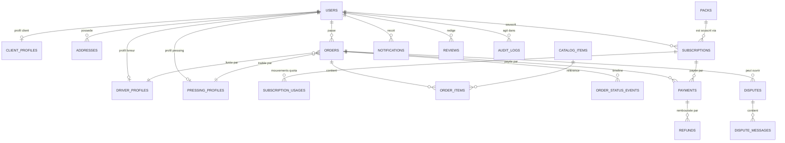

# 02 — Modèle de données

Deux variantes sont fournies :

- **MongoDB / Mongoose** : implémentation cible (recommandée, continuité v1).
- **PostgreSQL** : équivalent relationnel complet, si l'équipe impose SQL.

Les deux modèles respectent les mêmes invariants métier : prix en entiers FCFA, quota d'abonnement borné, ledger de consommation, historique de statut immuable, idempotence des paiements.

---

## 1. Conventions

| Sujet        | Règle                                                                                |
| ------------ | ------------------------------------------------------------------------------------ |
| Identifiants | `ObjectId` (Mongo) / `UUID` (SQL), exposés `id` en API.                              |
| Montants     | `Number` entier en FCFA (Mongo) / `BIGINT` (SQL). **Jamais de float.**               |
| Dates        | `Date` UTC (Mongo) / `TIMESTAMPTZ` (SQL).                                            |
| Soft delete  | `deletedAt` sur `users`, `catalog_items`, `packs`, `addresses`.                      |
| Snapshots    | Prix, nom d'article et conditions du pack sont copiés dans la commande/l'abonnement. |
| Statuts      | Enums stricts, définis une seule fois dans `packages/contracts`.                     |
| Coordonnées  | GeoJSON `Point` `[longitude, latitude]`, index `2dsphere`.                           |
| Audit        | Les événements de commande et le ledger de quota sont **append-only**.               |

---

## 2. Vue d'ensemble des collections

| #   | Collection            | Rôle                                      | Volumétrie estimée |
| --- | --------------------- | ----------------------------------------- | ------------------ |
| 1   | `users`               | Compte, rôle, authentification            | Moyenne            |
| 2   | `client_profiles`     | Profil client 1:1                         | Moyenne            |
| 3   | `driver_profiles`     | Profil livreur, zone, position            | Faible             |
| 4   | `pressing_profiles`   | Partenaire pressing, capacité             | Faible             |
| 5   | `addresses`           | Adresses favorites du client              | Moyenne            |
| 6   | `catalog_items`       | Articles + 3 prix                         | Faible             |
| 7   | `packs`               | Offres d'abonnement + quota               | Faible             |
| 8   | `subscriptions`       | Abonnement actif/programmé + compteurs    | Moyenne            |
| 9   | `subscription_usages` | Ledger de quota (append-only)             | Élevée             |
| 10  | `orders`              | Commandes + lignes + totaux               | Élevée             |
| 11  | `order_status_events` | Timeline immuable                         | Très élevée        |
| 12  | `payments`            | Intentions et résultats Orange Money/cash | Élevée             |
| 13  | `refunds`             | Remboursements                            | Faible             |
| 14  | `disputes`            | Litiges                                   | Faible             |
| 15  | `dispute_messages`    | Fil de discussion d'un litige             | Faible             |
| 16  | `notifications`       | In-app + statut push/SMS                  | Très élevée        |
| 17  | `promo_banners`       | Bannières d'accueil                       | Faible             |
| 18  | `delivery_zones`      | Zones et frais de livraison               | Faible             |
| 19  | `reviews`             | Notes pressing/livreur                    | Moyenne            |
| 20  | `audit_logs`          | Actions admin et sécurité                 | Élevée             |
| 21  | `otp_codes`           | Codes OTP hachés                          | Moyenne (TTL)      |
| 22  | `sessions`            | Refresh tokens hachés                     | Moyenne            |
| 23  | `idempotency_keys`    | Protection des créations/paiements        | Moyenne (TTL)      |
| 24  | `settings`            | Configuration plateforme (singleton)      | 1                  |
| 25  | `counters`            | Compteur `#FK-xxxx`                       | 1                  |

---

## 3. ERD (MongoDB)



> Dans MongoDB, `order_items` et les événements de statut peuvent être des sous-documents. Le schéma cible conserve `order_status_events` en collection séparée pour la volumétrie et l'immuabilité ; les lignes restent embarquées dans `orders` (lecture atomique de la commande).

---

## 4. Enums partagés

```ts
export const USER_ROLES = ['client', 'livreur', 'pressing', 'admin'] as const;
export const USER_STATUSES = ['actif', 'suspendu', 'supprime'] as const;

export const CATEGORIES = ['homme', 'femme', 'enfant', 'maison', 'blanchiment'] as const;
export const TREATMENTS = ['lavage', 'repassage', 'lavage_repassage'] as const;

export const SUBSCRIPTION_STATUSES = [
  'en_attente_paiement',
  'programmee',
  'active',
  'expiree',
  'annulee',
  'suspendue',
] as const;

export const ORDER_STATUSES = [
  'en_attente_paiement',
  'confirmee',
  'ramassage_assigne',
  'ramassage_en_cours',
  'ramassee',
  'deposee_au_pressing',
  'au_pressing',
  'en_traitement',
  'prete',
  'livraison_assignee',
  'livraison_en_cours',
  'livree',
  'terminee',
  'annulee',
  'litige',
] as const;

export const ITEM_TREATMENT_STATUSES = ['a_traiter', 'en_cours', 'termine'] as const;
export const CONFORMITY_STATUSES = ['a_verifier', 'conforme', 'non_conforme'] as const;

export const PAYMENT_STATUSES = [
  'initie',
  'en_attente',
  'reussi',
  'echoue',
  'annule',
  'expire',
  'rembourse',
] as const;

export const PAYMENT_PROVIDERS = ['orange_money', 'cash', 'wallet', 'system'] as const;
export const PAYMENT_PURPOSES = ['order', 'subscription', 'wallet_topup'] as const;

export const DISPUTE_STATUSES = ['ouvert', 'en_examen', 'resolu', 'ferme'] as const;
export const USAGE_TYPES = [
  'reservation',
  'consommation',
  'liberation',
  'remboursement',
  'ajustement',
  'expiration',
] as const;
```

---

## 5. Schémas Mongoose (implémentation cible)

### 5.1 `users`

```js
const { Schema, model } = require('mongoose');

const userSchema = new Schema(
  {
    role: {
      type: String,
      enum: ['client', 'livreur', 'pressing', 'admin'],
      required: true,
      index: true,
    },
    firstName: { type: String, required: true, trim: true, maxlength: 80 },
    lastName: { type: String, required: true, trim: true, maxlength: 80 },
    email: { type: String, trim: true, lowercase: true }, // absent si non renseigné
    phone: { type: String, required: true, trim: true, match: /^\+[1-9]\d{7,14}$/ },
    phoneVerifiedAt: { type: Date, default: null },
    passwordHash: { type: String, required: true, select: false },
    status: {
      type: String,
      enum: ['actif', 'suspendu', 'supprime'],
      default: 'actif',
      index: true,
    },
    mustChangePassword: { type: Boolean, default: false },
    avatarUrl: { type: String, default: null },
    locale: { type: String, default: 'fr', enum: ['fr', 'bm'] },
    pushTokens: [
      {
        token: { type: String, required: true },
        platform: { type: String, enum: ['android', 'ios'], required: true },
        updatedAt: { type: Date, default: Date.now },
      },
    ],
    lastLoginAt: { type: Date, default: null },
    createdBy: { type: Schema.Types.ObjectId, ref: 'User', default: null },
    deletedAt: { type: Date, default: null },
  },
  { timestamps: true },
);

userSchema.index({ email: 1 }, { unique: true, sparse: true });
userSchema.index({ phone: 1 }, { unique: true });
userSchema.index({ role: 1, status: 1 });
userSchema.index({ 'pushTokens.token': 1 });

userSchema.virtual('fullName').get(function () {
  return `${this.firstName} ${this.lastName}`.trim();
});
```

**Règles** : mot de passe haché avec Argon2id (ou bcrypt 12), jamais renvoyé ; email optionnel mais unique s'il existe ; téléphone seul obligatoire ; `createdBy` renseigné pour les comptes créés par l'admin.

> **Email absent plutôt que `null`** : MongoDB traite `null` comme une valeur indexée, ce qui ferait échouer l'index unique sparse dès le deuxième compte sans email. Le champ est donc **omis** du document lorsqu'il n'est pas fourni ; l'API le renvoie néanmoins en `email: null` dans l'utilisateur public.

### 5.2 Profils

```js
const clientProfileSchema = new Schema(
  {
    user: { type: Schema.Types.ObjectId, ref: 'User', required: true, unique: true },
    defaultPickupAddress: { type: Schema.Types.ObjectId, ref: 'Address', default: null },
    defaultDeliveryAddress: { type: Schema.Types.ObjectId, ref: 'Address', default: null },
    totalOrders: { type: Number, default: 0, min: 0 },
    lifetimeSpendXOF: { type: Number, default: 0, min: 0 },
    referralCode: { type: String, unique: true, sparse: true, uppercase: true },
    preferences: {
      perfume: { type: String, enum: ['lavande', 'frais', 'neutre'], default: 'neutre' },
    },
  },
  { timestamps: true },
);

const driverProfileSchema = new Schema(
  {
    user: { type: Schema.Types.ObjectId, ref: 'User', required: true, unique: true },
    code: { type: String, required: true, unique: true }, // FK-L-001
    vehicle: {
      type: { type: String, enum: ['moto', 'voiture', 'tricycle'], default: 'moto' },
      plate: { type: String, trim: true, default: null },
    },
    zoneCodes: { type: [String], default: [] },
    status: {
      type: String,
      enum: ['disponible', 'en_mission', 'hors_ligne'],
      default: 'hors_ligne',
      index: true,
    },
    currentLocation: {
      type: { type: String, enum: ['Point'], default: 'Point' },
      coordinates: { type: [Number], default: [0, 0] }, // [lng, lat]
    },
    lastLocationAt: { type: Date, default: null },
    activeOrderIds: [{ type: Schema.Types.ObjectId, ref: 'Order' }],
    assignedPressingIds: [{ type: Schema.Types.ObjectId, ref: 'PressingProfile' }],
    capacity: { type: Number, default: 5, min: 1 },
    ratingAvg: { type: Number, default: 0, min: 0, max: 5 },
    ratingCount: { type: Number, default: 0, min: 0 },
    documents: {
      idCardUrl: { type: String, default: null },
      licenseUrl: { type: String, default: null },
      photoUrl: { type: String, default: null },
      verifiedAt: { type: Date, default: null },
    },
  },
  { timestamps: true },
);

driverProfileSchema.index({ currentLocation: '2dsphere' });
driverProfileSchema.index({ status: 1, zoneCodes: 1 });

const pressingProfileSchema = new Schema(
  {
    user: { type: Schema.Types.ObjectId, ref: 'User', required: true, unique: true },
    code: { type: String, required: true, unique: true }, // FK-P-001
    businessName: { type: String, required: true, trim: true },
    addressText: { type: String, required: true },
    location: {
      type: { type: String, enum: ['Point'], default: 'Point' },
      coordinates: { type: [Number], required: true }, // [lng, lat]
    },
    openingHours: [
      {
        day: { type: Number, min: 0, max: 6 }, // 0 = dimanche
        open: String, // "08:00"
        close: String, // "19:00"
        closed: { type: Boolean, default: false },
      },
    ],
    services: { type: [String], default: ['lavage', 'repassage', 'lavage_repassage'] },
    capacityPerDay: { type: Number, default: 100, min: 1 },
    currentLoad: { type: Number, default: 0, min: 0 },
    status: { type: String, enum: ['actif', 'suspendu', 'ferme'], default: 'actif', index: true },
    commissionRate: { type: Number, default: 0.2, min: 0, max: 1 },
    ratingAvg: { type: Number, default: 0, min: 0, max: 5 },
    ratingCount: { type: Number, default: 0, min: 0 },
    documents: {
      rccmUrl: { type: String, default: null },
      ifuUrl: { type: String, default: null },
      verifiedAt: { type: Date, default: null },
    },
  },
  { timestamps: true },
);

pressingProfileSchema.index({ location: '2dsphere' });
pressingProfileSchema.index({ status: 1 });
```

```js
const addressSchema = new Schema(
  {
    client: { type: Schema.Types.ObjectId, ref: 'User', required: true, index: true },
    label: { type: String, required: true, trim: true, maxlength: 60 }, // Maison, Bureau...
    text: { type: String, required: true, trim: true, maxlength: 300 },
    location: {
      type: { type: String, enum: ['Point'], default: 'Point' },
      coordinates: { type: [Number], required: true }, // [lng, lat]
    },
    contactName: { type: String, trim: true, maxlength: 80 },
    contactPhone: { type: String, trim: true, maxlength: 20 },
    instructions: { type: String, trim: true, maxlength: 300 },
    isDefaultPickup: { type: Boolean, default: false },
    isDefaultDelivery: { type: Boolean, default: false },
    deletedAt: { type: Date, default: null },
  },
  { timestamps: true },
);

addressSchema.index({ location: '2dsphere' });
```

### 5.3 `catalog_items` — tarification à 3 niveaux

```js
const catalogItemSchema = new Schema(
  {
    code: {
      type: String,
      required: true,
      unique: true,
      trim: true,
      lowercase: true,
      maxlength: 40,
    },
    name: { type: String, required: true, trim: true, maxlength: 120 },
    category: {
      type: String,
      required: true,
      enum: ['homme', 'femme', 'enfant', 'maison', 'blanchiment'],
      index: true,
    },
    description: { type: String, trim: true, maxlength: 500, default: '' },
    imageUrl: { type: String, default: null },
    material: { type: String, trim: true, maxlength: 80, default: '' },
    prices: {
      lavage: { type: Number, required: true, min: 0, validate: Number.isInteger },
      repassage: { type: Number, required: true, min: 0, validate: Number.isInteger },
      lavage_repassage: { type: Number, required: true, min: 0, validate: Number.isInteger },
    },
    // Poids en "unités de linge" : un boubou peut valoir 2 unités de quota.
    quotaWeight: { type: Number, default: 1, min: 1, max: 10, validate: Number.isInteger },
    availableTreatments: {
      type: [{ type: String, enum: ['lavage', 'repassage', 'lavage_repassage'] }],
      default: ['lavage', 'repassage', 'lavage_repassage'],
    },
    isActive: { type: Boolean, default: true, index: true },
    displayOrder: { type: Number, default: 0, min: 0 },
    version: { type: Number, default: 1 },
    createdBy: { type: Schema.Types.ObjectId, ref: 'User', default: null },
    updatedBy: { type: Schema.Types.ObjectId, ref: 'User', default: null },
    deletedAt: { type: Date, default: null },
  },
  { timestamps: true },
);

catalogItemSchema.index({ category: 1, isActive: 1, displayOrder: 1 });
catalogItemSchema.index({ name: 'text', description: 'text' });

catalogItemSchema.methods.priceFor = function (treatment) {
  if (!this.availableTreatments.includes(treatment)) return null;
  return this.prices[treatment];
};
```

**Exemple de prix** :

| Article    | Lavage | Repassage | Lavage + repassage | Poids quota |
| ---------- | -----: | --------: | -----------------: | ----------: |
| Chemise    |    800 |       500 |              1 200 |           1 |
| Pantalon   |  1 000 |       700 |              1 500 |           1 |
| Boubou     |  1 500 |     1 000 |              2 200 |           2 |
| Costume    |  2 500 |     2 000 |              4 000 |           3 |
| Couverture |  2 000 |     1 500 |              3 000 |           2 |

### 5.4 `packs`

```js
const packSchema = new Schema(
  {
    code: { type: String, required: true, unique: true, trim: true, lowercase: true },
    name: { type: String, required: true, trim: true, maxlength: 100 },
    description: { type: String, trim: true, maxlength: 500, default: '' },
    priceXOF: { type: Number, required: true, min: 0, validate: Number.isInteger },
    billingPeriodDays: { type: Number, default: 30, min: 1, max: 365 },
    quotaUnits: { type: Number, required: true, min: 1, validate: Number.isInteger },
    includedTreatments: {
      type: [{ type: String, enum: ['lavage', 'repassage', 'lavage_repassage'] }],
      default: ['lavage', 'repassage', 'lavage_repassage'],
    },
    overagePolicy: { type: String, enum: ['prix_catalogue'], default: 'prix_catalogue' },
    deliveryIncluded: { type: Boolean, default: false },
    deliveryDiscountPercent: { type: Number, default: 0, min: 0, max: 100 },
    maxItemsPerOrder: { type: Number, default: 50, min: 1 },
    rollover: {
      enabled: { type: Boolean, default: false },
      maxPercent: { type: Number, default: 0, min: 0, max: 100 },
    },
    features: [{ type: String, trim: true, maxlength: 160 }],
    badge: { type: String, default: null, maxlength: 30 }, // "Populaire", "Économique"
    color: { type: String, default: '#0A3D91' },
    displayOrder: { type: Number, default: 0, min: 0 },
    isActive: { type: Boolean, default: true, index: true },
    validFrom: { type: Date, default: null },
    validTo: { type: Date, default: null },
    version: { type: Number, default: 1 },
    createdBy: { type: Schema.Types.ObjectId, ref: 'User', default: null },
    updatedBy: { type: Schema.Types.ObjectId, ref: 'User', default: null },
  },
  { timestamps: true },
);

packSchema.index({ isActive: 1, displayOrder: 1 });
```

**Seed suggéré** (modifiable par l'admin) :

| Code        | Nom            | Prix/mois |     Quota | Prestations incluses | Livraison |
| ----------- | -------------- | --------: | --------: | -------------------- | --------- |
| `essentiel` | Pack Essentiel |     6 000 |  5 unités | Lavage + repassage   | Non       |
| `normal`    | Pack Normal    |    11 000 | 10 unités | Lavage + repassage   | Non       |
| `premium`   | Pack Premium   |    20 000 | 20 unités | Les 3 prestations    | 50 %      |
| `famille`   | Pack Famille   |    35 000 | 40 unités | Les 3 prestations    | Incluse   |

> Le quota est exprimé en **unités de linge**, pas en vêtements : un boubou (poids 2) consomme 2 unités. C'est plus juste et évite les abus.

### 5.5 `subscriptions`

```js
const packSnapshotSchema = new Schema(
  {
    code: String,
    name: String,
    priceXOF: Number,
    quotaUnits: Number,
    includedTreatments: [String],
    billingPeriodDays: Number,
    deliveryIncluded: Boolean,
    deliveryDiscountPercent: Number,
    rollover: { enabled: Boolean, maxPercent: Number },
  },
  { _id: false },
);

const subscriptionSchema = new Schema(
  {
    client: { type: Schema.Types.ObjectId, ref: 'User', required: true, index: true },
    pack: { type: Schema.Types.ObjectId, ref: 'Pack', required: true },
    packSnapshot: { type: packSnapshotSchema, required: true },
    status: {
      type: String,
      enum: ['en_attente_paiement', 'programmee', 'active', 'expiree', 'annulee', 'suspendue'],
      default: 'en_attente_paiement',
      index: true,
    },
    startDate: { type: Date, required: true },
    endDate: { type: Date, required: true, index: true },
    quotaTotal: { type: Number, required: true, min: 0 },
    quotaUsed: { type: Number, default: 0, min: 0 },
    quotaReserved: { type: Number, default: 0, min: 0 },
    autoRenew: { type: Boolean, default: false },
    renewalOf: { type: Schema.Types.ObjectId, ref: 'Subscription', default: null },
    payment: { type: Schema.Types.ObjectId, ref: 'Payment', default: null },
    activatedAt: { type: Date, default: null },
    cancelledAt: { type: Date, default: null },
    cancelReason: { type: String, trim: true, maxlength: 300, default: null },
    expiredAt: { type: Date, default: null },
  },
  { timestamps: true },
);

// Un seul abonnement actif par client.
subscriptionSchema.index(
  { client: 1 },
  { unique: true, partialFilterExpression: { status: 'active' } },
);
subscriptionSchema.index({ status: 1, endDate: 1 });

subscriptionSchema.virtual('quotaAvailable').get(function () {
  return Math.max(0, this.quotaTotal - this.quotaUsed - this.quotaReserved);
});
```

**Invariant** : `quotaUsed + quotaReserved <= quotaTotal`. Vérifié par la garde atomique du service, pas par Mongoose (les validateurs ne sont pas atomiques).

### 5.6 `subscription_usages` — ledger append-only

```js
const subscriptionUsageSchema = new Schema(
  {
    subscription: { type: Schema.Types.ObjectId, ref: 'Subscription', required: true, index: true },
    client: { type: Schema.Types.ObjectId, ref: 'User', required: true, index: true },
    order: { type: Schema.Types.ObjectId, ref: 'Order', default: null, index: true },
    type: {
      type: String,
      enum: [
        'reservation',
        'consommation',
        'liberation',
        'remboursement',
        'ajustement',
        'expiration',
      ],
      required: true,
    },
    units: { type: Number, required: true, min: 1, validate: Number.isInteger },
    usedDelta: { type: Number, required: true, validate: Number.isInteger },
    reservedDelta: { type: Number, required: true, validate: Number.isInteger },
    quotaUsedAfter: { type: Number, required: true, min: 0 },
    quotaReservedAfter: { type: Number, required: true, min: 0 },
    reason: { type: String, trim: true, maxlength: 300, default: '' },
    actor: { type: Schema.Types.ObjectId, ref: 'User', default: null },
    requestId: { type: String, default: null },
  },
  { timestamps: { createdAt: true, updatedAt: false } },
);

subscriptionUsageSchema.index({ subscription: 1, createdAt: -1 });
subscriptionUsageSchema.index(
  { order: 1, type: 1 },
  { unique: true, partialFilterExpression: { order: { $type: 'objectId' } } },
);
```

**Lecture du ledger** :

| Type            | `usedDelta` | `reservedDelta` | Effet                                                     |
| --------------- | ----------: | --------------: | --------------------------------------------------------- |
| `reservation`   |           0 |              +N | Réserve N unités pour une commande en attente de paiement |
| `consommation`  |          +N |              −N | Transforme la réservation en consommation                 |
| `liberation`    |           0 |              −N | Annule une réservation (échec/expiration paiement)        |
| `remboursement` |          −N |               0 | Rend N unités après annulation                            |
| `ajustement`    |          ±N |              ±N | Correction admin tracée                                   |
| `expiration`    |           0 |              −N | Libère les réservations orphelines d'un abonnement expiré |

### 5.7 `orders`

```js
const orderItemSchema = new Schema({
  catalogItem: { type: Schema.Types.ObjectId, ref: 'CatalogItem', required: true },
  code: { type: String, required: true },
  name: { type: String, required: true },
  category: { type: String, required: true },
  treatment: {
    type: String,
    enum: ['lavage', 'repassage', 'lavage_repassage'],
    required: true,
  },
  quantity: { type: Number, required: true, min: 1, max: 99, validate: Number.isInteger },
  quotaWeight: { type: Number, required: true, min: 1, default: 1 },
  unitPrice: { type: Number, required: true, min: 0 },
  lineTotal: { type: Number, required: true, min: 0 },
  coveredQuantity: { type: Number, default: 0, min: 0 },
  billableQuantity: { type: Number, default: 0, min: 0 },
  coveredAmount: { type: Number, default: 0, min: 0 },
  billableAmount: { type: Number, default: 0, min: 0 },
  treatmentStatus: {
    type: String,
    enum: ['a_traiter', 'en_cours', 'termine'],
    default: 'a_traiter',
  },
  treatmentStartedAt: { type: Date, default: null },
  treatmentCompletedAt: { type: Date, default: null },
  conformityStatus: {
    type: String,
    enum: ['a_verifier', 'conforme', 'non_conforme'],
    default: 'a_verifier',
  },
  conformityNote: { type: String, trim: true, maxlength: 300, default: null },
  photos: [{ type: String }],
});

const orderSchema = new Schema(
  {
    orderNumber: { type: String, required: true, unique: true, match: /^#FK-\d+$/ },
    client: { type: Schema.Types.ObjectId, ref: 'User', required: true, index: true },
    pressing: { type: Schema.Types.ObjectId, ref: 'PressingProfile', default: null, index: true },
    driver: { type: Schema.Types.ObjectId, ref: 'DriverProfile', default: null, index: true },
    items: {
      type: [orderItemSchema],
      validate: [(items) => items.length > 0, 'Au moins un article est requis.'],
    },
    totals: {
      itemsCount: { type: Number, required: true, min: 1 },
      catalogSubtotal: { type: Number, required: true, min: 0 },
      packCoveredAmount: { type: Number, default: 0, min: 0 },
      supplementAmount: { type: Number, default: 0, min: 0 },
      deliveryFee: { type: Number, default: 0, min: 0 },
      discountAmount: { type: Number, default: 0, min: 0 },
      totalDue: { type: Number, required: true, min: 0 },
      totalPaid: { type: Number, default: 0, min: 0 },
      refundedAmount: { type: Number, default: 0, min: 0 },
    },
    pack: {
      subscription: { type: Schema.Types.ObjectId, ref: 'Subscription', default: null },
      snapshot: { type: packSnapshotSchema, default: null },
      coveredUnits: { type: Number, default: 0, min: 0 },
      overageUnits: { type: Number, default: 0, min: 0 },
    },
    pickup: {
      label: { type: String, default: 'Ramassage' },
      text: { type: String, required: true, maxlength: 300 },
      location: {
        type: { type: String, enum: ['Point'], default: 'Point' },
        coordinates: { type: [Number], required: true },
      },
      contactName: { type: String, trim: true, maxlength: 80 },
      contactPhone: { type: String, trim: true, maxlength: 20 },
      instructions: { type: String, trim: true, maxlength: 300, default: '' },
    },
    delivery: {
      label: { type: String, default: 'Livraison' },
      text: { type: String, required: true, maxlength: 300 },
      location: {
        type: { type: String, enum: ['Point'], default: 'Point' },
        coordinates: { type: [Number], required: true },
      },
      contactName: { type: String, trim: true, maxlength: 80 },
      contactPhone: { type: String, trim: true, maxlength: 20 },
      instructions: { type: String, trim: true, maxlength: 300, default: '' },
    },
    schedule: {
      pickupSlot: { label: String, start: Date, end: Date },
      deliverySlot: { label: String, start: Date, end: Date },
      estimatedReadyAt: { type: Date, default: null },
      estimatedDeliveryAt: { type: Date, default: null },
    },
    preferences: {
      perfume: { type: String, enum: ['lavande', 'frais', 'neutre'], default: 'neutre' },
      notes: { type: String, trim: true, maxlength: 500, default: '' },
    },
    status: {
      type: String,
      enum: [
        'en_attente_paiement',
        'confirmee',
        'ramassage_assigne',
        'ramassage_en_cours',
        'ramassee',
        'deposee_au_pressing',
        'au_pressing',
        'en_traitement',
        'prete',
        'livraison_assignee',
        'livraison_en_cours',
        'livree',
        'terminee',
        'annulee',
        'litige',
      ],
      default: 'en_attente_paiement',
      index: true,
    },
    lastStatusAt: { type: Date, default: Date.now },
    payment: {
      method: { type: String, enum: ['pack', 'orange_money', 'cash', 'wallet'], required: true },
      status: {
        type: String,
        enum: ['non_requis', 'en_attente', 'a_collecter', 'paye', 'rembourse', 'echoue'],
        default: 'en_attente',
      },
      payment: { type: Schema.Types.ObjectId, ref: 'Payment', default: null },
      paidAt: { type: Date, default: null },
    },
    conformity: {
      driverCheckedAt: { type: Date, default: null },
      driverCheckedBy: { type: Schema.Types.ObjectId, ref: 'User', default: null },
      status: {
        type: String,
        enum: ['a_verifier', 'conforme', 'non_conforme'],
        default: 'a_verifier',
      },
      note: { type: String, trim: true, maxlength: 500, default: '' },
      photos: [{ type: String }],
      pressingCheckedAt: { type: Date, default: null },
      pressingCheckedBy: { type: Schema.Types.ObjectId, ref: 'User', default: null },
      pressingNote: { type: String, trim: true, maxlength: 500, default: '' },
    },
    cancellation: {
      by: { type: Schema.Types.ObjectId, ref: 'User', default: null },
      reason: { type: String, trim: true, maxlength: 500, default: null },
      at: { type: Date, default: null },
      refundStatus: {
        type: String,
        enum: ['non_applicable', 'en_attente', 'effectue', 'refuse'],
        default: 'non_applicable',
      },
      refundAmount: { type: Number, default: 0, min: 0 },
    },
    dispute: { type: Schema.Types.ObjectId, ref: 'Dispute', default: null },
    proof: {
      deliveryPhotoUrl: { type: String, default: null },
      signatureUrl: { type: String, default: null },
      deliveredAt: { type: Date, default: null },
      confirmedByClientAt: { type: Date, default: null },
    },
    timestamps: {
      confirmedAt: Date,
      assignedAt: Date,
      pickedUpAt: Date,
      droppedAtPressingAt: Date,
      receivedByPressingAt: Date,
      treatmentStartedAt: Date,
      readyAt: Date,
      outForDeliveryAt: Date,
      deliveredAt: Date,
      completedAt: Date,
      cancelledAt: Date,
    },
  },
  { timestamps: true },
);

orderSchema.index({ orderNumber: 1 }, { unique: true });
orderSchema.index({ client: 1, createdAt: -1 });
orderSchema.index({ driver: 1, status: 1 });
orderSchema.index({ pressing: 1, status: 1 });
orderSchema.index({ status: 1, createdAt: -1 });
orderSchema.index({ 'pickup.location': '2dsphere' });
orderSchema.index({ 'delivery.location': '2dsphere' });
```

> Les totaux sont **figés** à la création. Toute modification ultérieure (annulation, litige) passe par des champs dédiés, jamais par une réécriture silencieuse des prix.

### 5.8 `order_status_events`

```js
const orderStatusEventSchema = new Schema(
  {
    order: { type: Schema.Types.ObjectId, ref: 'Order', required: true, index: true },
    fromStatus: { type: String, default: null },
    toStatus: { type: String, required: true },
    actor: { type: Schema.Types.ObjectId, ref: 'User', default: null },
    actorRole: {
      type: String,
      enum: ['client', 'livreur', 'pressing', 'admin', 'system'],
      required: true,
    },
    reason: { type: String, trim: true, maxlength: 500, default: '' },
    location: {
      type: { type: String, enum: ['Point'], default: 'Point' },
      coordinates: { type: [Number], default: undefined },
    },
    metadata: { type: Schema.Types.Mixed, default: {} },
  },
  { timestamps: { createdAt: true, updatedAt: false } },
);

orderStatusEventSchema.index({ order: 1, createdAt: -1 });
```

**Immuabilité** : middleware `pre` sur `updateOne`, `findOneAndUpdate`, `deleteOne`, `deleteMany` → rejet. Aucun endpoint ne met à jour un événement.

### 5.9 `payments`

```js
const paymentSchema = new Schema(
  {
    reference: { type: String, required: true, unique: true }, // PAY-20261102-0001
    idempotencyKey: { type: String, required: true, unique: true },
    purpose: { type: String, enum: ['order', 'subscription', 'wallet_topup'], required: true },
    client: { type: Schema.Types.ObjectId, ref: 'User', required: true, index: true },
    order: { type: Schema.Types.ObjectId, ref: 'Order', default: null, index: true },
    subscription: { type: Schema.Types.ObjectId, ref: 'Subscription', default: null, index: true },
    provider: { type: String, enum: ['orange_money', 'cash', 'wallet', 'system'], required: true },
    amountXOF: { type: Number, required: true, min: 1, validate: Number.isInteger },
    currency: { type: String, default: 'XOF', enum: ['XOF'] },
    status: {
      type: String,
      enum: ['initie', 'en_attente', 'reussi', 'echoue', 'annule', 'expire', 'rembourse'],
      default: 'initie',
      index: true,
    },
    providerTxId: { type: String, default: null },
    providerStatus: { type: String, default: null },
    checkoutUrl: { type: String, default: null },
    returnUrl: { type: String, default: null },
    failureCode: { type: String, default: null },
    failureMessage: { type: String, default: null },
    paidAt: { type: Date, default: null },
    expiresAt: { type: Date, required: true, index: true },
    reconciledAt: { type: Date, default: null },
    metadata: { type: Schema.Types.Mixed, default: {} },
  },
  { timestamps: true },
);

paymentSchema.index({ provider: 1, providerTxId: 1 }, { unique: true, sparse: true });
paymentSchema.index({ status: 1, expiresAt: 1 });
paymentSchema.index({ createdAt: -1 });
```

**Règles** :

- `amountXOF` est recalculé côté serveur, jamais fourni par le client.
- Un paiement `reussi` est **immuable**.
- Le webhook recherche par `providerTxId` ; s'il existe déjà en `reussi`, il renvoie `200` sans réappliquer l'effet (idempotence).
- `metadata` conserve la trace brute utile (sans données sensibles de carte).

### 5.10 `refunds`, `disputes`, `notifications`

```js
const refundSchema = new Schema(
  {
    payment: { type: Schema.Types.ObjectId, ref: 'Payment', required: true, index: true },
    order: { type: Schema.Types.ObjectId, ref: 'Order', default: null },
    client: { type: Schema.Types.ObjectId, ref: 'User', required: true },
    amountXOF: { type: Number, required: true, min: 1 },
    reason: { type: String, required: true, maxlength: 500 },
    status: {
      type: String,
      enum: ['demande', 'en_cours', 'effectue', 'refuse'],
      default: 'demande',
    },
    providerRef: { type: String, default: null },
    processedBy: { type: Schema.Types.ObjectId, ref: 'User', default: null },
    processedAt: { type: Date, default: null },
  },
  { timestamps: true },
);

const disputeSchema = new Schema(
  {
    order: { type: Schema.Types.ObjectId, ref: 'Order', required: true, index: true },
    openedBy: { type: Schema.Types.ObjectId, ref: 'User', required: true },
    reason: {
      type: String,
      enum: [
        'article_manquant',
        'article_endommage',
        'retard',
        'non_conformite',
        'paiement',
        'autre',
      ],
      required: true,
    },
    description: { type: String, required: true, maxlength: 1000 },
    evidenceUrls: [{ type: String }],
    status: {
      type: String,
      enum: ['ouvert', 'en_examen', 'resolu', 'ferme'],
      default: 'ouvert',
      index: true,
    },
    resolution: {
      type: {
        type: String,
        enum: ['remboursement', 'avoir', 'geste_commercial', 'aucune'],
        default: null,
      },
      amountXOF: { type: Number, default: 0, min: 0 },
      note: { type: String, maxlength: 1000, default: '' },
      decidedBy: { type: Schema.Types.ObjectId, ref: 'User', default: null },
      decidedAt: { type: Date, default: null },
    },
  },
  { timestamps: true },
);

const disputeMessageSchema = new Schema(
  {
    dispute: { type: Schema.Types.ObjectId, ref: 'Dispute', required: true, index: true },
    author: { type: Schema.Types.ObjectId, ref: 'User', required: true },
    authorRole: { type: String, enum: ['client', 'livreur', 'pressing', 'admin'], required: true },
    body: { type: String, required: true, maxlength: 2000 },
    attachments: [{ type: String }],
  },
  { timestamps: { createdAt: true, updatedAt: false } },
);

const notificationSchema = new Schema(
  {
    user: { type: Schema.Types.ObjectId, ref: 'User', required: true, index: true },
    role: { type: String, enum: ['client', 'livreur', 'pressing', 'admin'], required: true },
    type: { type: String, enum: ['info', 'success', 'warning', 'alert'], default: 'info' },
    title: { type: String, required: true, maxlength: 120 },
    body: { type: String, required: true, maxlength: 500 },
    data: {
      orderId: { type: Schema.Types.ObjectId, ref: 'Order', default: null },
      deepLink: { type: String, default: null },
    },
    channels: { type: [String], enum: ['in_app', 'push', 'sms'], default: ['in_app', 'push'] },
    readAt: { type: Date, default: null, index: true },
    sentAt: { type: Date, default: null },
    providerMessageId: { type: String, default: null },
  },
  { timestamps: true },
);

notificationSchema.index({ user: 1, createdAt: -1 });
```

### 5.11 Configuration, audit, sécurité

```js
const promoBannerSchema = new Schema(
  {
    title: { type: String, required: true, maxlength: 120 },
    subtitle: { type: String, maxlength: 200, default: '' },
    imageUrl: { type: String, required: true },
    cta: {
      label: { type: String, maxlength: 40, default: 'Découvrir' },
      deepLink: { type: String, maxlength: 300, default: '/packs' },
    },
    placement: {
      type: String,
      enum: ['home_top', 'home_carousel', 'packs'],
      default: 'home_carousel',
    },
    targetRoles: { type: [String], default: ['client'] },
    startsAt: { type: Date, default: null },
    endsAt: { type: Date, default: null },
    isActive: { type: Boolean, default: true, index: true },
    displayOrder: { type: Number, default: 0 },
  },
  { timestamps: true },
);

const deliveryZoneSchema = new Schema(
  {
    code: { type: String, required: true, unique: true },
    name: { type: String, required: true },
    city: { type: String, default: 'Bamako' },
    geometry: {
      type: { type: String, enum: ['Polygon'], default: 'Polygon' },
      coordinates: { type: [[[Number]]], required: true },
    },
    baseFeeXOF: { type: Number, required: true, min: 0 },
    perKmFeeXOF: { type: Number, default: 0, min: 0 },
    minFeeXOF: { type: Number, default: 0, min: 0 },
    maxDistanceKm: { type: Number, default: 20, min: 1 },
    isActive: { type: Boolean, default: true, index: true },
  },
  { timestamps: true },
);

deliveryZoneSchema.index({ geometry: '2dsphere' });

const auditLogSchema = new Schema(
  {
    actor: { type: Schema.Types.ObjectId, ref: 'User', default: null, index: true },
    actorRole: {
      type: String,
      enum: ['client', 'livreur', 'pressing', 'admin', 'system'],
      required: true,
    },
    action: { type: String, required: true, index: true }, // order.cancel, user.suspend...
    entityType: { type: String, required: true },
    entityId: { type: Schema.Types.ObjectId, default: null },
    before: { type: Schema.Types.Mixed, default: null },
    after: { type: Schema.Types.Mixed, default: null },
    ip: { type: String, default: null },
    userAgent: { type: String, default: null },
    requestId: { type: String, default: null },
  },
  { timestamps: { createdAt: true, updatedAt: false } },
);

auditLogSchema.index({ entityType: 1, entityId: 1, createdAt: -1 });
auditLogSchema.index({ createdAt: -1 });

const otpSchema = new Schema(
  {
    identifier: { type: String, required: true, index: true }, // téléphone E.164 ou email minuscule
    channel: { type: String, enum: ['sms', 'email'], required: true },
    purpose: {
      type: String,
      enum: ['phone_verify', 'password_reset', 'login', 'order_confirm'],
      required: true,
    },
    codeHash: { type: String, required: true, select: false }, // HMAC-SHA256(OTP_PEPPER)
    expiresAt: { type: Date, required: true },
    attempts: { type: Number, default: 0, min: 0 },
    consumedAt: { type: Date, default: null },
  },
  { timestamps: true },
);

otpSchema.index({ expiresAt: 1 }, { expireAfterSeconds: 0 });
otpSchema.index({ identifier: 1, purpose: 1, createdAt: -1 });

const sessionSchema = new Schema(
  {
    user: { type: Schema.Types.ObjectId, ref: 'User', required: true, index: true },
    tokenHash: { type: String, required: true, unique: true }, // SHA-256 du refresh opaque
    familyId: { type: String, required: true, index: true }, // chaîne de rotation d'un même login
    deviceId: { type: String, default: null },
    deviceInfo: { type: String, default: null },
    ip: { type: String, default: null },
    expiresAt: { type: Date, required: true },
    revokedAt: { type: Date, default: null },
    replacedBy: { type: String, default: null }, // id de la session suivante
  },
  { timestamps: true },
);

sessionSchema.index({ expiresAt: 1 }, { expireAfterSeconds: 0 });
sessionSchema.index({ user: 1, revokedAt: 1 });

const idempotencyKeySchema = new Schema(
  {
    key: { type: String, required: true },
    user: { type: Schema.Types.ObjectId, ref: 'User', required: true },
    method: { type: String, required: true },
    path: { type: String, required: true },
    requestHash: { type: String, required: true },
    responseStatus: { type: Number, default: null },
    responseBody: { type: Schema.Types.Mixed, default: null },
    expiresAt: { type: Date, required: true },
  },
  { timestamps: true },
);

idempotencyKeySchema.index({ key: 1, user: 1 }, { unique: true });
idempotencyKeySchema.index({ expiresAt: 1 }, { expireAfterSeconds: 0 });

const settingsSchema = new Schema(
  {
    singleton: { type: String, default: 'global', unique: true },
    currency: { type: String, default: 'XOF' },
    country: { type: String, default: 'ML' },
    commissionRate: { type: Number, default: 0.2, min: 0, max: 1 },
    deliveryBaseFeeXOF: { type: Number, default: 1000, min: 0 },
    cancellationWindowMinutes: { type: Number, default: 30 },
    reservationTtlMinutes: { type: Number, default: 20 },
    autoCompleteAfterHours: { type: Number, default: 24 },
    supportPhone: { type: String, default: '+22370000000' },
    maintenanceMode: { type: Boolean, default: false },
    updatedBy: { type: Schema.Types.ObjectId, ref: 'User', default: null },
  },
  { timestamps: true },
);
```

### 5.12 `reviews`

```js
const reviewSchema = new Schema(
  {
    order: { type: Schema.Types.ObjectId, ref: 'Order', required: true, unique: true },
    client: { type: Schema.Types.ObjectId, ref: 'User', required: true },
    targetType: { type: String, enum: ['pressing', 'driver'], required: true },
    targetId: { type: Schema.Types.ObjectId, required: true },
    rating: { type: Number, required: true, min: 1, max: 5 },
    comment: { type: String, maxlength: 500, default: '' },
  },
  { timestamps: true },
);

reviewSchema.index({ targetType: 1, targetId: 1, createdAt: -1 });
```

---

## 6. Index et contraintes

### Index critiques MongoDB

| Collection            | Index                                            | But                       |
| --------------------- | ------------------------------------------------ | ------------------------- |
| `users`               | `{ email: 1 } unique sparse`                     | Login email               |
| `users`               | `{ phone: 1 } unique`                            | Login téléphone           |
| `users`               | `{ role: 1, status: 1 }`                         | Listes admin, dispatch    |
| `catalog_items`       | `{ category: 1, isActive: 1, displayOrder: 1 }`  | Catalogue mobile          |
| `packs`               | `{ isActive: 1, displayOrder: 1 }`               | Liste des packs           |
| `subscriptions`       | `{ client: 1 } unique partiel status=active`     | Un seul pack actif        |
| `subscriptions`       | `{ status: 1, endDate: 1 }`                      | Job d'expiration          |
| `subscription_usages` | `{ subscription: 1, createdAt: -1 }`             | Historique de quota       |
| `subscription_usages` | `{ order: 1, type: 1 } unique partiel`           | Idempotence consommation  |
| `orders`              | `{ orderNumber: 1 } unique`                      | Recherche                 |
| `orders`              | `{ client: 1, createdAt: -1 }`                   | Historique client         |
| `orders`              | `{ driver: 1, status: 1 }`                       | Missions livreur          |
| `orders`              | `{ pressing: 1, status: 1 }`                     | File pressing             |
| `orders`              | `{ status: 1, createdAt: -1 }`                   | Dashboard admin           |
| `orders`              | `{ 'pickup.location': '2dsphere' }`              | Dispatch géographique     |
| `payments`            | `{ provider: 1, providerTxId: 1 } unique sparse` | Idempotence webhook       |
| `payments`            | `{ status: 1, expiresAt: 1 }`                    | Réconciliation/expiration |
| `order_status_events` | `{ order: 1, createdAt: -1 }`                    | Timeline                  |
| `notifications`       | `{ user: 1, createdAt: -1 }`                     | Centre de notifications   |
| `otp_codes`           | `{ identifier: 1, purpose: 1, createdAt: -1 }`   | Dernier code émis         |
| `otp_codes`           | TTL `expiresAt`                                  | Nettoyage                 |
| `sessions`            | `{ familyId: 1 }`                                | Révocation de famille     |
| `sessions`            | `{ user: 1, revokedAt: 1 }`                      | Sessions actives          |
| `sessions`            | TTL `expiresAt`                                  | Nettoyage                 |
| `idempotency_keys`    | `{ key: 1, user: 1 } unique`, TTL                | Idempotence               |

### Contraintes métier

1. Un client ne peut avoir qu'un **abonnement actif** à la fois ; un renouvellement est `programmee` et démarre à la fin du cycle courant.
2. `quotaUsed + quotaReserved <= quotaTotal` à tout instant.
3. Un `payment.reussi` ne peut plus changer de statut.
4. Une commande `terminee`, `annulee` ou `litige` ne peut plus avancer dans le flux nominal.
5. Un article de commande ne peut être marqué `termine` que par le pressing assigné.
6. Un livreur ne peut agir que sur une commande qui lui est assignée.
7. Les prix d'une commande sont des snapshots : modifier le catalogue ne change pas une commande existante.
8. Un `providerTxId` ne peut être traité qu'une fois (webhook idempotent).
9. Toute action admin sensible écrit un `audit_log`.
10. Un litige ou une annulation après ramassage exige une décision admin.

---

## 7. Moteur de quota — algorithmes transactionnels

### 7.1 Réservation à la création de commande

```ts
async function reserveQuota({ clientId, request, session }) {
  const subscription = await Subscription.findOne({ client: clientId, status: 'active' }).session(
    session,
  );
  if (!subscription) return { subscription: null, coveredUnits: 0 };

  const available = subscription.quotaTotal - subscription.quotaUsed - subscription.quotaReserved;
  let remaining = available;
  let coveredUnits = 0;

  for (const line of request.items) {
    const unitWeight = line.quotaWeight; // 1, 2, 3...
    const eligible = subscription.packSnapshot.includedTreatments.includes(line.treatment);
    if (!eligible) continue;

    const maxCoveredQuantity = Math.floor(remaining / unitWeight);
    const coveredQuantity = Math.min(line.quantity, maxCoveredQuantity);
    if (coveredQuantity <= 0) continue;

    line.coveredQuantity = coveredQuantity;
    line.billableQuantity = line.quantity - coveredQuantity;
    line.coveredAmount = coveredQuantity * line.unitPrice;
    line.billableAmount = line.billableQuantity * line.unitPrice;
    coveredUnits += coveredQuantity * unitWeight;
    remaining -= coveredQuantity * unitWeight;
  }

  if (coveredUnits > 0) {
    const updated = await Subscription.findOneAndUpdate(
      {
        _id: subscription._id,
        status: 'active',
        $expr: {
          $lte: [{ $add: ['$quotaUsed', '$quotaReserved', coveredUnits] }, '$quotaTotal'],
        },
      },
      { $inc: { quotaReserved: coveredUnits } },
      { new: true, session },
    );
    if (!updated) throw new ApiError(409, 'QUOTA_RACE', 'Le quota a changé, veuillez réessayer.');
  }

  return { subscription, coveredUnits };
}
```

### 7.2 Consommation (paiement réussi ou commande sans reste à payer)

```ts
async function commitQuota({ subscriptionId, orderId, units, actor, session }) {
  const sub = await Subscription.findOneAndUpdate(
    { _id: subscriptionId, quotaReserved: { $gte: units } },
    { $inc: { quotaReserved: -units, quotaUsed: units } },
    { new: true, session },
  );
  if (!sub) throw new ApiError(409, 'QUOTA_RESERVATION_MISSING', 'Réservation introuvable.');

  await SubscriptionUsage.create(
    [
      {
        subscription: subscriptionId,
        client: sub.client,
        order: orderId,
        type: 'consommation',
        units,
        usedDelta: units,
        reservedDelta: -units,
        quotaUsedAfter: sub.quotaUsed,
        quotaReservedAfter: sub.quotaReserved,
        actor,
      },
    ],
    { session },
  );

  return sub;
}
```

### 7.3 Libération (échec/expiration du paiement)

```ts
async function releaseQuota({ subscriptionId, orderId, units, reason, session }) {
  const sub = await Subscription.findOneAndUpdate(
    { _id: subscriptionId, quotaReserved: { $gte: units } },
    { $inc: { quotaReserved: -units } },
    { new: true, session },
  );
  if (!sub) return;

  await SubscriptionUsage.create(
    [
      {
        subscription: subscriptionId,
        client: sub.client,
        order: orderId,
        type: 'liberation',
        units,
        usedDelta: 0,
        reservedDelta: -units,
        quotaUsedAfter: sub.quotaUsed,
        quotaReservedAfter: sub.quotaReserved,
        reason,
      },
    ],
    { session },
  );
}
```

### 7.4 Remboursement (annulation après confirmation)

```ts
async function refundQuota({ subscriptionId, orderId, units, actor, session }) {
  const sub = await Subscription.findOneAndUpdate(
    { _id: subscriptionId, quotaUsed: { $gte: units } },
    { $inc: { quotaUsed: -units } },
    { new: true, session },
  );
  if (!sub) throw new ApiError(409, 'QUOTA_REFUND_IMPOSSIBLE', 'Quota déjà consommé/expiré.');

  await SubscriptionUsage.create(
    [
      {
        subscription: subscriptionId,
        client: sub.client,
        order: orderId,
        type: 'remboursement',
        units,
        usedDelta: -units,
        reservedDelta: 0,
        quotaUsedAfter: sub.quotaUsed,
        quotaReservedAfter: sub.quotaReserved,
        actor,
        reason: 'Annulation commande',
      },
    ],
    { session },
  );
}
```

### 7.5 Calcul du devis

```text
catalogSubtotal   = Σ (quantity × unitPrice)
packCoveredAmount = Σ (coveredQuantity × unitPrice)
supplementAmount  = Σ (billableQuantity × unitPrice)
deliveryFee       = zone.baseFee + max(0, distanceKm - includedKm) × zone.perKmFee
discountAmount    = promo éventuelle (plafonnée)
totalDue          = supplementAmount + deliveryFee - discountAmount
```

> Le client ne paie jamais le quota : il paie uniquement le **surplus** (linges hors quota/prestation non incluse) et la **livraison**. Si `totalDue = 0`, la commande est confirmée immédiatement.

---

## 8. Équivalent PostgreSQL (DDL complet)

> Nécessite PostgreSQL 16. Les montants sont en `BIGINT` FCFA. La géolocalisation utilise `lat`/`lng` pour rester portable ; activez PostGIS et remplacez par `GEOGRAPHY(POINT, 4326)` si disponible.

```sql
CREATE EXTENSION IF NOT EXISTS pgcrypto;

-- ============ ENUMS ============
CREATE TYPE user_role AS ENUM ('client', 'livreur', 'pressing', 'admin');
CREATE TYPE user_status AS ENUM ('actif', 'suspendu', 'supprime');
CREATE TYPE treatment AS ENUM ('lavage', 'repassage', 'lavage_repassage');
CREATE TYPE subscription_status AS ENUM ('en_attente_paiement', 'programmee', 'active', 'expiree', 'annulee', 'suspendue');
CREATE TYPE order_status AS ENUM (
  'en_attente_paiement', 'confirmee', 'ramassage_assigne', 'ramassage_en_cours',
  'ramassee', 'deposee_au_pressing', 'au_pressing', 'en_traitement', 'prete',
  'livraison_assignee', 'livraison_en_cours', 'livree', 'terminee', 'annulee', 'litige'
);
CREATE TYPE item_treatment_status AS ENUM ('a_traiter', 'en_cours', 'termine');
CREATE TYPE conformity_status AS ENUM ('a_verifier', 'conforme', 'non_conforme');
CREATE TYPE payment_status AS ENUM ('initie', 'en_attente', 'reussi', 'echoue', 'annule', 'expire', 'rembourse');
CREATE TYPE payment_provider AS ENUM ('orange_money', 'cash', 'wallet', 'system');
CREATE TYPE payment_purpose AS ENUM ('order', 'subscription', 'wallet_topup');
CREATE TYPE usage_type AS ENUM ('reservation', 'consommation', 'liberation', 'remboursement', 'ajustement', 'expiration');
CREATE TYPE dispute_status AS ENUM ('ouvert', 'en_examen', 'resolu', 'ferme');
CREATE TYPE refund_status AS ENUM ('demande', 'en_cours', 'effectue', 'refuse');

-- ============ COMPTES ============
CREATE TABLE users (
  id UUID PRIMARY KEY DEFAULT gen_random_uuid(),
  role user_role NOT NULL,
  first_name VARCHAR(80) NOT NULL,
  last_name VARCHAR(80) NOT NULL,
  email VARCHAR(255),
  phone VARCHAR(20) NOT NULL,
  phone_verified_at TIMESTAMPTZ,
  password_hash TEXT NOT NULL,
  status user_status NOT NULL DEFAULT 'actif',
  must_change_password BOOLEAN NOT NULL DEFAULT FALSE,
  avatar_url TEXT,
  locale VARCHAR(5) NOT NULL DEFAULT 'fr',
  last_login_at TIMESTAMPTZ,
  created_by UUID REFERENCES users(id),
  deleted_at TIMESTAMPTZ,
  created_at TIMESTAMPTZ NOT NULL DEFAULT now(),
  updated_at TIMESTAMPTZ NOT NULL DEFAULT now()
);
CREATE UNIQUE INDEX ux_users_email ON users (lower(email)) WHERE email IS NOT NULL;
CREATE UNIQUE INDEX ux_users_phone ON users (phone);
CREATE INDEX ix_users_role_status ON users (role, status);

CREATE TABLE client_profiles (
  user_id UUID PRIMARY KEY REFERENCES users(id) ON DELETE CASCADE,
  default_pickup_address_id UUID,
  default_delivery_address_id UUID,
  total_orders INTEGER NOT NULL DEFAULT 0 CHECK (total_orders >= 0),
  lifetime_spend_xof BIGINT NOT NULL DEFAULT 0 CHECK (lifetime_spend_xof >= 0),
  referral_code VARCHAR(20) UNIQUE,
  perfume VARCHAR(20) NOT NULL DEFAULT 'neutre',
  created_at TIMESTAMPTZ NOT NULL DEFAULT now(),
  updated_at TIMESTAMPTZ NOT NULL DEFAULT now()
);

CREATE TABLE driver_profiles (
  user_id UUID PRIMARY KEY REFERENCES users(id) ON DELETE CASCADE,
  code VARCHAR(20) NOT NULL UNIQUE,
  vehicle_type VARCHAR(20) NOT NULL DEFAULT 'moto',
  vehicle_plate VARCHAR(30),
  zone_codes TEXT[] NOT NULL DEFAULT '{}',
  status VARCHAR(20) NOT NULL DEFAULT 'hors_ligne',
  lat DOUBLE PRECISION,
  lng DOUBLE PRECISION,
  last_location_at TIMESTAMPTZ,
  capacity INTEGER NOT NULL DEFAULT 5 CHECK (capacity > 0),
  rating_avg NUMERIC(3,2) NOT NULL DEFAULT 0 CHECK (rating_avg BETWEEN 0 AND 5),
  rating_count INTEGER NOT NULL DEFAULT 0,
  documents JSONB NOT NULL DEFAULT '{}',
  created_at TIMESTAMPTZ NOT NULL DEFAULT now(),
  updated_at TIMESTAMPTZ NOT NULL DEFAULT now()
);
CREATE INDEX ix_driver_status ON driver_profiles (status);

CREATE TABLE pressing_profiles (
  user_id UUID PRIMARY KEY REFERENCES users(id) ON DELETE CASCADE,
  code VARCHAR(20) NOT NULL UNIQUE,
  business_name VARCHAR(160) NOT NULL,
  address_text TEXT NOT NULL,
  lat DOUBLE PRECISION NOT NULL,
  lng DOUBLE PRECISION NOT NULL,
  opening_hours JSONB NOT NULL DEFAULT '[]',
  services TEXT[] NOT NULL DEFAULT ARRAY['lavage','repassage','lavage_repassage'],
  capacity_per_day INTEGER NOT NULL DEFAULT 100 CHECK (capacity_per_day > 0),
  current_load INTEGER NOT NULL DEFAULT 0 CHECK (current_load >= 0),
  status VARCHAR(20) NOT NULL DEFAULT 'actif',
  commission_rate NUMERIC(4,3) NOT NULL DEFAULT 0.2 CHECK (commission_rate BETWEEN 0 AND 1),
  rating_avg NUMERIC(3,2) NOT NULL DEFAULT 0,
  rating_count INTEGER NOT NULL DEFAULT 0,
  documents JSONB NOT NULL DEFAULT '{}',
  created_at TIMESTAMPTZ NOT NULL DEFAULT now(),
  updated_at TIMESTAMPTZ NOT NULL DEFAULT now()
);

CREATE TABLE addresses (
  id UUID PRIMARY KEY DEFAULT gen_random_uuid(),
  client_id UUID NOT NULL REFERENCES users(id) ON DELETE CASCADE,
  label VARCHAR(60) NOT NULL,
  text TEXT NOT NULL,
  lat DOUBLE PRECISION NOT NULL,
  lng DOUBLE PRECISION NOT NULL,
  contact_name VARCHAR(80),
  contact_phone VARCHAR(20),
  instructions VARCHAR(300),
  is_default_pickup BOOLEAN NOT NULL DEFAULT FALSE,
  is_default_delivery BOOLEAN NOT NULL DEFAULT FALSE,
  deleted_at TIMESTAMPTZ,
  created_at TIMESTAMPTZ NOT NULL DEFAULT now(),
  updated_at TIMESTAMPTZ NOT NULL DEFAULT now()
);
CREATE INDEX ix_addresses_client ON addresses (client_id);

ALTER TABLE client_profiles
  ADD CONSTRAINT fk_client_pickup FOREIGN KEY (default_pickup_address_id) REFERENCES addresses(id),
  ADD CONSTRAINT fk_client_delivery FOREIGN KEY (default_delivery_address_id) REFERENCES addresses(id);

-- ============ CATALOGUE & PACKS ============
CREATE TABLE catalog_items (
  id UUID PRIMARY KEY DEFAULT gen_random_uuid(),
  code VARCHAR(40) NOT NULL UNIQUE,
  name VARCHAR(120) NOT NULL,
  category VARCHAR(30) NOT NULL,
  description VARCHAR(500) NOT NULL DEFAULT '',
  image_url TEXT,
  material VARCHAR(80) NOT NULL DEFAULT '',
  price_lavage BIGINT NOT NULL CHECK (price_lavage >= 0),
  price_repassage BIGINT NOT NULL CHECK (price_repassage >= 0),
  price_lavage_repassage BIGINT NOT NULL CHECK (price_lavage_repassage >= 0),
  quota_weight INTEGER NOT NULL DEFAULT 1 CHECK (quota_weight BETWEEN 1 AND 10),
  available_treatments treatment[] NOT NULL DEFAULT ARRAY['lavage','repassage','lavage_repassage']::treatment[],
  is_active BOOLEAN NOT NULL DEFAULT TRUE,
  display_order INTEGER NOT NULL DEFAULT 0,
  version INTEGER NOT NULL DEFAULT 1,
  created_by UUID REFERENCES users(id),
  updated_by UUID REFERENCES users(id),
  deleted_at TIMESTAMPTZ,
  created_at TIMESTAMPTZ NOT NULL DEFAULT now(),
  updated_at TIMESTAMPTZ NOT NULL DEFAULT now()
);
CREATE INDEX ix_catalog_category ON catalog_items (category, is_active, display_order);

CREATE TABLE packs (
  id UUID PRIMARY KEY DEFAULT gen_random_uuid(),
  code VARCHAR(40) NOT NULL UNIQUE,
  name VARCHAR(100) NOT NULL,
  description VARCHAR(500) NOT NULL DEFAULT '',
  price_xof BIGINT NOT NULL CHECK (price_xof >= 0),
  billing_period_days INTEGER NOT NULL DEFAULT 30 CHECK (billing_period_days > 0),
  quota_units INTEGER NOT NULL CHECK (quota_units > 0),
  included_treatments treatment[] NOT NULL DEFAULT ARRAY['lavage','repassage','lavage_repassage']::treatment[],
  overage_policy VARCHAR(30) NOT NULL DEFAULT 'prix_catalogue',
  delivery_included BOOLEAN NOT NULL DEFAULT FALSE,
  delivery_discount_percent INTEGER NOT NULL DEFAULT 0 CHECK (delivery_discount_percent BETWEEN 0 AND 100),
  max_items_per_order INTEGER NOT NULL DEFAULT 50,
  rollover_enabled BOOLEAN NOT NULL DEFAULT FALSE,
  rollover_max_percent INTEGER NOT NULL DEFAULT 0 CHECK (rollover_max_percent BETWEEN 0 AND 100),
  features TEXT[] NOT NULL DEFAULT '{}',
  badge VARCHAR(30),
  color VARCHAR(20) NOT NULL DEFAULT '#0A3D91',
  display_order INTEGER NOT NULL DEFAULT 0,
  is_active BOOLEAN NOT NULL DEFAULT TRUE,
  valid_from TIMESTAMPTZ,
  valid_to TIMESTAMPTZ,
  version INTEGER NOT NULL DEFAULT 1,
  created_by UUID REFERENCES users(id),
  updated_by UUID REFERENCES users(id),
  created_at TIMESTAMPTZ NOT NULL DEFAULT now(),
  updated_at TIMESTAMPTZ NOT NULL DEFAULT now()
);
CREATE INDEX ix_packs_active ON packs (is_active, display_order);

-- ============ ABONNEMENTS ============
CREATE TABLE subscriptions (
  id UUID PRIMARY KEY DEFAULT gen_random_uuid(),
  client_id UUID NOT NULL REFERENCES users(id),
  pack_id UUID NOT NULL REFERENCES packs(id),
  pack_snapshot JSONB NOT NULL,
  status subscription_status NOT NULL DEFAULT 'en_attente_paiement',
  start_date TIMESTAMPTZ NOT NULL,
  end_date TIMESTAMPTZ NOT NULL,
  quota_total INTEGER NOT NULL CHECK (quota_total >= 0),
  quota_used INTEGER NOT NULL DEFAULT 0 CHECK (quota_used >= 0),
  quota_reserved INTEGER NOT NULL DEFAULT 0 CHECK (quota_reserved >= 0),
  auto_renew BOOLEAN NOT NULL DEFAULT FALSE,
  renewal_of UUID REFERENCES subscriptions(id),
  payment_id UUID,
  activated_at TIMESTAMPTZ,
  cancelled_at TIMESTAMPTZ,
  cancel_reason VARCHAR(300),
  expired_at TIMESTAMPTZ,
  created_at TIMESTAMPTZ NOT NULL DEFAULT now(),
  updated_at TIMESTAMPTZ NOT NULL DEFAULT now(),
  CONSTRAINT ck_quota_bounds CHECK (quota_used + quota_reserved <= quota_total)
);
CREATE UNIQUE INDEX ux_subscriptions_one_active ON subscriptions (client_id) WHERE status = 'active';
CREATE INDEX ix_subscriptions_expiry ON subscriptions (status, end_date);

CREATE TABLE subscription_usages (
  id UUID PRIMARY KEY DEFAULT gen_random_uuid(),
  subscription_id UUID NOT NULL REFERENCES subscriptions(id) ON DELETE CASCADE,
  client_id UUID NOT NULL REFERENCES users(id),
  order_id UUID,
  type usage_type NOT NULL,
  units INTEGER NOT NULL CHECK (units > 0),
  used_delta INTEGER NOT NULL,
  reserved_delta INTEGER NOT NULL,
  quota_used_after INTEGER NOT NULL CHECK (quota_used_after >= 0),
  quota_reserved_after INTEGER NOT NULL CHECK (quota_reserved_after >= 0),
  reason VARCHAR(300) NOT NULL DEFAULT '',
  actor_id UUID REFERENCES users(id),
  request_id VARCHAR(100),
  created_at TIMESTAMPTZ NOT NULL DEFAULT now()
);
CREATE INDEX ix_usage_subscription ON subscription_usages (subscription_id, created_at DESC);
CREATE UNIQUE INDEX ux_usage_order_type ON subscription_usages (order_id, type) WHERE order_id IS NOT NULL;

-- ============ COMMANDES ============
CREATE TABLE orders (
  id UUID PRIMARY KEY DEFAULT gen_random_uuid(),
  order_number VARCHAR(20) NOT NULL UNIQUE,
  client_id UUID NOT NULL REFERENCES users(id),
  pressing_id UUID REFERENCES pressing_profiles(user_id),
  driver_id UUID REFERENCES driver_profiles(user_id),
  status order_status NOT NULL DEFAULT 'en_attente_paiement',
  last_status_at TIMESTAMPTZ NOT NULL DEFAULT now(),
  items_count INTEGER NOT NULL CHECK (items_count > 0),
  catalog_subtotal BIGINT NOT NULL CHECK (catalog_subtotal >= 0),
  pack_covered_amount BIGINT NOT NULL DEFAULT 0 CHECK (pack_covered_amount >= 0),
  supplement_amount BIGINT NOT NULL DEFAULT 0 CHECK (supplement_amount >= 0),
  delivery_fee BIGINT NOT NULL DEFAULT 0 CHECK (delivery_fee >= 0),
  discount_amount BIGINT NOT NULL DEFAULT 0 CHECK (discount_amount >= 0),
  total_due BIGINT NOT NULL CHECK (total_due >= 0),
  total_paid BIGINT NOT NULL DEFAULT 0 CHECK (total_paid >= 0),
  refunded_amount BIGINT NOT NULL DEFAULT 0 CHECK (refunded_amount >= 0),
  subscription_id UUID REFERENCES subscriptions(id),
  pack_snapshot JSONB,
  covered_units INTEGER NOT NULL DEFAULT 0,
  overage_units INTEGER NOT NULL DEFAULT 0,
  pickup_label VARCHAR(60) NOT NULL DEFAULT 'Ramassage',
  pickup_text TEXT NOT NULL,
  pickup_lat DOUBLE PRECISION NOT NULL,
  pickup_lng DOUBLE PRECISION NOT NULL,
  pickup_contact_name VARCHAR(80),
  pickup_contact_phone VARCHAR(20),
  pickup_instructions VARCHAR(300) NOT NULL DEFAULT '',
  delivery_label VARCHAR(60) NOT NULL DEFAULT 'Livraison',
  delivery_text TEXT NOT NULL,
  delivery_lat DOUBLE PRECISION NOT NULL,
  delivery_lng DOUBLE PRECISION NOT NULL,
  delivery_contact_name VARCHAR(80),
  delivery_contact_phone VARCHAR(20),
  delivery_instructions VARCHAR(300) NOT NULL DEFAULT '',
  pickup_slot JSONB,
  delivery_slot JSONB,
  estimated_ready_at TIMESTAMPTZ,
  estimated_delivery_at TIMESTAMPTZ,
  perfume VARCHAR(20) NOT NULL DEFAULT 'neutre',
  notes VARCHAR(500) NOT NULL DEFAULT '',
  payment_method VARCHAR(20) NOT NULL,
  payment_status VARCHAR(20) NOT NULL DEFAULT 'en_attente',
  payment_id UUID,
  paid_at TIMESTAMPTZ,
  conformity_status conformity_status NOT NULL DEFAULT 'a_verifier',
  conformity_note VARCHAR(500) NOT NULL DEFAULT '',
  conformity_photos TEXT[] NOT NULL DEFAULT '{}',
  driver_checked_at TIMESTAMPTZ,
  driver_checked_by UUID REFERENCES users(id),
  pressing_checked_at TIMESTAMPTZ,
  pressing_checked_by UUID REFERENCES users(id),
  cancellation_by UUID REFERENCES users(id),
  cancellation_reason VARCHAR(500),
  cancellation_at TIMESTAMPTZ,
  refund_status VARCHAR(20) NOT NULL DEFAULT 'non_applicable',
  refund_amount BIGINT NOT NULL DEFAULT 0,
  dispute_id UUID,
  delivery_photo_url TEXT,
  signature_url TEXT,
  delivered_at TIMESTAMPTZ,
  confirmed_by_client_at TIMESTAMPTZ,
  confirmed_at TIMESTAMPTZ,
  assigned_at TIMESTAMPTZ,
  picked_up_at TIMESTAMPTZ,
  dropped_at_pressing_at TIMESTAMPTZ,
  received_by_pressing_at TIMESTAMPTZ,
  treatment_started_at TIMESTAMPTZ,
  ready_at TIMESTAMPTZ,
  out_for_delivery_at TIMESTAMPTZ,
  completed_at TIMESTAMPTZ,
  cancelled_at TIMESTAMPTZ,
  created_at TIMESTAMPTZ NOT NULL DEFAULT now(),
  updated_at TIMESTAMPTZ NOT NULL DEFAULT now()
);
CREATE INDEX ix_orders_client ON orders (client_id, created_at DESC);
CREATE INDEX ix_orders_driver ON orders (driver_id, status);
CREATE INDEX ix_orders_pressing ON orders (pressing_id, status);
CREATE INDEX ix_orders_status ON orders (status, created_at DESC);
CREATE INDEX ix_orders_pickup_geo ON orders (pickup_lat, pickup_lng);
CREATE INDEX ix_orders_delivery_geo ON orders (delivery_lat, delivery_lng);

CREATE TABLE order_items (
  id UUID PRIMARY KEY DEFAULT gen_random_uuid(),
  order_id UUID NOT NULL REFERENCES orders(id) ON DELETE CASCADE,
  catalog_item_id UUID NOT NULL REFERENCES catalog_items(id),
  code VARCHAR(40) NOT NULL,
  name VARCHAR(120) NOT NULL,
  category VARCHAR(30) NOT NULL,
  treatment treatment NOT NULL,
  quantity INTEGER NOT NULL CHECK (quantity BETWEEN 1 AND 99),
  quota_weight INTEGER NOT NULL DEFAULT 1 CHECK (quota_weight BETWEEN 1 AND 10),
  unit_price BIGINT NOT NULL CHECK (unit_price >= 0),
  line_total BIGINT NOT NULL CHECK (line_total >= 0),
  covered_quantity INTEGER NOT NULL DEFAULT 0 CHECK (covered_quantity >= 0),
  billable_quantity INTEGER NOT NULL DEFAULT 0 CHECK (billable_quantity >= 0),
  covered_amount BIGINT NOT NULL DEFAULT 0 CHECK (covered_amount >= 0),
  billable_amount BIGINT NOT NULL DEFAULT 0 CHECK (billable_amount >= 0),
  treatment_status item_treatment_status NOT NULL DEFAULT 'a_traiter',
  treatment_started_at TIMESTAMPTZ,
  treatment_completed_at TIMESTAMPTZ,
  conformity_status conformity_status NOT NULL DEFAULT 'a_verifier',
  conformity_note VARCHAR(300),
  photos TEXT[] NOT NULL DEFAULT '{}',
  created_at TIMESTAMPTZ NOT NULL DEFAULT now(),
  CHECK (covered_quantity + billable_quantity = quantity)
);
CREATE INDEX ix_order_items_order ON order_items (order_id);

CREATE TABLE order_status_events (
  id UUID PRIMARY KEY DEFAULT gen_random_uuid(),
  order_id UUID NOT NULL REFERENCES orders(id) ON DELETE CASCADE,
  from_status order_status,
  to_status order_status NOT NULL,
  actor_id UUID REFERENCES users(id),
  actor_role VARCHAR(20) NOT NULL,
  reason VARCHAR(500) NOT NULL DEFAULT '',
  lat DOUBLE PRECISION,
  lng DOUBLE PRECISION,
  metadata JSONB NOT NULL DEFAULT '{}',
  created_at TIMESTAMPTZ NOT NULL DEFAULT now()
);
CREATE INDEX ix_status_events_order ON order_status_events (order_id, created_at DESC);

-- ============ PAIEMENTS ============
CREATE TABLE payments (
  id UUID PRIMARY KEY DEFAULT gen_random_uuid(),
  reference VARCHAR(40) NOT NULL UNIQUE,
  idempotency_key VARCHAR(100) NOT NULL UNIQUE,
  purpose payment_purpose NOT NULL,
  client_id UUID NOT NULL REFERENCES users(id),
  order_id UUID REFERENCES orders(id),
  subscription_id UUID REFERENCES subscriptions(id),
  provider payment_provider NOT NULL,
  amount_xof BIGINT NOT NULL CHECK (amount_xof > 0),
  currency VARCHAR(3) NOT NULL DEFAULT 'XOF',
  status payment_status NOT NULL DEFAULT 'initie',
  provider_tx_id VARCHAR(120),
  provider_status VARCHAR(60),
  checkout_url TEXT,
  return_url TEXT,
  failure_code VARCHAR(60),
  failure_message VARCHAR(500),
  paid_at TIMESTAMPTZ,
  expires_at TIMESTAMPTZ NOT NULL,
  reconciled_at TIMESTAMPTZ,
  metadata JSONB NOT NULL DEFAULT '{}',
  created_at TIMESTAMPTZ NOT NULL DEFAULT now(),
  updated_at TIMESTAMPTZ NOT NULL DEFAULT now()
);
CREATE UNIQUE INDEX ux_payments_provider_tx ON payments (provider, provider_tx_id) WHERE provider_tx_id IS NOT NULL;
CREATE INDEX ix_payments_status_expiry ON payments (status, expires_at);

ALTER TABLE subscriptions ADD CONSTRAINT fk_subscription_payment FOREIGN KEY (payment_id) REFERENCES payments(id);
ALTER TABLE orders ADD CONSTRAINT fk_order_payment FOREIGN KEY (payment_id) REFERENCES payments(id);

CREATE TABLE refunds (
  id UUID PRIMARY KEY DEFAULT gen_random_uuid(),
  payment_id UUID NOT NULL REFERENCES payments(id),
  order_id UUID REFERENCES orders(id),
  client_id UUID NOT NULL REFERENCES users(id),
  amount_xof BIGINT NOT NULL CHECK (amount_xof > 0),
  reason VARCHAR(500) NOT NULL,
  status refund_status NOT NULL DEFAULT 'demande',
  provider_ref VARCHAR(120),
  processed_by UUID REFERENCES users(id),
  processed_at TIMESTAMPTZ,
  created_at TIMESTAMPTZ NOT NULL DEFAULT now(),
  updated_at TIMESTAMPTZ NOT NULL DEFAULT now()
);

-- ============ LITIGES ============
CREATE TABLE disputes (
  id UUID PRIMARY KEY DEFAULT gen_random_uuid(),
  order_id UUID NOT NULL REFERENCES orders(id),
  opened_by UUID NOT NULL REFERENCES users(id),
  reason VARCHAR(40) NOT NULL,
  description VARCHAR(1000) NOT NULL,
  evidence_urls TEXT[] NOT NULL DEFAULT '{}',
  status dispute_status NOT NULL DEFAULT 'ouvert',
  resolution_type VARCHAR(30),
  resolution_amount BIGINT NOT NULL DEFAULT 0,
  resolution_note VARCHAR(1000) NOT NULL DEFAULT '',
  decided_by UUID REFERENCES users(id),
  decided_at TIMESTAMPTZ,
  created_at TIMESTAMPTZ NOT NULL DEFAULT now(),
  updated_at TIMESTAMPTZ NOT NULL DEFAULT now()
);
CREATE INDEX ix_disputes_status ON disputes (status, created_at DESC);

CREATE TABLE dispute_messages (
  id UUID PRIMARY KEY DEFAULT gen_random_uuid(),
  dispute_id UUID NOT NULL REFERENCES disputes(id) ON DELETE CASCADE,
  author_id UUID NOT NULL REFERENCES users(id),
  author_role user_role NOT NULL,
  body VARCHAR(2000) NOT NULL,
  attachments TEXT[] NOT NULL DEFAULT '{}',
  created_at TIMESTAMPTZ NOT NULL DEFAULT now()
);

ALTER TABLE orders ADD CONSTRAINT fk_order_dispute FOREIGN KEY (dispute_id) REFERENCES disputes(id);

-- ============ NOTIFICATIONS & CONTENU ============
CREATE TABLE notifications (
  id UUID PRIMARY KEY DEFAULT gen_random_uuid(),
  user_id UUID NOT NULL REFERENCES users(id) ON DELETE CASCADE,
  role user_role NOT NULL,
  type VARCHAR(20) NOT NULL DEFAULT 'info',
  title VARCHAR(120) NOT NULL,
  body VARCHAR(500) NOT NULL,
  order_id UUID REFERENCES orders(id),
  deep_link TEXT,
  channels TEXT[] NOT NULL DEFAULT ARRAY['in_app','push'],
  read_at TIMESTAMPTZ,
  sent_at TIMESTAMPTZ,
  provider_message_id VARCHAR(120),
  created_at TIMESTAMPTZ NOT NULL DEFAULT now()
);
CREATE INDEX ix_notifications_user ON notifications (user_id, created_at DESC);

CREATE TABLE promo_banners (
  id UUID PRIMARY KEY DEFAULT gen_random_uuid(),
  title VARCHAR(120) NOT NULL,
  subtitle VARCHAR(200) NOT NULL DEFAULT '',
  image_url TEXT NOT NULL,
  cta_label VARCHAR(40) NOT NULL DEFAULT 'Découvrir',
  cta_deep_link VARCHAR(300) NOT NULL DEFAULT '/packs',
  placement VARCHAR(30) NOT NULL DEFAULT 'home_carousel',
  target_roles TEXT[] NOT NULL DEFAULT ARRAY['client'],
  starts_at TIMESTAMPTZ,
  ends_at TIMESTAMPTZ,
  is_active BOOLEAN NOT NULL DEFAULT TRUE,
  display_order INTEGER NOT NULL DEFAULT 0,
  created_at TIMESTAMPTZ NOT NULL DEFAULT now(),
  updated_at TIMESTAMPTZ NOT NULL DEFAULT now()
);

CREATE TABLE delivery_zones (
  id UUID PRIMARY KEY DEFAULT gen_random_uuid(),
  code VARCHAR(40) NOT NULL UNIQUE,
  name VARCHAR(120) NOT NULL,
  city VARCHAR(80) NOT NULL DEFAULT 'Bamako',
  geometry JSONB NOT NULL,
  base_fee_xof BIGINT NOT NULL CHECK (base_fee_xof >= 0),
  per_km_fee_xof BIGINT NOT NULL DEFAULT 0,
  min_fee_xof BIGINT NOT NULL DEFAULT 0,
  max_distance_km NUMERIC(5,2) NOT NULL DEFAULT 20,
  is_active BOOLEAN NOT NULL DEFAULT TRUE,
  created_at TIMESTAMPTZ NOT NULL DEFAULT now(),
  updated_at TIMESTAMPTZ NOT NULL DEFAULT now()
);

CREATE TABLE reviews (
  id UUID PRIMARY KEY DEFAULT gen_random_uuid(),
  order_id UUID NOT NULL UNIQUE REFERENCES orders(id),
  client_id UUID NOT NULL REFERENCES users(id),
  target_type VARCHAR(20) NOT NULL,
  target_id UUID NOT NULL,
  rating INTEGER NOT NULL CHECK (rating BETWEEN 1 AND 5),
  comment VARCHAR(500) NOT NULL DEFAULT '',
  created_at TIMESTAMPTZ NOT NULL DEFAULT now(),
  updated_at TIMESTAMPTZ NOT NULL DEFAULT now()
);

-- ============ SÉCURITÉ & AUDIT ============
CREATE TABLE otp_codes (
  id UUID PRIMARY KEY DEFAULT gen_random_uuid(),
  identifier VARCHAR(254) NOT NULL,
  channel VARCHAR(10) NOT NULL CHECK (channel IN ('sms', 'email')),
  purpose VARCHAR(30) NOT NULL,
  code_hash TEXT NOT NULL,
  expires_at TIMESTAMPTZ NOT NULL,
  attempts INTEGER NOT NULL DEFAULT 0,
  consumed_at TIMESTAMPTZ,
  created_at TIMESTAMPTZ NOT NULL DEFAULT now()
);
CREATE INDEX ix_otp_identifier ON otp_codes (identifier, purpose, created_at DESC);
CREATE INDEX ix_otp_expires ON otp_codes (expires_at);

CREATE TABLE sessions (
  id UUID PRIMARY KEY DEFAULT gen_random_uuid(),
  user_id UUID NOT NULL REFERENCES users(id) ON DELETE CASCADE,
  token_hash TEXT NOT NULL UNIQUE,
  family_id VARCHAR(64) NOT NULL,
  device_id VARCHAR(120),
  device_info VARCHAR(300),
  ip VARCHAR(45),
  expires_at TIMESTAMPTZ NOT NULL,
  revoked_at TIMESTAMPTZ,
  replaced_by UUID,
  created_at TIMESTAMPTZ NOT NULL DEFAULT now(),
  updated_at TIMESTAMPTZ NOT NULL DEFAULT now()
);
CREATE INDEX ix_sessions_user ON sessions (user_id, revoked_at);
CREATE INDEX ix_sessions_family ON sessions (family_id);
CREATE INDEX ix_sessions_expires ON sessions (expires_at);

CREATE TABLE idempotency_keys (
  id UUID PRIMARY KEY DEFAULT gen_random_uuid(),
  key VARCHAR(100) NOT NULL,
  user_id UUID NOT NULL REFERENCES users(id) ON DELETE CASCADE,
  method VARCHAR(10) NOT NULL,
  path VARCHAR(300) NOT NULL,
  request_hash VARCHAR(64) NOT NULL,
  response_status INTEGER,
  response_body JSONB,
  expires_at TIMESTAMPTZ NOT NULL,
  created_at TIMESTAMPTZ NOT NULL DEFAULT now(),
  UNIQUE (key, user_id)
);

CREATE TABLE audit_logs (
  id UUID PRIMARY KEY DEFAULT gen_random_uuid(),
  actor_id UUID REFERENCES users(id),
  actor_role VARCHAR(20) NOT NULL,
  action VARCHAR(80) NOT NULL,
  entity_type VARCHAR(50) NOT NULL,
  entity_id UUID,
  before JSONB,
  after JSONB,
  ip VARCHAR(45),
  user_agent TEXT,
  request_id VARCHAR(80),
  created_at TIMESTAMPTZ NOT NULL DEFAULT now()
);
CREATE INDEX ix_audit_entity ON audit_logs (entity_type, entity_id, created_at DESC);

CREATE TABLE settings (
  id BOOLEAN PRIMARY KEY DEFAULT TRUE CHECK (id),
  currency VARCHAR(3) NOT NULL DEFAULT 'XOF',
  country VARCHAR(2) NOT NULL DEFAULT 'ML',
  commission_rate NUMERIC(4,3) NOT NULL DEFAULT 0.2,
  delivery_base_fee_xof BIGINT NOT NULL DEFAULT 1000,
  cancellation_window_minutes INTEGER NOT NULL DEFAULT 30,
  reservation_ttl_minutes INTEGER NOT NULL DEFAULT 20,
  auto_complete_after_hours INTEGER NOT NULL DEFAULT 24,
  support_phone VARCHAR(20) NOT NULL DEFAULT '+22370000000',
  maintenance_mode BOOLEAN NOT NULL DEFAULT FALSE,
  updated_by UUID REFERENCES users(id),
  updated_at TIMESTAMPTZ NOT NULL DEFAULT now()
);
INSERT INTO settings (id) VALUES (TRUE) ON CONFLICT DO NOTHING;
```

### Points de vigilance SQL

- Le `CHECK (quota_used + quota_reserved <= quota_total)` est **immédiat** : toute transaction doit respecter l'ordre des updates.
- Pour la concurrence, utilisez `SELECT ... FOR UPDATE` sur la ligne `subscriptions` avant de calculer la couverture, puis `UPDATE`.
- Les index partiels `WHERE status='active'` garantissent un seul abonnement actif.
- `order_items` est une table séparée (contrairement à Mongo) : pensez aux jointures et à l'ordre d'affichage (`created_at`).
- Si PostGIS est disponible, remplacez `lat/lng` par `GEOGRAPHY(POINT, 4326)` et créez des index GiST.

---

## 9. Jeux de données de démonstration

```json
{
  "catalog": [
    {
      "code": "chemise",
      "name": "Chemise",
      "category": "homme",
      "prices": { "lavage": 800, "repassage": 500, "lavage_repassage": 1200 },
      "quotaWeight": 1
    },
    {
      "code": "pantalon",
      "name": "Pantalon",
      "category": "homme",
      "prices": { "lavage": 1000, "repassage": 700, "lavage_repassage": 1500 },
      "quotaWeight": 1
    },
    {
      "code": "boubou",
      "name": "Boubou",
      "category": "femme",
      "prices": { "lavage": 1500, "repassage": 1000, "lavage_repassage": 2200 },
      "quotaWeight": 2
    },
    {
      "code": "costume",
      "name": "Costume",
      "category": "homme",
      "prices": { "lavage": 2500, "repassage": 2000, "lavage_repassage": 4000 },
      "quotaWeight": 3
    },
    {
      "code": "couverture",
      "name": "Couverture",
      "category": "maison",
      "prices": { "lavage": 2000, "repassage": 1500, "lavage_repassage": 3000 },
      "quotaWeight": 2
    }
  ],
  "packs": [
    {
      "code": "essentiel",
      "name": "Pack Essentiel",
      "priceXOF": 6000,
      "quotaUnits": 5,
      "includedTreatments": ["lavage", "repassage", "lavage_repassage"]
    },
    {
      "code": "normal",
      "name": "Pack Normal",
      "priceXOF": 11000,
      "quotaUnits": 10,
      "includedTreatments": ["lavage", "repassage", "lavage_repassage"]
    },
    {
      "code": "premium",
      "name": "Pack Premium",
      "priceXOF": 20000,
      "quotaUnits": 20,
      "includedTreatments": ["lavage", "repassage", "lavage_repassage"],
      "deliveryDiscountPercent": 50
    },
    {
      "code": "famille",
      "name": "Pack Famille",
      "priceXOF": 35000,
      "quotaUnits": 40,
      "includedTreatments": ["lavage", "repassage", "lavage_repassage"],
      "deliveryIncluded": true
    }
  ]
}
```

**Comptes de démonstration** (mots de passe à changer en production) :

| Rôle     | Email                | Téléphone      | Mot de passe     |
| -------- | -------------------- | -------------- | ---------------- |
| Admin    | `admin@finiko.ml`    | `+22370000000` | `Admin@2026!`    |
| Livreur  | `livreur@finiko.ml`  | `+22370000001` | `Livreur@2026!`  |
| Client   | `client@finiko.ml`   | `+22370000002` | `Client@2026!`   |
| Pressing | `pressing@finiko.ml` | `+22370000003` | `Pressing@2026!` |
