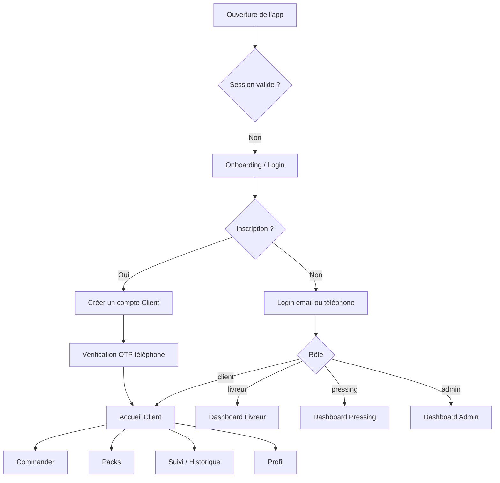
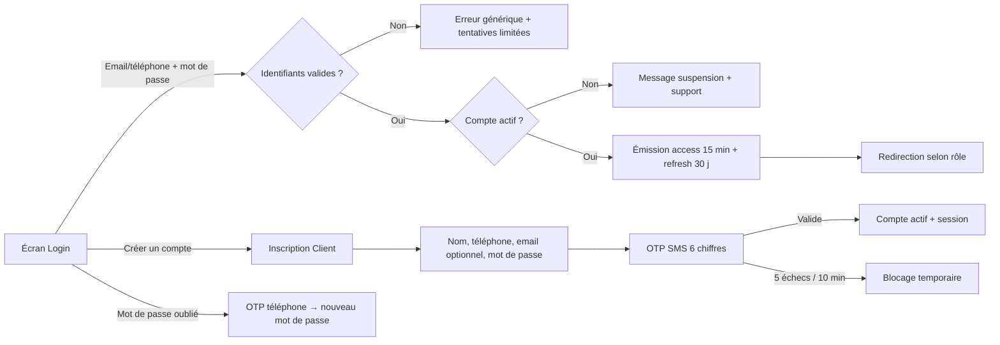
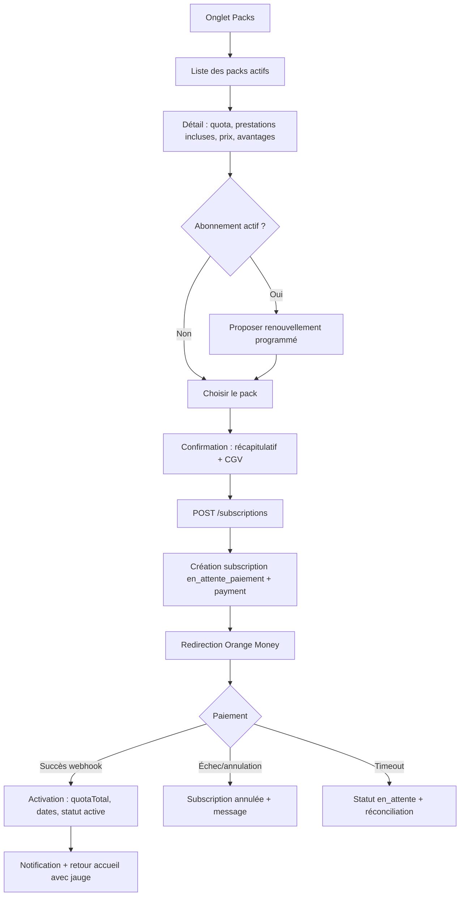
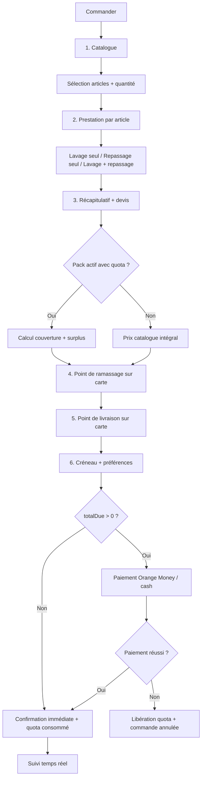
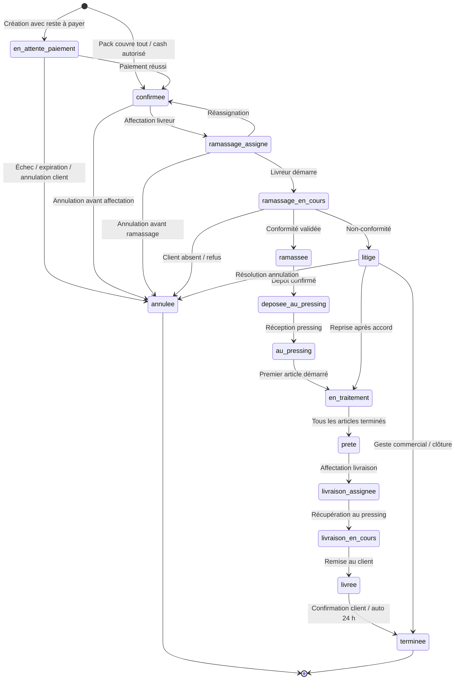
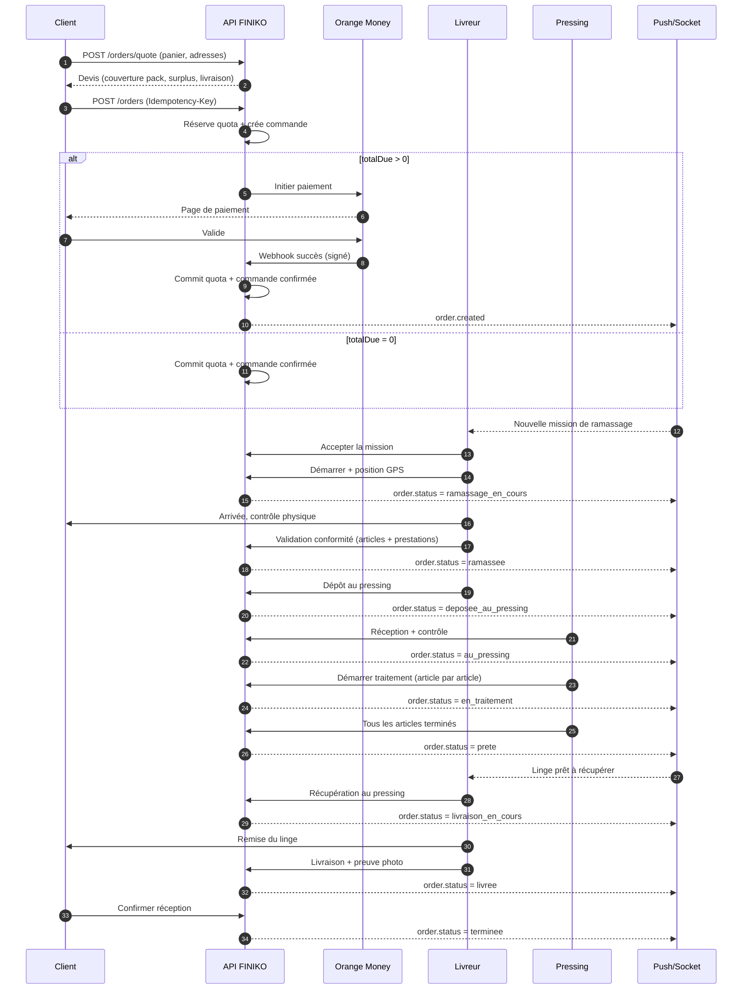
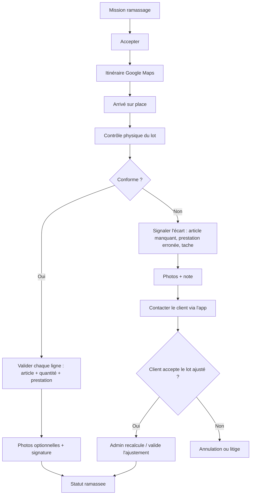
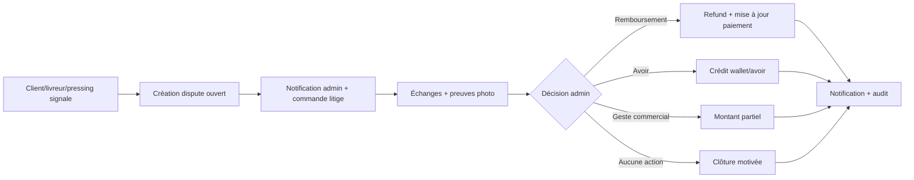

# 03 — User flows

## 1. Acteurs et permissions

| Acteur       | Peut                                                                                                                             | Ne peut pas                                                                              |
| ------------ | -------------------------------------------------------------------------------------------------------------------------------- | ---------------------------------------------------------------------------------------- |
| **Client**   | S'inscrire, commander, souscrire un pack, payer, suivre, annuler avant ramassage, ouvrir un litige, noter                        | Créer un compte livreur/pressing, voir les commandes d'un autre client, modifier un prix |
| **Livreur**  | Voir ses missions, accepter/refuser, naviguer, vérifier la conformité, déposer au pressing, récupérer, livrer, collecter du cash | Modifier les prix, changer le contenu d'une commande, traiter du linge                   |
| **Pressing** | Réceptionner, marquer les articles en traitement/terminés, déclarer prêt, signaler un écart                                      | Livrer au client, encaisser, modifier les prestations                                    |
| **Admin**    | CRUD catalogue/packs/comptes, affecter, superviser, annuler, rembourser, gérer litiges, configurer                               | Supprimer définitivement une commande payée (soft delete/annulation tracée)              |

---

## 2. Navigation globale



**Règle de redirection** : chaque rôle atterrit sur son espace. Les écrans partagés (détail commande, paiement, litige, profil) sont accessibles à tous les rôles authentifiés, avec des actions filtrées par rôle et par propriété de la ressource.

---

## 3. Authentification et inscription

### 3.1 Parcours



### 3.2 Détails

- **Identifiant** : email **ou** téléphone, détection automatique du format.
- **Inscription** : uniquement `client`. Les champs rôle sont ignorés côté API.
- **OTP** : 6 chiffres, 5 minutes, 5 tentatives, renvoi limité à 1/minute et 5/heure.
- **Session** : access token JWT 15 min, refresh token opaque 30 jours, rotation à chaque refresh, révocation par appareil.
- **Stockage mobile** : `expo-secure-store` pour les tokens, jamais AsyncStorage.
- **Déconnexion** : révoque la session serveur, purge le cache TanStack Query et les stores.
- **Comptes livreur/pressing** : créés par l'admin, mot de passe temporaire + `mustChangePassword=true`, SMS d'invitation.

### 3.3 Cas d'erreur

| Cas                    | Message                                              | Action                                 |
| ---------------------- | ---------------------------------------------------- | -------------------------------------- |
| Identifiants invalides | « Identifiant ou mot de passe incorrect. »           | Ne jamais révéler si le compte existe. |
| Compte suspendu        | « Votre compte est suspendu. Contactez le support. » | Afficher le numéro de support.         |
| OTP expiré             | « Code expiré. Demandez un nouveau code. »           | Bouton renvoyer.                       |
| Trop de tentatives     | « Trop de tentatives. Réessayez dans 10 minutes. »   | Rate limit serveur + client.           |
| Téléphone déjà utilisé | « Un compte existe déjà avec ce numéro. »            | Proposer connexion.                    |

---

## 4. Espace Client

### 4.1 Accueil

Contenu, dans l'ordre :

1. **Header** : salutation, ville/zone, cloche de notifications.
2. **Bannières** : carrousel piloté par l'admin (promotions, nouveautés).
3. **Carte Pack actif** : nom du pack, jauge `quotaUsed / quotaTotal`, date de fin, bouton « Commander avec mon pack ».
4. **Raccourcis** : Commander, Suivre une commande, Packs, Historique.
5. **Services** : Lavage, Repassage, Lavage + Repassage (avec prix « à partir de »).
6. **Packs & abonnements** : aperçu horizontal, bouton « Voir tous ».
7. **Dernière commande** : statut + accès au suivi.

**États** : chargement (skeletons), vide (aucune commande → CTA commander), erreur réseau (bandeau + réessayer), mode hors ligne (dernières données en cache + bandeau).

### 4.2 Souscription à un pack



**Règles** :

- Un seul abonnement **actif** par client. Si un abonnement est actif, l'achat crée un abonnement `programmee` qui démarrera à `endDate`.
- Le paiement peut être relancé depuis « Mes abonnements » tant que le statut est `en_attente_paiement` (dans la limite de 20 min).
- Le quota est crédité **après** confirmation serveur du paiement, jamais à la redirection retour.
- Renouvellement : rappel J-3, J-1 et J0. Pas de débit silencieux (Orange Money exige une action).
- Annulation : possible avant la fin de la période ; le quota restant demeure utilisable jusqu'à `endDate`, aucun remboursement prorata (sauf geste admin).

### 4.3 Commande — parcours pas à pas



#### Étape 1 — Catalogue

- Filtres : catégorie, recherche.
- Chaque carte : visuel, nom, prix « à partir de », badge « inclus dans mon pack » si applicable.
- Ajout au panier avec quantité (1–99).
- Le panier est conservé localement (Zustand persisté) pour reprendre une commande interrompue.

#### Étape 2 — Prestation par article

| Article | Lavage | Repassage | Lavage + repassage |
| ------- | -----: | --------: | -----------------: |
| Chemise |    800 |       500 |              1 200 |
| Boubou  |  1 500 |     1 000 |              2 200 |

- Une seule prestation par ligne d'article. Pour deux prestations différentes sur le même article, créer deux lignes.
- Les prestations non proposées pour un article sont désactivées.
- Le prix affiché est celui du catalogue au moment du devis ; il sera figé à la création.

#### Étape 3 — Devis transparent

L'écran affiche toujours :

```text
Sous-total catalogue          14 000 FCFA
Pris en charge par le pack   −11 800 FCFA
Surplus à payer                2 200 FCFA
Frais de livraison             1 000 FCFA
─────────────────────────────────────────
Total à payer                  3 200 FCFA
Quota restant après commande   0 / 10 unités
```

**Exemple chiffré** — Pack Normal (10 unités, 11 000 FCFA/mois) :

- 8 chemises en lavage + repassage : 8 × 1 200 = 9 600 FCFA, 8 unités.
- 2 boubous en lavage + repassage : 2 × 2 200 = 4 400 FCFA, 2 × 2 = 4 unités.
- Total catalogue : 14 000 FCFA, 12 unités nécessaires.
- Quota disponible : 10 unités.
- Couverture : 8 chemises (8 unités) + 1 boubou (2 unités) = 10 unités, soit 11 800 FCFA.
- Surplus : 1 boubou = 2 200 FCFA.
- Livraison : 1 000 FCFA.
- **À payer : 3 200 FCFA.**

> L'allocation est déterministe : lignes dans l'ordre du panier, puis quantité couverte = `min(quantité, floor(quota_restant / poids_article))`. L'UI affiche clairement quels articles sont couverts.

#### Étape 4 — Ramassage sur carte

- Carte Google centrée sur Bamako, marqueur draggable, bouton « Ma position ».
- Recherche d'adresse (Places) via proxy serveur + possibilité de saisir un repère texte.
- Champs : libellé (Maison/Bureau), contact, téléphone, instructions (portail, étage, repère).
- Sauvegarde en adresse favorite (option).
- Validation : coordonnées obligatoires + texte de repère obligatoire + contact.

#### Étape 5 — Livraison sur carte

- Même composant, avec option « Identique au ramassage ».
- Vérification de la zone desservie ; si hors zone, message explicite et suggestion de point de dépôt.
- Calcul des frais : zone + distance (Directions API ou Haversine), plafonné par la config.

#### Étape 6 — Créneau et préférences

- Créneaux proposés selon les heures d'ouverture du pressing assigné et la capacité.
- Parfum : lavande, frais, neutre.
- Notes libres (max 500 caractères).
- Option « Laisser chez le gardien » avec avertissement.

#### Étape 7 — Paiement

| Situation                           | Moyen                    | Comportement                                           |
| ----------------------------------- | ------------------------ | ------------------------------------------------------ |
| Pack couvre tout, livraison incluse | `pack`                   | Confirmation immédiate, quota consommé.                |
| Pack couvre tout, livraison à payer | `orange_money` ou `cash` | OM : redirection ; cash : encaissement à la livraison. |
| Pack partiel                        | `orange_money` ou `cash` | Paiement du surplus + livraison.                       |
| Aucun pack                          | `orange_money` ou `cash` | Paiement intégral.                                     |

- **Orange Money** : redirection web, retour par deep link `finiko://payment/callback`, puis polling du statut. L'UI ne valide jamais un paiement sur simple retour navigateur.
- **Cash** : disponible si l'admin l'autorise ; le livreur encaisse et marque « payé » à la remise. Risque d'impayé suivi dans le dashboard.
- **Échec** : message clair, bouton réessayer, réservation de quota libérée après expiration (20 min) ou annulation immédiate.

#### Étape 8 — Confirmation

- Numéro `#FK-1042`, récapitulatif, adresse, créneau, total, quota restant.
- Notification in-app + push + SMS de confirmation.
- Redirection vers le suivi.

### 4.4 Suivi de commande

Stepper client (8 étapes visuelles) :

```text
① Commande confirmée
② Livreur en route pour le ramassage
③ Linge ramassé
④ Au pressing
⑤ Traitement en cours
⑥ Prêt
⑦ En livraison
⑧ Livré
```

Chaque étape affiche l'heure, l'acteur et une description. En cas d'annulation/litige, un bandeau remplace le stepper.

**Actions client** :

- Appeler le livreur (numéro masqué via proxy téléphonique si disponible, sinon numéro réel du livreur assigné).
- Annuler avant ramassage (selon la matrice de remboursement).
- Signaler un problème (litige).
- Confirmer la réception (ou validation automatique après 24 h).
- Noter le pressing et le livreur.

### 4.5 Historique et transactions

- Onglets : Commandes, Abonnements, Paiements.
- Filtres : statut, période, recherche par numéro.
- Détail d'un abonnement : ledger lisible (« 12 nov. — Commande #FK-1042 — 8 unités — solde 2/10 »).
- Téléchargement de reçu (V1.1).

---

## 5. Machine à états de la commande



### Matrice des transitions autorisées

| Statut courant        | Acteur         | Action                     | Statut suivant        |
| --------------------- | -------------- | -------------------------- | --------------------- |
| `en_attente_paiement` | système        | Paiement confirmé          | `confirmee`           |
| `en_attente_paiement` | client/système | Annulation/expiration      | `annulee`             |
| `confirmee`           | admin          | Affecter un livreur        | `ramassage_assigne`   |
| `ramassage_assigne`   | livreur        | Accepter + démarrer        | `ramassage_en_cours`  |
| `ramassage_assigne`   | admin/livreur  | Réassigner/refuser         | `confirmee`           |
| `ramassage_en_cours`  | livreur        | Conformité OK              | `ramassee`            |
| `ramassage_en_cours`  | livreur        | Conformité KO              | `litige`              |
| `ramassee`            | livreur        | Déposer au pressing        | `deposee_au_pressing` |
| `deposee_au_pressing` | pressing       | Réceptionner               | `au_pressing`         |
| `au_pressing`         | pressing       | Démarrer un article        | `en_traitement`       |
| `en_traitement`       | pressing       | Terminer tous les articles | `prete`               |
| `prete`               | admin          | Affecter la livraison      | `livraison_assignee`  |
| `livraison_assignee`  | livreur        | Récupérer au pressing      | `livraison_en_cours`  |
| `livraison_en_cours`  | livreur        | Remettre au client         | `livree`              |
| `livree`              | client/système | Confirmer réception / 24 h | `terminee`            |
| tout sauf terminal    | admin          | Annuler                    | `annulee`             |
| tout sauf terminal    | client/admin   | Ouvrir un litige           | `litige`              |

> Toute transition écrit un `order_status_event` avec acteur, rôle, motif, coordonnées et métadonnées. Un statut ne peut jamais être écrit directement par un `PATCH /orders/:id`.

---

## 6. Séquence de fulfillment (happy path)



---

## 7. Espace Livreur

### 7.1 Dashboard

- Statut de disponibilité : Disponible / En mission / Hors ligne.
- Compteurs : missions à ramasser, en cours, livraisons du jour, gains estimés.
- Filtre par type : Ramassages, Dépôts, Livraisons.
- Chaque mission : numéro, client (nom + quartier), distance, créneau, nombre d'articles, badges de prestations, bouton « Ouvrir ».

### 7.2 Ramassage



**Écran de contrôle de conformité** : liste des lignes de la commande avec traitement attendu, quantité, case « conforme » par ligne, bouton « Tout est conforme ». Le livreur ne peut pas modifier la quantité ni la prestation : il **constate**. Toute divergence passe par un signalement.

**Guidage GPS** : ouverture de Google Maps avec les coordonnées de ramassage ; bouton « Appeler » ; bouton « Je suis arrivé » qui notifie le client et horodate l'arrivée.

### 7.3 Dépôt au pressing

- Itinéraire vers le pressing assigné.
- Récapitulatif du lot.
- Confirmation de remise : nom du réceptionnaire (saisi) + horodatage.
- Statut `deposee_au_pressing` ; le pressing reçoit une notification.

### 7.4 Récupération et livraison

- Notification `order.ready` → mission de livraison.
- Au pressing : contrôle du nombre de articles, récupération, photo du lot.
- Itinéraire vers le point de livraison.
- À l'arrivée : appel client, remise, photo de preuve, signature optionnelle, encaissement cash si applicable.
- Statut `livree`, notification client pour confirmation.

### 7.5 Mode hors ligne

- Les actions « démarrer », « arrivé », « conforme », « déposé », « livré » sont mises en file locale (MMKV) avec un UUID d'action.
- À la reconnexion, rejeu séquentiel idempotent ; si le serveur a déjà appliqué l'action, succès silencieux.
- Les photos sont uploadées en arrière-plan (file + compression).
- L'UI affiche un badge « en attente de synchronisation » et interdit les transitions incohérentes.

---

## 8. Espace Pressing

### 8.1 Réception

- File d'attente : lots déposés, triés par heure d'arrivée et priorité (Express).
- Détail : livreur, nombre d'articles, prestations agrégées, photos de conformité.
- Contrôle contradictoire : nombre d'articles reçus vs déclarés.
- Si écart : signalement + photo → statut `litige` (le traitement ne démarre pas).
- Si conforme : statut `au_pressing`.

### 8.2 Traitement

Vue **kanban** par statut d'article :

```text
À traiter (12)      En cours (3)        Terminé (7)
─────────────────   ─────────────────   ─────────────────
Chemise × 6         Boubou × 1          Pantalon × 4
  Lavage + rep.       Repassage seul      Lavage seul
Pantalon × 4        Costume × 2
  Lavage seul         Lavage + rep.
Boubou × 2
  Repassage seul
```

- Regroupement par prestation pour organiser les machines.
- Action par ligne : « Démarrer » → « Terminer ».
- Action groupée : « Tout marquer terminé » avec confirmation.
- Quand **toutes** les lignes sont `termine` → statut `prete`, notification automatique au livreur et au client.
- Le pressing ne peut pas déclarer prêt s'il reste une ligne non terminée.
- Le pressing ne voit jamais le prix payé par le client (confidentialité commerciale) ; il voit la prestation et la quantité.

### 8.3 Clôture et historique

- Bouton « Prêt pour livraison » (si toutes les lignes sont terminées).
- Historique des lots traités, temps moyen, volume, litiges.
- Statistiques : articles/jour, respect des délais, taux de reprise.

---

## 9. Espace Administrateur

### 9.1 Dashboard global

| Bloc        | Indicateurs                                                            |
| ----------- | ---------------------------------------------------------------------- |
| Revenus     | CA encaissé (packs + à la carte + cash), CA du jour/mois, panier moyen |
| Abonnements | Actifs, expirés, taux de renouvellement, quota consommé                |
| Commandes   | Par statut, en retard, annulées, litiges ouverts                       |
| Opérations  | Livreurs disponibles, pressings actifs, charge par pressing            |
| Qualité     | SLA ramassage, SLA livraison, note moyenne, taux de non-conformité     |

### 9.2 Catalogue et tarifs

- Liste des articles, recherche, filtre catégorie, activation/désactivation.
- Création/édition : nom, code, catégorie, visuel, poids quota, **3 prix** (lavage, repassage, lavage + repassage), prestations disponibles.
- Suppression logique si l'article est utilisé dans une commande (jamais de suppression physique).
- Prévisualisation du prix tel que vu par le client.

### 9.3 Packs

- CRUD : nom, prix, quota, prestations incluses, livraison incluse/réduite, rollover, avantages, badge, ordre d'affichage.
- Désactivation : les abonnements en cours conservent leur snapshot ; le pack disparaît du catalogue.
- Simulation : « 10 unités = combien de chemises/boubous ? » pour aider l'admin à calibrer.

### 9.4 Comptes

- Créer un livreur ou un pressing : nom, téléphone, email, zone, capacité, documents.
- Modifier, suspendre, réactiver, réinitialiser le mot de passe.
- Voir l'activité : commandes, notes, incidents, dernier login.
- Un compte suspendu ne peut plus se connecter ; ses missions en cours doivent être réassignées.

### 9.5 Supervision des commandes

- Tableau filtrable par statut, date, client, livreur, pressing, paiement.
- Détail avec timeline complète, articles, preuves, paiements, litiges.
- Actions : affecter/réaffecter, changer le pressing, annuler, rembourser, ouvrir un litige, ajouter une note interne.
- Toute action sensible est confirmée et auditée.

### 9.6 Affectations

**Ramassage** :

- Vue carte/liste des commandes confirmées.
- Suggestions : livreur disponible le plus proche avec capacité.
- Affectation manuelle ou automatique (option).
- Alerte si aucune affectation dans les 15 minutes.

**Livraison** :

- Vue des commandes `prete`.
- Affectation au livreur qui a fait le ramassage en priorité, sinon le plus proche du pressing.

### 9.7 Finances

- Onglets : Packs, Commandes, Remboursements, Cash à reverser.
- Rapprochement Orange Money : paiements `reussi` vs relevé opérateur.
- Export CSV (V1.1).
- Commission pressing calculée sur les prestations (paramétrable).

### 9.8 Litiges

- File des litiges ouverts avec SLA.
- Fil de discussion client / livreur / pressing / admin.
- Décision : remboursement total/partiel, avoir, geste commercial, aucune action.
- La résolution met à jour la commande et déclenche le remboursement si applicable.

---

## 10. Annulation, remboursement et litige

### 10.1 Matrice d'annulation

| Moment                             | Qui    | Remboursement paiement                            | Quota                             |
| ---------------------------------- | ------ | ------------------------------------------------- | --------------------------------- |
| Avant paiement                     | Client | Aucun débit                                       | Réservation libérée               |
| Paiement réussi, avant affectation | Client | 100 % Orange Money                                | Consommation annulée (remboursée) |
| Affecté, avant ramassage           | Client | 100 %                                             | Remboursé                         |
| Livreur en route                   | Client | 100 % si le livreur n'est pas arrivé, sinon admin | Remboursé sur décision admin      |
| Linge ramassé                      | Admin  | Décision au cas par cas                           | Remboursement admin possible      |
| Au pressing / en traitement        | Admin  | Généralement refusé (sauf geste)                  | Idem                              |
| Prêt / en livraison                | Admin  | Refusé (sauf geste)                               | Idem                              |
| Livré                              | Admin  | Litige uniquement                                 | Pas de remboursement              |

### 10.2 Litige



- Un litige ne bloque pas la livraison si le linge est prêt : l'admin peut décider de livrer puis traiter le litige.
- Les preuves sont conservées 12 mois.
- Délai cible de résolution : 48 h.

---

## 11. Notifications

| Événement                     | Client | Livreur | Pressing | Admin | Canaux            |
| ----------------------------- | ------ | ------- | -------- | ----- | ----------------- |
| Commande créée                | ✅     | —       | —        | —     | in-app, push, SMS |
| Paiement réussi               | ✅     | —       | —        | —     | in-app, push      |
| Paiement échoué               | ✅     | —       | —        | ✅    | in-app, push      |
| Livreur affecté               | ✅     | ✅      | —        | —     | in-app, push      |
| Livreur en route              | ✅     | —       | —        | —     | push              |
| Linge ramassé                 | ✅     | —       | ✅       | —     | in-app, push      |
| Déposé au pressing            | ✅     | —       | ✅       | —     | in-app            |
| Réception pressing            | ✅     | —       | —        | —     | in-app            |
| Traitement démarré            | ✅     | —       | —        | —     | in-app            |
| Linge prêt                    | ✅     | ✅      | —        | —     | push + SMS        |
| En livraison                  | ✅     | —       | —        | —     | push              |
| Livré                         | ✅     | —       | —        | —     | push + SMS        |
| Commande terminée             | ✅     | —       | —        | —     | in-app            |
| Abonnement activé             | ✅     | —       | —        | ✅    | in-app, push, SMS |
| Abonnement J-3                | ✅     | —       | —        | —     | push, SMS         |
| Litige ouvert                 | ✅     | ✅      | ✅       | ✅    | in-app, push      |
| Mission non affectée > 15 min | —      | —       | —        | ✅    | in-app, push      |

**Règles** :

- Les notifications critiques (paiement, prêt, livraison) partent aussi en SMS si le push échoue.
- L'utilisateur peut désactiver les notifications marketing, pas les notifications transactionnelles.
- Chaque notification contient un `deepLink` vers l'écran concerné.

---

## 12. Cas limites et comportements attendus

| Cas                                                    | Comportement                                                                                                                                                            |
| ------------------------------------------------------ | ----------------------------------------------------------------------------------------------------------------------------------------------------------------------- |
| **Paiement réussi après expiration de la réservation** | Le webhook est prioritaire. Si le quota n'est plus réservable, le paiement est remboursé automatiquement et le client notifié. Ne jamais garder l'argent sans commande. |
| **Double webhook**                                     | Le second retourne `200` sans effet (idempotence par `providerTxId`).                                                                                                   |
| **Double tap « Payer »**                               | `Idempotency-Key` sur la commande + verrou sur le paiement ; une seule intention créée.                                                                                 |
| **Quota concurrent**                                   | Garde atomique ; si échec, recalcul du devis et message « le quota a changé ».                                                                                          |
| **Livreur ne se présente pas**                         | Alerte admin à +15 min, réassignation, notification client.                                                                                                             |
| **Pressing fermé**                                     | Le dépôt reste `deposee_au_pressing`, alerte admin, réassignation possible.                                                                                             |
| **Client absent à la livraison**                       | 2 tentatives + appels ; retour au pressing ; frais de re-livraison ; litige si désaccord.                                                                               |
| **Adresse erronée**                                    | Le livreur appelle, peut déplacer le point sur la carte avec accord client ; sinon annulation.                                                                          |
| **Article non conforme**                               | Signalement photo, statut `litige`, décision client/admin avant reprise.                                                                                                |
| **Abonnement expiré pendant une commande**             | La réservation reste valide jusqu'à la fin de la commande ; l'expiration ne libère pas les unités consommées, seulement les réservations orphelines.                    |
| **Réseau coupé en mission**                            | Actions en file, rejeu à la reconnexion, statut « en attente de synchronisation ».                                                                                      |
| **App tuée pendant le paiement**                       | Au retour, l'app appelle `GET /payments/:id` et affiche le statut réel.                                                                                                 |
| **Compte suspendu avec mission en cours**              | Admin réassigne avant suspension effective ; sinon la mission reste visible jusqu'à clôture.                                                                            |

---

## 13. Définition des KPI

| KPI                          | Formule                                                   | Cible MVP       |
| ---------------------------- | --------------------------------------------------------- | --------------- |
| CA encaissé                  | Σ paiements `reussi` (packs + commandes) − remboursements | Suivi quotidien |
| Taux de conversion commande  | commandes confirmées / devis créés                        | > 60 %          |
| Panier moyen                 | CA commandes / nombre de commandes                        | > 8 000 FCFA    |
| Taux d'utilisation du quota  | unités consommées / unités vendues                        | > 55 %          |
| SLA ramassage                | % ramassages réalisés dans le créneau                     | > 85 %          |
| SLA livraison                | % livraisons dans le créneau                              | > 80 %          |
| Taux de non-conformité       | commandes `litige` / commandes ramassées                  | < 3 %           |
| Délai de traitement pressing | médiane `prete − au_pressing`                             | < 24 h          |
| Taux de renouvellement pack  | abonnements renouvelés / expirés                          | > 50 %          |
| Note moyenne                 | moyenne des reviews                                       | > 4,3/5         |
