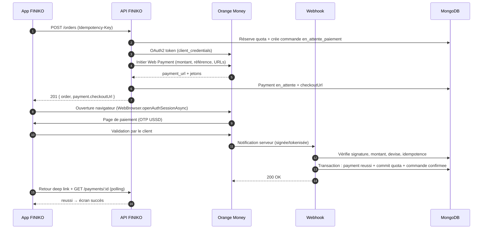
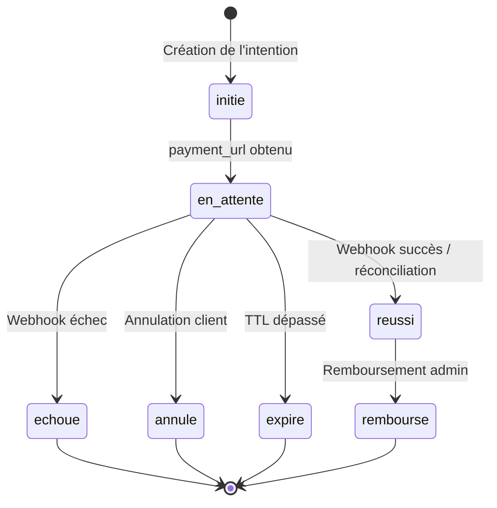

# 06 — Paiements Orange Money & Google Maps

## Partie A — Orange Money

> **Prérequis contractuel** : Orange Money Web Payment / M Payment est réservé aux **marchands Orange Money** enregistrés (KYA) et validés par l'opérateur local. Les endpoints, champs exacts et modalités de signature sont fournis dans le **contrat marchand / espace partenaire Orange Developer**. Le présent document définit l'architecture d'intégration ; les noms de champs doivent être alignés sur la documentation contractuelle remise à FINIKO Mali.

### 1. Principes

1. **Aucun paiement n'est validé côté mobile.** Le retour navigateur n'est qu'un signal UX ; la vérité vient du webhook serveur ou de la réconciliation.
2. **Idempotence totale** : une intention = une référence unique ; un webhook = un `providerTxId` traité une seule fois.
3. **Machine à états explicite** : `initie → en_attente → reussi | echoue | annule | expire | rembourse`.
4. **Le montant est recalculé côté serveur** et vérifié dans le webhook.
5. **Séparation des purposes** : `order` (surplus + livraison) et `subscription` (pack).
6. **Traçabilité** : chaque transition de paiement est horodatée et auditée.
7. **Repli** : si le webhook tarde, un job de réconciliation interroge l'opérateur ; si le paiement a réussi mais que la commande n'est plus réservable, remboursement automatique.

### 2. Parcours utilisateur



### 3. Adaptateur de paiement

```ts
// modules/payments/providers/payment-provider.ts
export interface PaymentProvider {
  readonly name: 'orange_money' | 'cash' | 'wallet' | 'system';

  initiate(input: InitiatePaymentInput): Promise<InitiatePaymentResult>;

  /**
   * Vérifie et normalise un webhook. Doit lever une erreur si la signature,
   * le montant, la devise ou la fenêtre temporelle sont invalides.
   */
  parseWebhook(rawBody: Buffer, headers: Record<string, string>): Promise<ProviderEvent>;

  /** Interroge l'opérateur pour la réconciliation. */
  fetchStatus(providerTxId: string): Promise<ProviderStatus>;

  /** Certains opérateurs ne permettent pas le remboursement API. */
  refund?(input: RefundInput): Promise<RefundResult>;

  readonly capabilities: {
    refundApi: boolean;
    webhookSignature: 'hmac' | 'token' | 'both';
  };
}
```

```ts
export type InitiatePaymentInput = {
  reference: string; // PAY-20261102-0008
  amountXOF: number;
  currency: 'XOF';
  description: string; // "FINIKO #FK-1042"
  customerPhone: string; // +223...
  returnUrl: string; // deep link / page de retour
  cancelUrl: string;
  notifUrl: string;
  metadata: { orderId?: string; subscriptionId?: string };
};

export type InitiatePaymentResult = {
  providerTxId: string | null;
  checkoutUrl: string;
  expiresAt: Date;
  raw: unknown;
};

export type ProviderEvent = {
  providerTxId: string;
  reference: string; // order_id / merchant reference
  status: 'SUCCESS' | 'FAILED' | 'CANCELLED' | 'PENDING';
  amountXOF: number;
  currency: string;
  paidAt: Date | null;
  raw: unknown;
};
```

### 4. Configuration

```dotenv
# Orange Money — valeurs à obtenir auprès d'Orange Mali / Orange Developer
ORANGE_MONEY_ENABLED=true
ORANGE_MONEY_BASE_URL=https://api.orange.com/orange-money-webpay/ml/v1
ORANGE_MONEY_TOKEN_URL=https://api.orange.com/oauth/v3/token
ORANGE_MONEY_CLIENT_ID=...
ORANGE_MONEY_CLIENT_SECRET=...
ORANGE_MONEY_MERCHANT_KEY=...
ORANGE_MONEY_CURRENCY=XOF          # à confirmer avec le contrat (Mali)
ORANGE_MONEY_NOTIF_URL=https://api.finiko.ml/api/v1/webhooks/orange-money
ORANGE_MONEY_RETURN_URL=https://api.finiko.ml/api/v1/payments/return
ORANGE_MONEY_CANCEL_URL=https://api.finiko.ml/api/v1/payments/cancel
ORANGE_MONEY_WEBHOOK_SECRET=...
ORANGE_MONEY_WEBHOOK_IP_ALLOWLIST=...
ORANGE_MONEY_TIMEOUT_MS=15000
```

> **Important** : l'URL de base, le chemin pays (`/ml/v1`), la devise et le mode d'authentification (OAuth2 client credentials, clé marchande, token de notification) doivent être confirmés par le contrat Orange. Le code isole ces variations dans `orange-money.provider.ts` et dans la configuration, jamais dans les services métier.

### 5. Initiation d'un paiement

```ts
// modules/payments/providers/orange-money.provider.ts
async initiate(input: InitiatePaymentInput): Promise<InitiatePaymentResult> {
  const token = await this.getAccessToken(); // cache Redis, TTL = expires_in - 60s

  const body = {
    merchant_key: this.config.merchantKey,
    currency: this.config.currency,
    order_id: input.reference,
    amount: input.amountXOF,
    reference: input.description,
    lang: 'fr',
    return_url: input.returnUrl,
    cancel_url: input.cancelUrl,
    notif_url: input.notifUrl,
  };

  const response = await this.http.post('/webpayment', body, {
    headers: { Authorization: `Bearer ${token}` },
    timeout: this.config.timeoutMs,
  });

  if (!response.data?.payment_url) {
    throw new PaymentProviderError('Réponse Orange Money invalide', response.data);
  }

  return {
    providerTxId: response.data.pay_token ?? null,
    checkoutUrl: response.data.payment_url,
    expiresAt: addMinutes(new Date(), 20),
    raw: response.data,
  };
}
```

**Remarques** :

- Le `payment_url` est une page hébergée par Orange ; le client y saisit son numéro et le mot de passe temporaire obtenu via USSD.
- Le mobile ouvre cette URL avec `WebBrowser.openAuthSessionAsync(url, 'finiko://payment/callback')`.
- La référence `order_id` doit être **unique** et ≤ la longueur maximale imposée par l'opérateur. `PAY-YYYYMMDD-XXXX` respecte cette contrainte.
- Ne jamais envoyer le numéro de téléphone ou des données personnelles dans l'URL de retour.

### 6. Webhook

**Endpoint** : `POST /api/v1/webhooks/orange-money`

**Traitement** :

```ts
async function handleOrangeMoneyWebhook(req, res) {
  const raw = req.rawBody; // body parser raw, pas JSON parsé
  const event = await provider.parseWebhook(raw, req.headers);

  const payment = await Payment.findOne({
    $or: [{ reference: event.reference }, { providerTxId: event.providerTxId }],
  });

  if (!payment) {
    logger.warn({ event }, 'Webhook OM: paiement inconnu');
    return res.status(200).json({ received: true }); // ne pas faire rejouer
  }

  if (payment.status === 'reussi') {
    return res.status(200).json({ received: true, duplicate: true });
  }

  if (event.amountXOF !== payment.amountXOF || event.currency !== payment.currency) {
    await alertAdmin('PAYMENT_AMOUNT_MISMATCH', { payment, event });
    return res.status(200).json({ received: true }); // rejeu inutile
  }

  if (event.status === 'SUCCESS') {
    await paymentService.confirmSuccess(payment, event);
  } else if (event.status === 'FAILED' || event.status === 'CANCELLED') {
    await paymentService.confirmFailure(payment, event);
  } else {
    await paymentService.markPending(payment, event);
  }

  return res.status(200).json({ received: true });
}
```

**Règles de réponse** :

| Situation                 | Réponse        | Raison                                    |
| ------------------------- | -------------- | ----------------------------------------- |
| Traité avec succès        | `200`          | Acquittement                              |
| Doublon                   | `200`          | Idempotence                               |
| Paiement inconnu          | `200` + alerte | Un rejeu ne changera rien                 |
| Montant/devise incohérent | `200` + alerte | Erreur définitive, investigation manuelle |
| DB indisponible / timeout | `503`          | L'opérateur doit réessayer                |
| Signature invalide        | `401`          | Rejet, alerte sécurité                    |

**Vérification de la signature** : selon le contrat, utiliser l'une des méthodes suivantes (ou les deux) :

1. **Token de notification** fourni à l'initiation (`notif_token`) et renvoyé dans le webhook.
2. **HMAC** `X-OM-Signature: t=...,v1=...` calculé sur le corps brut avec `ORANGE_MONEY_WEBHOOK_SECRET`.
3. **Allowlist IP** des serveurs Orange.
4. **Fenêtre temporelle** de 5 minutes + cache anti-rejeu Redis (`webhook:{txId}` TTL 24 h).

### 7. Machine à états du paiement



**Effets métier** :

| Transition                           | Effet                                                                            |
| ------------------------------------ | -------------------------------------------------------------------------------- |
| `en_attente → reussi` (order)        | `paymentStatus=paye`, `order.status=confirmee`, commit quota, notification       |
| `en_attente → reussi` (subscription) | `subscription.status=active`, crédit du quota, dates, notification               |
| `en_attente → echoue`                | `order.status=annulee` (si aucune autre couverture), release quota, notification |
| `en_attente → expire`                | Idem échec + job de libération                                                   |
| `reussi → rembourse`                 | `refund` créé, `order.refundedAmount`, notification                              |

### 8. Réconciliation

Un webhook peut être perdu (réseau, déploiement, bug). Le job `reconcile-payments` tourne toutes les 2 minutes :

```ts
const pending = await Payment.find({
  provider: 'orange_money',
  status: { $in: ['en_attente', 'initie'] },
  createdAt: { $lte: subMinutes(new Date(), 2) },
  expiresAt: { $gte: subHours(new Date(), 24) },
}).limit(100);

for (const payment of pending) {
  const status = await provider.fetchStatus(payment.providerTxId);
  if (status === 'SUCCESS') await paymentService.confirmSuccess(payment, status);
  if (status === 'FAILED') await paymentService.confirmFailure(payment, status);
  if (payment.expiresAt < new Date()) await paymentService.expire(payment);
}
```

**Rapprochement comptable** : export quotidien des paiements `reussi` (référence, montant, date, commande) à comparer au relevé marchand Orange. Les écarts sont traités manuellement et tracés dans `audit_logs`.

### 9. Remboursements

| Cas                                     | Méthode                                                            | Délai                   |
| --------------------------------------- | ------------------------------------------------------------------ | ----------------------- |
| Annulation avant ramassage, paiement OM | Remboursement OM si l'API/contrat le permet, sinon virement/manuel | 24–72 h                 |
| Geste commercial                        | Avoir wallet (V1.1) ou OM                                          | 24–48 h                 |
| Paiement réussi sans commande (course)  | Remboursement automatique                                          | Immédiat à la détection |
| Cash                                    | Remise en main propre par le livreur / admin                       | Immédiat                |

> Si l'API de remboursement n'est pas disponible dans le contrat marchand, le remboursement est **manuel** via le portail Orange Money, puis marqué `effectue` dans FINIKO avec la référence opérateur. Le client reçoit une notification et le rapprochement est audité.

### 10. Paiement cash

- Autorisé par paramètre `settings.cashEnabled` (recommandé : oui au lancement, pour les clients sans Orange Money).
- Le livreur encaisse à la livraison, saisit le montant, marque `collect-cash`.
- Un paiement `cash` est créé avec `provider='cash'`, `status='reussi'`, `paidAt`.
- Le cash à reverser est suivi par livreur dans le dashboard admin (montant collecté − montant reversé).
- Risque : impayé/vol. Mitigation : limite par mission, reconciliation quotidienne, suspension si écart.

### 11. Sécurité paiement

- Secrets uniquement côté serveur (variables d'environnement, coffre-fort).
- Aucune clé marchande dans l'app mobile.
- Vérification stricte du montant/device.
- Webhook sur un endpoint séparé, body brut, signature, IP allowlist, rate limit.
- Journalisation sans données sensibles (pas de mot de passe, pas de token complet).
- Alertes : taux d'échec > 15 %, webhook en erreur, paiement sans commande, écart de rapprochement.
- Test de charge : 50 paiements simultanés, vérifier l'absence de double activation.

### 12. Tests et go-live

| Étape             | Contenu                                                                                                 |
| ----------------- | ------------------------------------------------------------------------------------------------------- |
| 1. Sandbox        | Compte marchand de test Orange, numéros de test, scénarios succès/échec/annulation                      |
| 2. Mock local     | `MockPaymentProvider` : `payment_url` pointe vers `/dev/pay/:ref`, boutons succès/échec, webhook simulé |
| 3. Contract tests | Validation des champs, signature, idempotence, montants                                                 |
| 4. Recette        | 20 paiements réels de faible montant, rapprochement                                                     |
| 5. Production     | Activation, monitoring 72 h, astreinte                                                                  |

**Checklist go-live** :

- [ ] Contrat marchand Orange Mali signé et KYA validé.
- [ ] Identifiants production reçus et stockés dans le coffre.
- [ ] URLs de retour/notification en HTTPS public.
- [ ] Webhook testé depuis l'extérieur (ngrok/staging).
- [ ] Réconciliation testée avec un webhook volontairement perdu.
- [ ] Remboursement testé (API ou procédure manuelle).
- [ ] Messages d'erreur client validés en français.
- [ ] Support et procédure d'escalade documentés.

---

## Partie B — Google Maps

### 1. APIs utilisées

| API                                       | Usage                                 | Où                  |
| ----------------------------------------- | ------------------------------------- | ------------------- |
| Maps SDK for Android                      | Affichage carte, marqueur, itinéraire | Mobile              |
| Maps SDK for iOS                          | Idem                                  | Mobile              |
| Places API (New) — Autocomplete + Details | Recherche d'adresse                   | **Serveur** (proxy) |
| Geocoding API                             | Reverse geocoding (pin → adresse)     | **Serveur** (proxy) |
| Routes API / Directions API               | Distance et durée réelles             | **Serveur** (cache) |

> Ne jamais embarquer une clé serveur dans l'app. Les clés SDK sont restreintes par package Android + empreinte SHA-1 et par bundle iOS ; les clés web sont restreintes par IP serveur et par API.

### 2. Clés et restrictions

| Clé                       | Plateforme | Restrictions                                                                |
| ------------------------- | ---------- | --------------------------------------------------------------------------- |
| `GOOGLE_MAPS_ANDROID_KEY` | Android    | Package `ml.finiko.app` + SHA-1 debug/release ; Maps SDK Android uniquement |
| `GOOGLE_MAPS_IOS_KEY`     | iOS        | Bundle ID `ml.finiko.app` ; Maps SDK iOS uniquement                         |
| `GOOGLE_MAPS_SERVER_KEY`  | Serveur    | IP du serveur ; Places API (New), Geocoding, Routes                         |

```dotenv
GOOGLE_MAPS_SERVER_KEY=...
GOOGLE_MAPS_DEFAULT_CENTER_LAT=12.6392
GOOGLE_MAPS_DEFAULT_CENTER_LNG=-8.0029
GOOGLE_MAPS_DEFAULT_ZOOM=13
GOOGLE_MAPS_COUNTRY=ML
GOOGLE_MAPS_LANGUAGE=fr
```

### 3. Composant carte (mobile)

```tsx
<MapView
  provider={PROVIDER_GOOGLE}
  style={{ flex: 1 }}
  initialRegion={{
    latitude: 12.6392,
    longitude: -8.0029,
    latitudeDelta: 0.05,
    longitudeDelta: 0.05,
  }}
  showsUserLocation
  showsMyLocationButton={false}
  onRegionChangeComplete={debouncedReverseGeocode}
>
  <Marker coordinate={center} draggable onDragEnd={onMarkerDragEnd} />
</MapView>
```

**Flux de sélection** :

1. Carte centrée sur la position ou le quartier par défaut.
2. Pin central fixe + carte déplaçable (pattern Uber) **ou** marqueur draggable.
3. Reverse geocoding debounced 500 ms → proposition d'adresse.
4. Recherche : `GET /geo/autocomplete?q=...&lat=...&lng=...` (proxy) → suggestions.
5. Sélection d'une suggestion → `GET /geo/place/:placeId` → coordonnées + adresse formatée.
6. Formulaire : libellé, contact, instructions.
7. Validation : `POST /geo/validate` vérifie la zone desservie + calcule les frais.

### 4. Proxy serveur

```ts
// modules/geo/geo.routes.ts
router.get('/geo/autocomplete', authenticate, async (req, res) => {
  const { q, lat, lng } = autocompleteSchema.parse(req.query);
  const cacheKey = `geo:ac:${q}:${round(lat, 2)}:${round(lng, 2)}`;
  const cached = await redis.get(cacheKey);
  if (cached) return res.json({ success: true, data: JSON.parse(cached) });

  const response = await places.autocomplete({
    input: q,
    locationBias: { circle: { center: { latitude: lat, longitude: lng }, radius: 30000 } },
    includedRegionCodes: ['ml'],
    languageCode: 'fr',
  });

  const data = response.suggestions.map(toSuggestion);
  await redis.set(cacheKey, JSON.stringify(data), 'EX', 3600);
  res.json({ success: true, data });
});
```

**Cache** : autocomplete 1 h, place details 24 h, geocoding 24 h, directions 10 min (par paire de points arrondie à 3 décimales). Cela réduit fortement les coûts.

### 5. Calcul des frais de livraison

```ts
async function quoteDelivery(pickup: LatLng, delivery: LatLng) {
  const zone = await DeliveryZone.findOne({
    isActive: true,
    geometry: {
      $geoIntersects: { $geometry: { type: 'Point', coordinates: [pickup.lng, pickup.lat] } },
    },
  });

  if (!zone) throw new ApiError(422, 'DELIVERY_ZONE_UNSERVED');

  const route = await routes.compute({
    origin: pickup,
    destination: delivery,
    travelMode: 'DRIVE',
  });

  const distanceKm = route.distanceMeters / 1000;
  if (distanceKm > zone.maxDistanceKm) throw new ApiError(422, 'DELIVERY_ZONE_UNSERVED');

  const base = zone.baseFeeXOF;
  const variable = Math.ceil(distanceKm * zone.perKmFeeXOF);
  const fee = Math.max(zone.minFeeXOF, base + variable);

  return {
    zone: zone.name,
    distanceKm: round(distanceKm, 1),
    durationMinutes: Math.ceil(route.durationSeconds / 60),
    feeXOF: fee,
    serviceable: true,
  };
}
```

**Fallback** : si Routes API échoue, utiliser la distance Haversine × 1,3 (facteur de sinuosité urbaine) et un tarif de zone. Ne jamais bloquer une commande pour une panne de calcul d'itinéraire : appliquer le tarif de zone par défaut et journaliser.

### 6. Affichage côté livreur

- Bouton « Naviguer » → `google.navigation:q=lat,lng` (Android) / `comgooglemaps://` (iOS) ou navigation interne.
- Distance et ETA affichés avant acceptation.
- Mise à jour de position toutes les 15 s en mission ; stockage Redis pour la carte admin ; Mongo throttlé.
- En arrière-plan Android : foreground service + notification persistante (obligatoire pour la localisation continue).

### 7. Confidentialité et conformité

- Demander la permission de localisation avec un écran explicatif avant le prompt système.
- L'utilisateur peut commander avec une adresse saisie manuellement si la permission est refusée.
- Ne pas suivre la position en dehors des missions.
- Purger les positions historiques après 30 jours ; conserver uniquement les points de ramassage/livraison dans la commande.
- Mentions dans la politique de confidentialité (APDP Mali) : finalité, durée, destinataires, droits.

### 8. Coûts et quotas

- Activer uniquement les APIs nécessaires (Maps SDK, Places, Geocoding, Routes).
- Plafonner les appels par utilisateur (rate limit) et par jour (budget alert).
- Mettre en cache agressivement.
- Préférer les suggestions Places à des appels Details systématiques.
- Suivre le coût par commande dans le dashboard admin (option V1.1).
- Alerte si le budget Maps dépasse 80 % du seuil mensuel.

### 9. Checklist Maps

- [ ] Projet Google Cloud créé, facturation activée.
- [ ] APIs activées et restreintes.
- [ ] Clés Android/iOS/server séparées et restreintes.
- [ ] SHA-1 debug et release enregistrés.
- [ ] Carte testée sur un appareil réel (pas seulement émulateur).
- [ ] Permission refusée testée (saisie manuelle).
- [ ] Zone hors couverture testée.
- [ ] Panne Routes testée (fallback tarifaire).
- [ ] Politique de confidentialité mise à jour.
