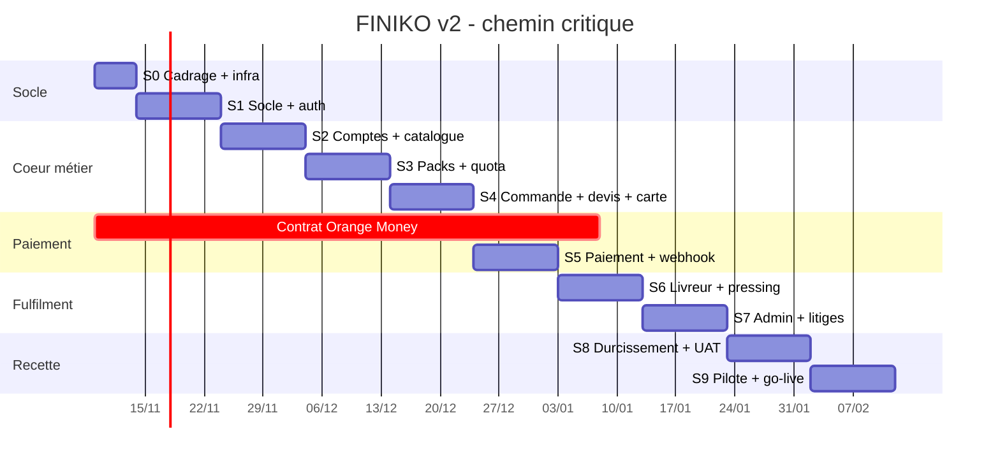

# 08 - Roadmap, lots et recette

> Ce document transforme la conception (docs 01 à 07) en **plan exécutable** : lots de travail, sprints, critères d'acceptation, charges, risques, pilote et conditions de mise en production.
> Il fait foi pour la priorisation. Toute modification de périmètre passe par une mise à jour de ce fichier et, si elle change une décision structurante, par un ADR dans `docs/01-architecture.md`.

---

## 1. Principes de planification

1. **Tranche verticale d'abord.** Chaque lot livre un parcours utilisable de bout en bout, pas une couche technique isolée.
2. **Le cœur métier avant l'habillage.** Quota, tarification, machine à états et paiement sont testés avant les écrans secondaires.
3. **Aucune dépendance externe bloquante en fin de projet.** Le contrat Orange Money et les accès Maps sont attaqués au Sprint 0, pas au Sprint 5.
4. **Le mobile ne valide jamais un paiement.** Le webhook et la réconciliation restent la source de vérité, y compris en pilote.
5. **Chaque sprint se termine par une démo sur un environnement déployé**, avec des données de démonstration réalistes.
6. **Un lot n'est « fait » que si ses tests passent en CI** et si ses critères d'acceptation sont cochés par le PO.
7. **Le pilote est un lot à part entière.** Il consomme du temps de correction, de support et d'ajustement produit.

---

## 2. Hypothèses de planification

### 2.1 Équipe cible

| Rôle               | Charge  | Responsabilités                                                           |
| ------------------ | ------- | ------------------------------------------------------------------------- |
| Product Owner      | 0,4 ETP | Priorisation, recette, relation pressing/livreurs, décisions de périmètre |
| Lead fullstack     | 1,0 ETP | Architecture, auth, quota, paiements, admin, revues de code               |
| Développeur mobile | 1,0 ETP | Expo, écrans des 4 rôles, offline, Maps, E2E                              |
| Designer produit   | 0,5 ETP | Design system, wireframes, prototypes, assets, accessibilité              |
| QA / recette       | 0,5 ETP | Plans de test, jeux de données, UAT, non-régression                       |
| DevOps / ops       | 0,2 ETP | CI/CD, infra, sauvegardes, supervision, astreinte                         |

> Hypothèse de départ : **2 développeurs à temps plein**. Les scénarios à 1 et 3 développeurs sont chiffrés au § 8.

### 2.2 Capacité

- Sprint de **2 semaines**, soit 10 jours ouvrés.
- Capacité brute : 2 dev × 10 j = **20 j/h par sprint**.
- Capacité nette retenue : **18 j/h par sprint** (10 % absorbés par cérémonies, revues, support).
- **Sprint 0** : 1 semaine de cadrage technique.
- **19 semaines** au total, dont 9 sprints de construction/recette et 1 semaine de préparation.

### 2.3 Dépendances externes

| Dépendance                                        | Besoin                                                                        | Responsable    | Échéance cible                                 | Impact si retard                                        |
| ------------------------------------------------- | ----------------------------------------------------------------------------- | -------------- | ---------------------------------------------- | ------------------------------------------------------- |
| Contrat marchand Orange Money Mali                | Identifiants sandbox, endpoints, format de signature, règles de remboursement | PO + direction | **Sprint 0** (sandbox) / Sprint 4 (production) | Bloque le lot 4 ; fallback cash uniquement, MVP dégradé |
| Compte Orange Developer                           | Accès documentation et console                                                | Lead           | Sprint 0                                       | Retard d'intégration                                    |
| Clés Google Maps                                  | Maps SDK Android/iOS, Geocoding, Directions, Places                           | Lead           | Sprint 3                                       | Tunnel de commande sans carte                           |
| Facturation Google Cloud                          | Quota et alertes de coût                                                      | Ops            | Sprint 3                                       | Risque de dépassement                                   |
| Compte Cloudinary                                 | Upload signé des photos de linge                                              | Lead           | Sprint 2                                       | Conformité et litiges dégradés                          |
| Compte Expo / EAS                                 | Builds Android, OTA, push FCM                                                 | Dev mobile     | Sprint 1                                       | Pas de build distribuable                               |
| Play Console                                      | Publication pilote fermé                                                      | PO             | Sprint 7                                       | Pilote limité à des APK directs                         |
| Pressings partenaires                             | 2 pressings équipés à Bamako                                                  | PO             | Sprint 6                                       | Pas de fulfilment réel                                  |
| Livreurs pilotes                                  | 3 livreurs avec smartphone Android + data                                     | PO             | Sprint 7                                       | Pas de ramassage                                        |
| Validation juridique (APDP, CGU, confidentialité) | Mentions, durées de conservation, base légale                                 | PO + juriste   | Sprint 7                                       | Go-live repoussé                                        |
| Numéro court SMS / passerelle                     | Notifications de secours                                                      | Ops            | Sprint 7                                       | Dépendance totale au push                               |

> **Règle** : toute dépendance externe non disponible à sa date cible déclenche un point de go/no-go et, si nécessaire, l'activation du mode dégradé documenté (paiement cash, saisie manuelle des affectations, notifications in-app seulement).

---

## 3. Jalons

| Jalon                              | Fin    | Contenu                                                                       | Critère de sortie                                                         |
| ---------------------------------- | ------ | ----------------------------------------------------------------------------- | ------------------------------------------------------------------------- |
| **M0 — Conception validée**        | J0     | Docs 01 à 08                                                                  | Relecture PO + lead, décisions ouvertes listées                           |
| **M1 — Socle & auth**              | Fin S1 | Monorepo, CI, contrats Zod, auth email/téléphone, JWT + refresh, RBAC de base | Un client s'inscrit, se connecte, rafraîchit son token ; tests auth verts |
| **M2 — Catalogue, packs et quota** | Fin S3 | CRUD catalogue, packs, abonnements, ledger de quota, moteur transactionnel    | Tests de concurrence quota verts ; abonnement activable en base           |
| **M3 — Commande et devis**         | Fin S4 | Panier, devis, couverture pack, surplus, adresses, zones, carte               | Le devis documenté (8 chemises + 2 boubous) retourne 3 200 FCFA           |
| **M4 — Paiement Orange Money**     | Fin S5 | Initiation, redirection, webhook signé, réconciliation, remboursement, cash   | Paiement sandbox de bout en bout + webhook idempotent                     |
| **M5 — Fulfilment et admin**       | Fin S7 | Livreur, pressing, temps réel, dashboard admin, litiges, audit, notifications | Une commande réelle traverse tous les statuts depuis le mobile            |
| **M6 — Release candidate**         | Fin S8 | Durcissement, perf, sécurité, UAT, corrections                                | 0 défaut P1/P2 ouvert, seuils du § 12.2 atteints                          |
| **M7 — Pilote ouvert**             | Fin S9 | Pilote fermé, corrections, go/no-go                                           | Signature PO + ops, runbooks actifs                                       |

---

## 4. Lots de travail

### Lot 0 — Socle technique et outillage

**Objectif** : rendre l'équipe productive et la CI fiable dès la première semaine.

**Périmètre**

- Initialisation du monorepo pnpm : `apps/mobile`, `apps/api`, `packages/contracts`.
- `tsconfig` de base en mode strict, ESLint, Prettier, `lint-staged`, `husky`.
- `docker-compose.yml` : MongoDB 7 en replica set (`rs0` initié automatiquement) et Redis 7.
- `packages/contracts` : enums, schémas Zod partagés (auth, catalogue, commande, devis, paiement), constantes de statuts.
- API : bootstrap Express 5, gestion d'erreurs centralisée, logger Pino, `/health`, `/ready`, validation Zod, enveloppe de réponse.
- Mobile : bootstrap Expo Router, thème de base, client HTTP, écran de santé.
- CI GitHub Actions : lint, typecheck, tests unitaires, tests d'intégration sur replica set, build mobile de contrôle.
- Sentry (API + mobile), modèles d'issues, modèle de PR, `CODEOWNERS`, stratégie de branches (`main` protégée, branches courtes).
- Environnements : `local`, `staging`, `production` ; fichier `.env.example` exhaustif.

**Hors périmètre** : toute fonctionnalité métier.

**Critères d'acceptation**

- [ ] `pnpm install && pnpm lint && pnpm typecheck && pnpm test` passe sur un poste neuf.
- [ ] `docker compose up` démarre Mongo (replica set opérationnel) et Redis ; un test d'intégration écrit dans une transaction.
- [ ] La CI est verte sur une PR vide et bloque un typecheck en erreur.
- [ ] `GET /health` répond `200` avec version et commit.
- [ ] Un build Android de développement s'installe sur un appareil physique.
- [ ] Aucun secret dans le dépôt ; `.env.example` documente chaque variable.

**Charge** : 8 j/h dev + 1 j QA.
**Dépendances** : aucune.

---

### Lot 1 — Authentification, comptes et profils

**Objectif** : permettre à chaque acteur d'entrer dans son espace, avec des règles d'inscription conformes au cahier des charges.

**Périmètre**

- Inscription **client uniquement** : email **ou** téléphone E.164, mot de passe (Argon2id), acceptation CGU.
- Connexion par email **ou** téléphone, message d'erreur générique, limitation du débit.
- JWT d'accès court (15 min) + refresh token rotatif stocké haché (`sessions`), révocation, déconnexion de tous les appareils.
- OTP SMS/email pour vérification du numéro et réinitialisation du mot de passe (`otp_codes` avec TTL).
- Création des comptes **livreur**, **pressing** et **admin** par l'admin uniquement ; mot de passe temporaire + changement forcé à la première connexion.
- Statuts `actif`, `suspendu`, `supprime` ; un compte suspendu reçoit `ACCOUNT_SUSPENDED` sur toute requête authentifiée.
- Profils 1:1 : `client_profiles`, `driver_profiles`, `pressing_profiles`.
- Adresses favorites du client (`addresses`) : libellé, point carte, instructions, adresse par défaut.
- RBAC de base : middleware `authenticate`, `authorize(...roles)`, ownership.
- Écrans mobile : splash, onboarding, choix connexion/inscription, login, register, OTP, mot de passe oublié, changement forcé.

**Critères d'acceptation**

- [ ] Un client peut s'inscrire puis se connecter avec **email ou téléphone**, indifféremment.
- [ ] Un livreur ne peut pas s'auto-inscrire (`403 FORBIDDEN`).
- [ ] Le refresh token est à usage unique ; sa réutilisation révoque la session et journalise l'événement.
- [ ] 5 tentatives échouées déclenchent un ralentissement puis un blocage temporaire (`RATE_LIMITED`).
- [ ] Un compte suspendu est rejeté même avec un token encore valide.
- [ ] Les guards mobile redirigent chaque rôle vers son espace et empêchent le retour arrière.
- [ ] Tests : login email/téléphone, OTP, rotation, suspension, matrice RBAC de base.

**Charge** : 10 j/h dev + 2 j QA/design.
**Dépendances** : lot 0 ; passerelle SMS (peut être simulée en local).

---

### Lot 2 — Catalogue, packs, abonnements et moteur de quota

**Objectif** : livrer le cœur différenciant de FINIKO — trois prestations par article et un quota mensuel fiable.

**Périmètre**

- `catalog_items` : catégories, trois prix entiers (`lavage`, `repassage`, `lavage_repassage`), `quotaWeight`, disponibilité, image Cloudinary, soft delete.
- CRUD admin du catalogue avec validation (prix > 0, cohérence des trois prix, poids ≥ 1, code unique).
- `packs` : prix, quota, prestations incluses, avantages livraison, durée, ordre d'affichage, actif/inactif, soft delete.
- `subscriptions` : souscription, paiement, activation, dates de début/fin, compteurs `quotaTotal`, `quotaUsed`, `quotaReserved`, statut, snapshot des conditions du pack.
- `subscription_usages` : ledger append-only (`reservation`, `consommation`, `liberation`, `remboursement`, `ajustement`, `expiration`).
- Moteur de quota transactionnel :
  - réservation atomique avec garde `quotaUsed + quotaReserved + demande <= quotaTotal` ;
  - consommation à la confirmation ;
  - libération à l'échec/expiration du paiement ;
  - remboursement en cas d'annulation après confirmation ;
  - expiration et rollover selon `settings`.
- Jobs BullMQ : expiration des abonnements, libération des réservations orphelines, rappels de fin de quota.
- Écrans mobile : liste des packs, détail, souscription, mes abonnements, jauge de quota, historique des mouvements.
- Écrans admin : catalogue, packs, abonnements.

**Critères d'acceptation**

- [ ] Un article expose exactement trois prix ; toute combinaison partielle est refusée à la création.
- [ ] Le devis et l'abonnement **snapshotent** prix et conditions : une modification ultérieure du pack ne change pas un abonnement en cours.
- [ ] Deux commandes concurrentes de 6 unités sur un quota de 10 : **une seule** réussit ; l'autre reçoit `QUOTA_EXHAUSTED` ou `QUOTA_RACE` ; aucun compteur négatif.
- [ ] `Σ ledger = quotaUsed + quotaReserved` est vérifié par un test d'invariant après 1 000 opérations aléatoires.
- [ ] Une réservation non consommée est libérée après expiration (valeur configurable) et le job est idempotent.
- [ ] L'expiration d'un abonnement passe le statut à `expiree` et bloque toute nouvelle réservation (`SUBSCRIPTION_INACTIVE`).
- [ ] Un client ne voit que ses propres abonnements et mouvements.
- [ ] Couverture ≥ 80 % sur `quota.service` et `pricing.service`.

**Charge** : 16 j/h dev + 3 j QA/design.
**Dépendances** : lot 1 ; pack seedé ; Redis pour les jobs.

---

### Lot 3 — Commande, devis, adresses et cartes

**Objectif** : permettre au client de composer son panier, d'obtenir un prix juste et de choisir ses points de ramassage/livraison.

**Périmètre**

- Panier local (Zustand) : lignes article + prestation + quantité, persistance entre sessions.
- `POST /orders/quote` : calcul serveur, couverture pack, surplus, frais de livraison, remise éventuelle, expiration du devis (10 min).
- Tarification : prix snapshotés, `quotaWeight`, surplus au prix unitaire, livraison par zone ou distance, arrondis en FCFA entiers.
- `POST /orders` : création idempotente (`Idempotency-Key`), réservation de quota, statut initial `en_attente_paiement`, numéro `#FK-xxxx`.
- Adresses : recherche, sélection sur carte, point de ramassage et de livraison, instructions, créneau souhaité.
- `delivery_zones` : zones de Bamako, frais, délai, disponibilité ; refus `DELIVERY_ZONE_UNSERVED` hors zone.
- Proxy serveur Google Maps : autocomplete, geocoding, directions, matrice de distance ; clés restreintes côté plateforme.
- Composant mobile `MapPicker` + écran de récapitulatif de commande.
- Machine à états : création des transitions autorisées, événements `order_status_events`, refus `INVALID_TRANSITION`.

**Critères d'acceptation**

- [ ] Le devis de référence — 8 chemises + 2 boubous avec Pack Normal 10 unités — retourne **2 200 FCFA de surplus + 1 000 FCFA de livraison = 3 200 FCFA**.
- [ ] Modifier un prix catalogue après création ne change **jamais** le total d'une commande existante.
- [ ] Un devis expiré renvoie `QUOTE_EXPIRED` ; le client peut le recalculer sans perdre son panier.
- [ ] Une adresse hors zone renvoie `DELIVERY_ZONE_UNSERVED` avec un message actionnable.
- [ ] Deux créations avec la même `Idempotency-Key` renvoient la **même** commande, jamais un doublon.
- [ ] Une commande créée sans stock de quota valide ne laisse aucune réservation fantôme.
- [ ] La carte affiche les points, permet la recherche et renvoie des coordonnées exploitables par le serveur.
- [ ] Les frais de livraison sont calculés côté serveur, jamais acceptés depuis le client.

**Charge** : 12 j/h dev + 2 j QA/design.
**Dépendances** : lots 1 et 2 ; clés Google Maps.

---

### Lot 4 — Paiement Orange Money, cash et réconciliation

**Objectif** : encaisser réellement, sans jamais faire confiance au client.

**Périmètre**

- Interface `PaymentProvider` et adaptateur `OrangeMoneyProvider` (initiation, statut, remboursement, vérification de signature).
- `POST /subscriptions` et `POST /orders` : création d'une intention de paiement, montant serveur, référence unique, expiration.
- Redirection / deep link vers Orange Money ; retour applicatif avec polling du statut.
- Webhook signé : vérification, idempotence, mise à jour du paiement, transition de la commande, consommation du quota.
- Réconciliation : job de statut pour les paiements `en_attente`, rapport quotidien des écarts.
- Remboursements : total ou partiel, motif, `refunds`, ledger, limitation aux cas autorisés.
- Paiement cash : mission livreur, encaissement déclaré, confirmation admin, jamais de confirmation automatique côté mobile.
- Sécurité : montant recalculé côté serveur, refus de montant incohérent, alerte fraude, journalisation.
- Écrans mobile : choix du moyen de paiement, attente, succès, échec, réessai, historique des transactions.
- Écrans admin : paiements, remboursements, écarts de réconciliation.

**Critères d'acceptation**

- [ ] Un paiement sandbox réussi fait passer la commande de `en_attente_paiement` à `confirmee` et consomme la réservation de quota.
- [ ] Un webhook rejoué 5 fois ne produit qu'**un seul** effet (paiement, quota, événement).
- [ ] Une signature invalide est rejetée et journalisée ; aucune transition n'est appliquée.
- [ ] Un montant reçu différent du montant attendu ne confirme pas la commande et crée une alerte.
- [ ] Un paiement expiré libère la réservation et remet la commande dans un état annulable proprement.
- [ ] Un remboursement met à jour `refunds`, le paiement et le ledger de quota de façon cohérente.
- [ ] Le mobile affiche l'état réel du serveur après retour de paiement, y compris en cas de perte de réseau.
- [ ] Le rapport de réconciliation explique chaque écart (montant, statut, horodatage).

**Charge** : 13 j/h dev + 3 j QA.
**Dépendances** : lot 3 ; **contrat Orange Money sandbox** ; compte marchand pour le remboursement.

> Si le contrat n'est pas disponible, le lot 4 est partiellement livré avec un `FakePaymentProvider` de staging **clairement identifié**, et le mode cash reste le seul moyen réel. Le passage en production exige la recette réelle.

---

### Lot 5 — Fulfilment : livreur, pressing et temps réel

**Objectif** : faire circuler la commande du ramassage à la livraison, avec une traçabilité article par article.

**Périmètre**

- Livreur : missions assignées, acceptation, navigation GPS, appel client, arrivée, contrôle de conformité (photo, comptage, refus partiel), signature/preuve, dépôt au pressing.
- Pressing : réception, kanban par statut, démarrage et fin de traitement **par article**, marquage `prete`, photo éventuelle, historique.
- Affectations : manuelles par l'admin, auto-dispatch simple (zone + charge) en option ; réassignation avec événement.
- Transitions complètes : `confirmee` → `ramassage_assigne` → `ramassage_en_cours` → `ramassee` → `deposee_au_pressing` → `au_pressing` → `en_traitement` → `prete` → `livraison_assignee` → `livraison_en_cours` → `livree` → `terminee`.
- `order_status_events` append-only : acteur, rôle, ancien/nouveau statut, position, photo, note.
- Socket.IO : rooms `user:{id}`, `role:{role}`, `order:{orderId}` ; événements `order:status`, `order:assigned`, `order:ready`, `mission:new`, `driver:location`, `notification:new`.
- Position livreur : envoi throttlé (15 s) en mission uniquement, arrêt à la fin de mission.
- Mode hors ligne livreur/pressing : file d'actions locales, rejeu idempotent, indicateur de synchronisation, résolution des conflits par le serveur.
- Écrans mobile : dashboard livreur, mission, conformité, dépôt, livraison ; dashboard pressing, réception, kanban, détail article.

**Critères d'acceptation**

- [ ] Une commande traverse **tous** les statuts depuis le mobile, avec un événement par transition et le bon acteur.
- [ ] Un livreur non assigné reçoit `ORDER_NOT_ASSIGNED` ; il ne peut pas agir sur la mission d'un autre.
- [ ] Le pressing ne peut pas marquer `prete` si un article n'est pas `termine` (`NOT_ALL_ITEMS_DONE`).
- [ ] Toute transition invalide renvoie `INVALID_TRANSITION` sans modifier la commande.
- [ ] Le client voit le statut et la position mis à jour en moins de 3 s sur un réseau correct.
- [ ] Une action hors ligne (conformité, fin d'article) est rejouée une seule fois après reconnexion.
- [ ] La position n'est **pas** collectée hors mission ; l'arrêt est effectif côté serveur.
- [ ] Les photos de conformité sont accessibles aux seuls participants et aux admins.

**Charge** : 18 j/h dev + 4 j QA/design.
**Dépendances** : lots 3 et 4 ; 2 pressings et 3 livreurs équipés.

---

### Lot 6 — Administration, litiges, notifications et audit

**Objectif** : donner à l'administrateur la maîtrise opérationnelle et financière, et un traitement propre des incidents.

**Périmètre**

- Dashboard admin : commandes du jour, CA encaissé, abonnements actifs, quotas, SLA, alertes.
- Supervision des commandes : recherche, filtres, détail, timeline, réaffectation, annulation, remboursement.
- Comptes : création livreur/pressing/admin, suspension, réactivation, réinitialisation de mot de passe, zones et capacité.
- Catalogue et packs : CRUD complet, activation, ordre, soft delete.
- Litiges : ouverture client/livreur/pressing/admin, fil de messages, photos, statuts `ouvert` → `en_examen` → `resolu`/`ferme`, issue (remboursement, reprise, geste commercial).
- Notifications : in-app, push Expo, SMS de secours ; préférences ; modèles par événement ; journal d'envoi.
- Bannières promo : CRUD, planification, ciblage simple, ordre.
- Audit : `audit_logs` pour toute mutation admin et tout événement de sécurité, avec acteur, IP, avant/après.
- Exports : commandes et paiements en CSV pour la comptabilité.
- Écrans mobile : notifications, détail, litige, profil, préférences, aide.

**Critères d'acceptation**

- [ ] Chaque mutation admin produit une entrée d'audit consultable, avec valeur avant/après.
- [ ] Un litige peut être ouvert depuis une commande livrée, alimenté par les deux parties, puis résolu avec une issue traçable.
- [ ] Un remboursement déclenché depuis un litige respecte les mêmes contrôles que le lot 4.
- [ ] Un compte suspendu perd immédiatement l'accès aux endpoints métier.
- [ ] Les notifications critiques (commande prête, paiement, mission) partent en push **et** en SMS si le push échoue.
- [ ] Le dashboard affiche des chiffres cohérents avec les collections (`payments`, `orders`, `subscriptions`) sur le jeu de démonstration.
- [ ] Un export CSV contient les montants en entiers, les statuts et les identifiants lisibles.
- [ ] La matrice RBAC complète est testée, y compris les tentatives d'accès croisé entre rôles.

**Charge** : 15 j/h dev + 3 j QA/design.
**Dépendances** : lots 2 à 5.

---

### Lot 7 — Durcissement, performance et sécurité

**Objectif** : transformer une application fonctionnelle en application exploitable.

**Périmètre**

- Revue sécurité : OWASP API Top 10, validation stricte, mass assignment, injection NoSQL, rate limiting, en-têtes, CORS, uploads.
- Tests de charge selon `docs/07` : 100 commandes/min, 50 webhooks simultanés, 200 positions toutes les 15 s.
- Optimisation : index MongoDB, requêtes N+1, pagination, compression, cache des lectures catalogue/packs.
- Observabilité : métriques métier, traces, dashboards, alertes (paiement bloqué, quota incohérent, job en échec, taux d'erreur).
- Sauvegardes : PITR Atlas, test de restauration chronométré, RPO 15 min / RTO 2 h.
- Runbooks : paiement bloqué, quota incohérent, commande sans livreur, pressing saturé, fraude.
- Accessibilité mobile : contrastes, tailles tactiles, lecteur d'écran sur les parcours critiques.
- Mise à jour des dépendances, `pnpm audit`, gitleaks, revue des secrets.
- Documentation d'exploitation et de support.

**Critères d'acceptation**

- [ ] Tests de charge conformes : p95 < 800 ms, aucune double consommation de quota, aucun doublon de commande.
- [ ] Aucune vulnérabilité haute ou critique ouverte (`pnpm audit`, revue OWASP).
- [ ] Une restauration de sauvegarde est réalisée avec succès en staging et chronométrée.
- [ ] Les 5 runbooks sont testés au moins une fois en staging.
- [ ] Les alertes se déclenchent réellement sur un incident simulé (webhook en échec, job bloqué).
- [ ] Parcours critiques utilisables avec TalkBack à 200 % de taille de police.
- [ ] Le taux de crash en staging est < 0,5 % des sessions.

**Charge** : 9 j/h dev + 2 j QA/ops.
**Dépendances** : lots 4 à 6.

---

### Lot 8 — Recette, pilote et corrections

**Objectif** : valider sur le terrain et corriger avant l'ouverture.

**Périmètre**

- UAT structurée : 10 clients, 3 livreurs, 2 pressings, 2 admins, 100 commandes.
- Scénarios de recette : inscription, achat de pack, commande couverte, commande avec surplus, paiement échoué puis réessayé, annulation, litige, mission hors ligne, pressing complet, remboursement.
- Collecte des retours : formulaire in-app, entretiens de 15 min, analyse des crashes et des abandons.
- Corrections priorisées : P1 bloquants, P2 majeurs, P3 si le temps le permet.
- Formation : 1 session pressings (2 h), 1 session livreurs (1 h 30), 1 session admin (2 h), guides PDF/WhatsApp.
- Support pilote : canal WhatsApp dédié, astreinte 8 h–20 h, journal des incidents.
- Ajustements de prix/packs si nécessaire (via admin, pas en base directe).
- Décision go/no-go.

**Critères d'acceptation**

- [ ] Les 100 commandes pilotes sont tracées, dont au moins 30 avec pack et 10 avec litige simulé.
- [ ] Aucun défaut P1 ouvert ; P2 ouverts documentés avec contournement.
- [ ] Les 4 profils ont réalisé leur parcours complet sans assistance technique.
- [ ] Les 2 pressings ont traité une commande article par article sans erreur de statut.
- [ ] Le taux de succès de paiement réel est ≥ 90 % sur le pilote.
- [ ] La réconciliation ne présente aucun écart inexpliqué.
- [ ] Les runbooks et le support sont opérationnels.
- [ ] Le PO et l'ops signent le go/no-go.

**Charge** : 12 j/h dev + 6 j QA/PO.
**Dépendances** : lots 0 à 7 ; partenaires équipés ; contrat Orange Money production.

---

## 5. Planning des sprints

| Sprint | Durée  | Objectif                             | Lots          | Démo de fin de sprint                               | Critère de sortie               |
| ------ | ------ | ------------------------------------ | ------------- | --------------------------------------------------- | ------------------------------- |
| **S0** | 1 sem. | Cadrage technique, comptes, contrats | 0 (démarrage) | Environnement local + CI vide                       | Dépendances externes commandées |
| **S1** | 2 sem. | Socle + auth                         | 0, 1          | Inscription/connexion client sur appareil           | M1                              |
| **S2** | 2 sem. | Comptes, profils, catalogue          | 1, 2          | Admin crée un livreur ; CRUD catalogue              | Tests RBAC verts                |
| **S3** | 2 sem. | Packs, abonnements, quota            | 2             | Souscription + jauge de quota + test de concurrence | M2                              |
| **S4** | 2 sem. | Panier, devis, adresses, carte       | 3             | Devis 3 200 FCFA + sélection carte                  | M3                              |
| **S5** | 2 sem. | Paiement Orange Money sandbox        | 4             | Paiement + webhook + réconciliation                 | M4                              |
| **S6** | 2 sem. | Livreur + pressing + sockets         | 5             | Commande ramassée, déposée, traitée                 | Parcours complet en staging     |
| **S7** | 2 sem. | Admin, litiges, notifications, audit | 5, 6          | Dashboard, litige, remboursement                    | M5                              |
| **S8** | 2 sem. | Durcissement, perf, UAT              | 7             | Charge + restauration + alertes                     | M6                              |
| **S9** | 2 sem. | Pilote, corrections, go/no-go        | 8             | Bilan pilote + démonstration terrain                | M7                              |

**Calendrier indicatif** (à recaler sur la date de démarrage réelle) :

| Sprint | Semaines    | Dates indicatives           |
| ------ | ----------- | --------------------------- |
| S0     | S+1         | 9 → 13 nov. 2026            |
| S1     | S+2 à S+3   | 16 → 27 nov. 2026           |
| S2     | S+4 à S+5   | 30 nov. → 11 déc. 2026      |
| S3     | S+6 à S+7   | 14 → 25 déc. 2026           |
| S4     | S+8 à S+9   | 28 déc. 2026 → 8 janv. 2027 |
| S5     | S+10 à S+11 | 11 → 22 janv. 2027          |
| S6     | S+12 à S+13 | 25 janv. → 5 févr. 2027     |
| S7     | S+14 à S+15 | 8 → 19 févr. 2027           |
| S8     | S+16 à S+17 | 22 févr. → 5 mars 2027      |
| S9     | S+18 à S+19 | 8 → 19 mars 2027            |

> Les semaines du 21 décembre au 3 janvier sont à risque (congés, disponibilité des partenaires). Prévoir une marge ou décaler le pilote d'une semaine.

---

## 6. Chemin critique et parallélisation

**Chemin critique réel** : `contrat Orange Money → lot 4 → lot 5 → UAT → pilote`. Le développement peut avancer sur les lots 1 à 3 sans le contrat, mais **aucune promesse de date de production ne doit être faite avant réception des identifiants sandbox**.

**Parallélisation possible**

- Mobile et API avancent ensemble dès que `packages/contracts` est stable (fin S1).
- Le design system (S1–S2) précède les écrans, pas l'inverse.
- Les écrans admin peuvent être développés pendant le lot 5, sur des données seedées.
- La rédaction des runbooks et des guides commence en S7, pas en S9.

---

## 7. Definition of Ready / Definition of Done

### 7.1 Definition of Ready (une story entre en sprint si…)

- [ ] Le besoin est décrit en langage utilisateur, avec le rôle concerné.
- [ ] Les critères d'acceptation sont testables et validés par le PO.
- [ ] Les maquettes ou wireframes existent pour les écrans concernés.
- [ ] Les contrats d'API (Zod/OpenAPI) sont identifiés ou esquissés.
- [ ] Les dépendances externes sont disponibles ou un mock est prévu.
- [ ] L'estimation est faite par l'équipe (≤ 3 j ; sinon découpage).
- [ ] Les impacts données, sécurité et audit sont identifiés.

### 7.2 Definition of Done (une story est terminée si…)

- [ ] Code revu et mergé sur `main`.
- [ ] Tests unitaires et d'intégration écrits, CI verte.
- [ ] Critères d'acceptation démontrés sur staging.
- [ ] Gestion des erreurs et états de chargement/vide traités côté mobile.
- [ ] Événement d'audit écrit si l'action est sensible.
- [ ] Documentation mise à jour (OpenAPI, README, runbook si besoin).
- [ ] Aucune régression sur les parcours critiques (smoke test).
- [ ] Accessibilité de base vérifiée (contraste, libellé, taille tactile).
- [ ] Feature flag si la fonctionnalité n'est pas prête pour la production.

---

## 8. Synthèse des charges et scénarios

### 8.1 Charge par lot

| Lot                         | Dev (j/h) | QA/Design/PO (j/h) |   Total |
| --------------------------- | --------: | -----------------: | ------: |
| 0 — Socle                   |         8 |                  1 |       9 |
| 1 — Auth & comptes          |        10 |                  2 |      12 |
| 2 — Catalogue, packs, quota |        16 |                  3 |      19 |
| 3 — Commande & devis        |        12 |                  2 |      14 |
| 4 — Paiement                |        13 |                  3 |      16 |
| 5 — Fulfilment              |        18 |                  4 |      22 |
| 6 — Admin & litiges         |        15 |                  3 |      18 |
| 7 — Durcissement            |         9 |                  2 |      11 |
| 8 — Recette & pilote        |        12 |                  6 |      18 |
| **Total**                   |   **113** |             **26** | **139** |

**Marge de risque recommandée : +15 %** (bugs d'intégration, allers-retours Orange Money, ajustements terrain), soit **≈ 160 j/h**.

### 8.2 Scénarios

| Scénario               | Durée de construction | Durée totale avec recette     | Commentaire                                           |
| ---------------------- | --------------------- | ----------------------------- | ----------------------------------------------------- |
| 1 dev fullstack        | ~23 semaines          | ~27 semaines (≈ 6,5 mois)     | Risque élevé de bus factor ; mobile et API en série   |
| **2 devs (référence)** | **~16 semaines**      | **~19 semaines (≈ 4,5 mois)** | Hypothèse du planning                                 |
| 3 devs                 | ~12 semaines          | ~15 semaines (≈ 3,5 mois)     | Gain limité par le chemin critique et la coordination |

> Le levier principal n'est pas le nombre de développeurs mais **la disponibilité du contrat Orange Money, des pressings et des livreurs**. Un troisième développeur n'avance pas le chemin critique.

---

## 9. Registre des risques

| #   | Risque                                              | Prob.   | Impact   | Parade                                                                           | Responsable |
| --- | --------------------------------------------------- | ------- | -------- | -------------------------------------------------------------------------------- | ----------- |
| R1  | Contrat Orange Money indisponible ou incomplet      | Moyenne | Critique | Attaquer en S0 ; adaptateur + fake provider ; fallback cash ; clause de go/no-go | PO          |
| R2  | Webhook non fiable (perte, doublon, retard)         | Moyenne | Élevé    | Idempotence, réconciliation périodique, alerte sur paiements bloqués             | Lead        |
| R3  | Double consommation de quota en concurrence         | Faible  | Critique | Transactions, garde atomique, tests de concurrence, invariant vérifié            | Lead        |
| R4  | Coût Google Maps supérieur au budget                | Moyenne | Moyen    | Proxy serveur, cache, quotas, restrictions de clés, alertes de facturation       | Ops         |
| R5  | Pressings peu à l'aise avec l'outil                 | Élevée  | Élevé    | UX simple, formation, support WhatsApp, mode hors ligne, saisie assistée         | PO          |
| R6  | Réseau instable à Bamako                            | Élevée  | Élevé    | File d'actions offline, retry, états optimistes, SMS de secours                  | Dev mobile  |
| R7  | Dérive de périmètre (nouvelles demandes)            | Élevée  | Moyen    | MoSCoW, changement par avenant, backlog V1.1                                     | PO          |
| R8  | Fuite de données personnelles / non-conformité APDP | Faible  | Critique | Minimisation, chiffrement, audit, politique de rétention, revue juridique        | Lead + PO   |
| R9  | Fraude au paiement ou au remboursement              | Moyenne | Élevé    | Montants serveur, signature, rapprochement, seuils, double validation admin      | Lead        |
| R10 | Indisponibilité Atlas / perte de données            | Faible  | Critique | PITR, test de restauration, RPO 15 min / RTO 2 h                                 | Ops         |
| R11 | Retard de publication Play Store                    | Moyenne | Moyen    | Démarrer la fiche en S7, pilote par APK direct en secours                        | PO          |
| R12 | Départ d'un développeur clé                         | Faible  | Élevé    | Documentation, revues croisées, pas de bus factor sur le quota/paiement          | Lead        |

---

## 10. Périmètre : MVP, V1.1, V2

### 10.1 MVP (obligatoire pour le pilote)

| Domaine    | Inclus                                                                               |
| ---------- | ------------------------------------------------------------------------------------ |
| Auth       | Email ou téléphone, inscription client, comptes créés par admin, refresh, suspension |
| Catalogue  | 3 prestations par article, catégories, disponibilité, images                         |
| Packs      | Achat, activation, quota, ledger, expiration, rollover configurable                  |
| Commande   | Panier, devis serveur, couverture pack, surplus, adresses, zones, carte              |
| Paiement   | Orange Money, cash, webhook, réconciliation, remboursement                           |
| Livreur    | Missions, GPS, conformité, dépôt, récupération, livraison, offline                   |
| Pressing   | Réception, traitement article par article, prêt                                      |
| Admin      | Dashboard, CRUD, comptes, affectations, finances, litiges, audit                     |
| Temps réel | Suivi commande, notifications push/SMS                                               |
| Sécurité   | RBAC + ownership, audit, rate limit, secrets, sauvegardes                            |

### 10.2 V1.1 (après stabilisation)

- Paiement par carte bancaire.
- Auto-dispatch optimisé multi-pressing (distance, charge, capacité, SLA).
- Fidélité, parrainage, codes promo.
- Web admin complet (au-delà du mobile admin).
- iOS en production.
- Langues nationales (bambara).
- Factures PDF et export comptable avancé.
- Renouvellement automatique des packs et prélèvement récurrent (si Orange le permet).
- Notation et réponse du pressing aux avis.
- Analytics produit avancé et cohortes.
- Multi-villes.

### 10.3 V2 (vision)

- Multi-pays et multi-devises.
- Offre B2B (hôtels, restaurants, entreprises) avec facturation mensuelle.
- Marketplace de pressings partenaires.
- Prévision de la demande et optimisation des tournées.
- Bot WhatsApp / USSD pour les clients sans smartphone.
- Programme de garantie et assurance linge.

---

## 11. Stratégie de tests et recette

### 11.1 Pyramide

| Niveau      | Contenu                                             | Outils             | Fréquence                 |
| ----------- | --------------------------------------------------- | ------------------ | ------------------------- |
| Unitaire    | Pricing, quota, transitions, validateurs, formatage | Vitest             | À chaque commit           |
| Intégration | API + MongoDB replica set + Redis, webhooks, jobs   | Vitest + Supertest | À chaque PR               |
| Contrat     | Schémas Zod ↔ OpenAPI ↔ client mobile               | CI                 | À chaque PR               |
| E2E mobile  | Parcours client, livreur, pressing, admin           | Maestro            | Quotidien + avant release |
| Charge      | Commandes, webhooks, positions                      | k6                 | S8 + avant pic            |
| Sécurité    | Audit dépendances, secrets, OWASP, autorisation     | CI + revue         | Chaque sprint             |
| UAT         | Scénarios métier réels                              | Manuel guidé       | S8–S9                     |

### 11.2 Scénarios de recette obligatoires

1. Inscription client par email, puis connexion par téléphone.
2. Achat d'un pack, vérification du quota, consommation partielle, épuisement.
3. Commande entièrement couverte par le pack (0 FCFA à payer).
4. Commande avec surplus, paiement Orange Money réussi.
5. Paiement échoué, réessai, puis succès ; vérifier la libération/consommation du quota.
6. Annulation avant ramassage avec remboursement.
7. Ramassage avec article non conforme ; décision client ; poursuite ou annulation.
8. Traitement pressing article par article ; impossible de marquer prêt si incomplet.
9. Livraison, confirmation client, clôture.
10. Litige après livraison, échange de messages, remboursement partiel.
11. Mission livreur en perte de réseau, rejeu à la reconnexion.
12. Suspension d'un compte en cours de session.
13. Accès croisé entre rôles refusé (client → admin, livreur → autre mission).
14. Webhook rejoué et webhook avec signature invalide.
15. Restauration de sauvegarde et redémarrage de l'API.

### 11.3 Environnements et données

| Environnement | Usage                   | Données                                   |
| ------------- | ----------------------- | ----------------------------------------- |
| `local`       | Développement           | Seed de démonstration, Mongo/Redis Docker |
| `staging`     | Intégration, UAT, démos | Seed + données de test, paiement sandbox  |
| `production`  | Pilote puis ouvert      | Réelles, paiement réel, accès restreint   |

- Le seed de démonstration est celui de `docs/02-donnees.md` § 9.
- Les tests automatisés utilisent une base éphémère et ne touchent jamais staging/production.
- Les jeux de données de charge sont anonymisés et générés, jamais copiés depuis la production.

---

## 12. Pilote et go-live

### 12.1 Phases

| Phase                | Durée       | Périmètre                                          | Objectif                                      |
| -------------------- | ----------- | -------------------------------------------------- | --------------------------------------------- |
| **Dogfooding**       | 1 semaine   | Équipe + proches, 20 commandes                     | Corriger les évidences                        |
| **Pilote fermé**     | 3 semaines  | 10 clients, 3 livreurs, 2 pressings, 100 commandes | Valider le terrain, les SLA, le support       |
| **Ouverture Bamako** | Progressive | 100 % des clients de la zone                       | Stabiliser à l'échelle                        |
| **Stabilisation**    | 30 jours    | Toute la plateforme                                | Réduire les incidents, ajuster les prix/packs |

**Règles du pilote**

- Montants réels plafonnés (ex. 25 000 FCFA par commande) pendant les 2 premières semaines.
- Un canal WhatsApp unique pour le support, avec astreinte 8 h–20 h.
- Un rapport quotidien : commandes, paiements, incidents, écarts de quota.
- Tout incident P1 déclenche un post-mortem sous 72 h.

### 12.2 Seuils go/no-go

| Critère                       | Seuil                                    |
| ----------------------------- | ---------------------------------------- |
| Défauts P1 ouverts            | 0                                        |
| Défauts P2 ouverts            | 0 ou contournement documenté             |
| Taux de succès paiement réel  | ≥ 90 %                                   |
| Crash-free sessions (pilote)  | ≥ 99,5 %                                 |
| p95 API sous charge nominale  | < 800 ms                                 |
| Écarts de réconciliation      | 0 inexpliqué                             |
| Tests de quota en concurrence | 100 % verts                              |
| Actions admin auditées        | 100 %                                    |
| Sauvegarde restaurée          | Test réussi et chronométré               |
| Runbooks                      | Testés en staging                        |
| Formation des 4 profils       | Réalisée et signée                       |
| Validation juridique          | CGU, confidentialité, rétention validées |

### 12.3 Rollback

- **API** : retour à la release précédente (image taguée), migrations additives uniquement.
- **Mobile** : rollout Play Store par paliers 10 % → 50 % → 100 % ; désactivation des fonctionnalités risquées par feature flag.
- **Paiement** : bascule immédiate en mode cash + message in-app si Orange Money est indisponible.
- **Données** : aucune migration destructive sans double écriture et script de retour arrière testé.

### 12.4 Support et formation

- Guides courts (1 page) par rôle, en français, avec captures.
- Vidéo de 3 min pour les livreurs et les pressings.
- FAQ litiges, remboursements, quota.
- Tableau de bord des incidents et des demandes support.
- Revue hebdomadaire des tickets pendant le premier mois.

---

## 13. Après lancement (30 / 60 / 90 jours)

| Horizon  | Priorités                                                                                                     |
| -------- | ------------------------------------------------------------------------------------------------------------- |
| **J+30** | Corriger les irritants du quotidien, stabiliser les SLA, ajuster les créneaux et zones, réduire les litiges   |
| **J+60** | Optimiser le taux d'utilisation des packs, améliorer le taux de succès de paiement, automatiser l'affectation |
| **J+90** | Décider V1.1 (carte, fidélité, web admin), préparer la deuxième ville, renforcer l'analytics                  |

**Indicateurs de succès** : voir `docs/03-user-flows.md` § 13. Revue mensuelle avec le PO, arbitrage du backlog V1.1.

---

## 14. Budget d'exploitation indicatif

> Ordres de grandeur en FCFA, à remplacer par des devis. Les tarifs fournisseurs évoluent et dépendent du change USD/XOF.

| Poste                         | MVP (~100 commandes/mois) | Croissance (~1 000 commandes/mois) |
| ----------------------------- | ------------------------: | ---------------------------------: |
| MongoDB Atlas (M10 → M20)     |           35 000 – 60 000 |                   90 000 – 180 000 |
| Redis managé                  |            6 000 – 18 000 |                    25 000 – 50 000 |
| Hébergement API (2 instances) |           15 000 – 42 000 |                    45 000 – 90 000 |
| Cloudinary                    |                0 – 30 000 |                    30 000 – 90 000 |
| Google Maps                   |          30 000 – 100 000 |                  150 000 – 400 000 |
| Push / SMS                    |           10 000 – 30 000 |                   50 000 – 150 000 |
| Sentry / observabilité        |                0 – 20 000 |                    20 000 – 60 000 |
| Expo EAS                      |                0 – 30 000 |                    30 000 – 60 000 |
| Divers (domaine, CDN, emails) |           10 000 – 20 000 |                    20 000 – 40 000 |
| **Total mensuel**             |   **≈ 110 000 – 350 000** |          **≈ 460 000 – 1 120 000** |

**Coûts ponctuels** : Play Console (~15 000 FCFA), compte Apple si iOS (99 USD/an), numéro SMS, éventuels frais d'intégration Orange Money (à confirmer), création des visuels et impression des supports pour les pressings.

---

## 15. Gouvernance et rituels

| Rituel             | Fréquence            | Participants                    | Sortie                      |
| ------------------ | -------------------- | ------------------------------- | --------------------------- |
| Daily              | Quotidien, 15 min    | Équipe                          | Blocages identifiés         |
| Sprint planning    | Début de sprint, 2 h | Équipe + PO                     | Objectif et backlog engagés |
| Revue de sprint    | Fin de sprint, 1 h   | Équipe + PO + parties prenantes | Démo et acceptation         |
| Rétrospective      | Fin de sprint, 1 h   | Équipe                          | 1 à 2 actions concrètes     |
| Comité de pilotage | Hebdomadaire, 30 min | PO, lead, ops                   | Décisions, risques, budget  |
| Revue KPI          | Mensuelle, 1 h       | PO + direction                  | Ajustements produit         |

**Règles de collaboration**

- Une PR = une intention, description claire, captures si UI, tests inclus.
- Revue obligatoire par une personne différente de l'auteur.
- Aucune modification directe en production ; tout passe par une release taguée.
- Les décisions structurantes sont écrites (ADR) dans la même semaine.

---

## 16. Checklist de démarrage (Sprint 0)

**Dépôt et outillage**

- [ ] Dépôt Git initialisé, branche `main` protégée, conventional commits.
- [ ] Monorepo pnpm + workspaces + `packages/contracts`.
- [ ] ESLint, Prettier, TypeScript strict, Vitest.
- [ ] CI lint / typecheck / tests / build mobile.
- [ ] Modèles d'issue, de PR, `CODEOWNERS`, `CONTRIBUTING.md`.

**Infrastructure**

- [ ] `docker-compose.yml` : Mongo replica set + Redis.
- [ ] Cluster Atlas de développement + utilisateur dédié.
- [ ] Redis managé de développement.
- [ ] Projets Sentry API et mobile.
- [ ] Projet Expo + build Android de développement.
- [ ] Compte Cloudinary + preset signé.

**Dépendances externes**

- [ ] Demande de contrat marchand Orange Money déposée.
- [ ] Accès Orange Developer créé.
- [ ] Clés Google Maps demandées, restrictions définies.
- [ ] Facturation Google Cloud + alertes de budget.
- [ ] Passerelle SMS choisie.
- [ ] Play Console ouverte.

**Produit**

- [ ] Backlog initial priorisé (lots 0 à 8).
- [ ] Wireframes des parcours critiques.
- [ ] Jeu de données de démonstration validé.
- [ ] Critères de go/no-go partagés avec la direction.
- [ ] Parties prenantes pressings/livreurs identifiées.

**Sécurité et conformité**

- [ ] `.env.example` complet, aucun secret versionné.
- [ ] Politique de rétention et de confidentialité rédigée.
- [ ] Registre des traitements initialisé.
- [ ] Procédure d'incident et canal d'astreinte définis.

---

## 17. Traçabilité exigences → documents → lots

| Exigence                                          | Document de référence         | Lot     |
| ------------------------------------------------- | ----------------------------- | ------- |
| Auth email ou téléphone, inscription client seule | 03 § 3, 04 § 3                | 1       |
| Comptes livreur/pressing créés par l'admin        | 03 § 9.4, 04 § 12             | 1, 6    |
| Catalogue avec 3 prix par article                 | 02 § 5.3, 04 § 4              | 2       |
| Packs et quota mensuel                            | 02 § 5.4–5.6 et § 7, 03 § 4.2 | 2       |
| Paiement pack ou à l'acte                         | 02 § 7.5, 04 § 6              | 2, 3, 4 |
| Carte Google Maps ramassage/livraison             | 05 § 6, 06 partie B           | 3       |
| Commande et suivi temps réel                      | 03 § 4.3–4.4, 04 § 6, 15      | 3, 5    |
| Missions livreur, GPS, conformité                 | 03 § 7, 04 § 7                | 5       |
| Réception et traitement article par article       | 03 § 8, 04 § 8                | 5       |
| Dashboard admin, CA, affectations, litiges        | 03 § 9, 04 § 12               | 6       |
| Orange Money, webhook, réconciliation             | 06 partie A, 04 § 9           | 4       |
| Notifications push/SMS                            | 03 § 11, 04 § 11              | 5, 6    |
| Audit et sécurité                                 | 07 § 3–6, 04 § 2              | 1, 6, 7 |
| Sauvegardes et exploitation                       | 07 § 7–8                      | 7       |
| Qualité et CI/CD                                  | 07 § 9                        | 0, 7    |

---

## 18. Prochaine action

Le dossier de conception est complet. La prochaine étape est le **Sprint 0** :

1. Scaffolder le monorepo (`apps/mobile`, `apps/api`, `packages/contracts`).
2. Ajouter le `docker-compose.yml` MongoDB replica set + Redis.
3. Créer les schémas Zod partagés et le squelette des modules API.
4. Initialiser la CI et les environnements.
5. Lancer la demande de contrat Orange Money et les accès Maps.

Une fois le socle vert, enchaîner sur le lot 1 (auth) puis le lot 2 (quota), qui constituent le vrai socle de valeur de FINIKO.
